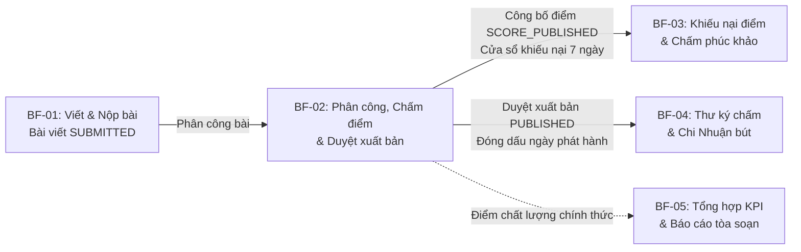
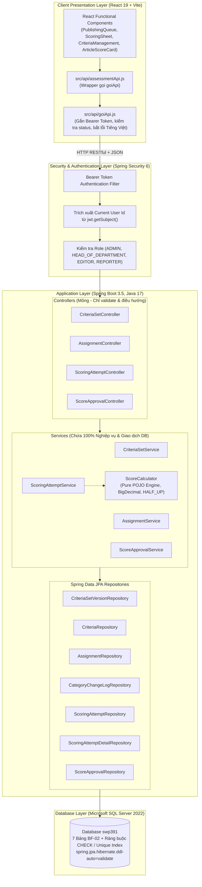
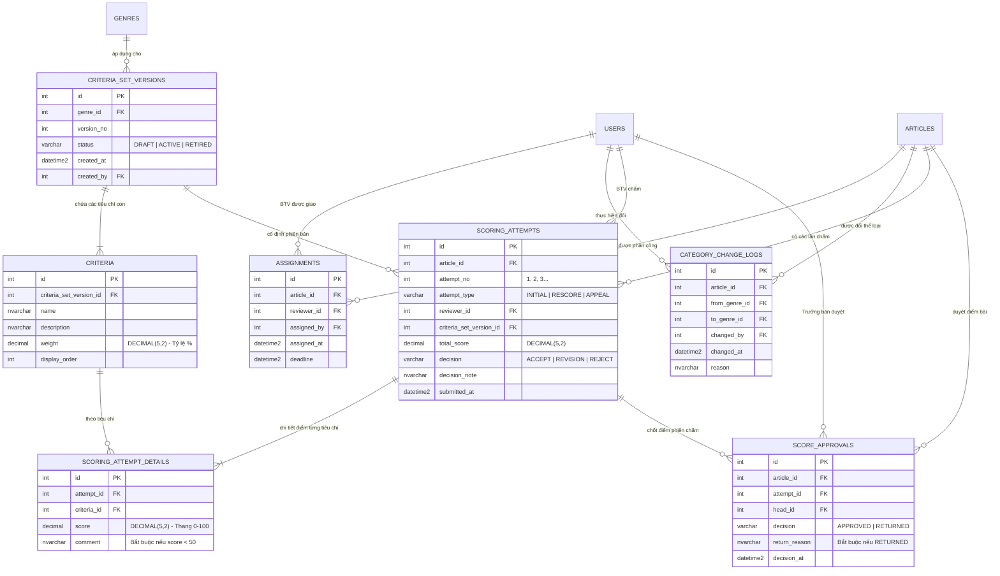
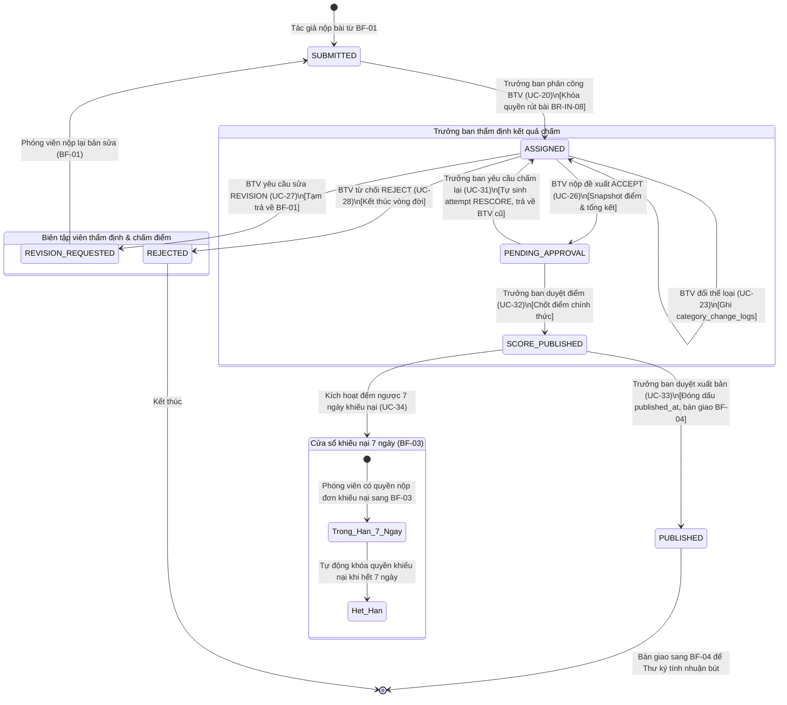
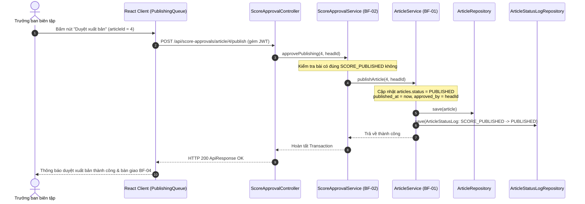

# TÀI LIỆU MÔ TẢ KIẾN TRÚC HỆ THỐNG PHÂN HỆ BF-02
## ĐÁNH GIÁ CHẤT LƯỢNG BÀI BÁO, PHÂN CÔNG & DUYỆT ĐĂNG
*(Article Assignment, Quality Assessment & Publishing Approval)*

> **Dự án:** Hệ thống Đánh giá Chất lượng Bài báo & Quản lý Nhuận bút (SWP391)  
> **Phân hệ thực hiện:** **Luồng BF-02**  
> **Người thực hiện:** Nguyễn Tùng Dương  
> **Vị trí file:** `docs/BF02_SYSTEM_ARCHITECTURE.md` *(Tài liệu công khai toàn nhóm, đã đưa vào Git tracking)*  
> **Ngày cập nhật:** 26/10/2026 — Đã hoàn thành 100% trọn vẹn cả 3 Iteration (Iter 1, Iter 2, Iter 3)

---

## MỤC LỤC TỔNG QUAN

1. [BỐI CẢNH NGHIỆP VỤ & PHẠM VI USE CASES TOÀN LUỒNG](#1-bối-cảnh-nghiệp-vụ--phạm-vi-use-cases-toàn-luồng)
2. [KIẾN TRÚC TỔNG THỂ & PHÂN TẦNG CÔNG NGHỆ (TECH STACK & ARCHITECTURE LAYERS)](#2-kiến-trúc-tổng-thể--phân-tầng-công-nghệ)
3. [MÔ HÌNH DỮ LIỆU & QUAN HỆ 7 BẢNG CSDL SỞ HỮU (DATA ARCHITECTURE & SCHEMA)](#3-mô-hình-dữ-liệu--quan-hệ-7-bảng-csdl-sở-hữu)
4. [VÒNG ĐỜI TRẠNG THÁI BÀI VIẾT & SƠ ĐỒ CHUYỂN DỊCH (STATE MACHINE & BUSINESS FLOWS)](#4-vòng-đời-trạng-thái-bài-viết--sơ-đồ-chuyển-dịch)
5. [RANH GIỚI TRÁCH NHIỆM & GIAO TIẾP LIÊN PHÂN HỆ (CROSS-FLOW BOUNDARIES & INTEGRATION)](#5-ranh-giới-trách-nhiệm--giao-tiếp-liên-phân-hệ)
6. [KIẾN TRÚC BẢO MẬT, XÁC THỰC & PHÂN QUYỀN (SECURITY & RBAC)](#6-kiến-trúc-bảo-mật-xác-thực--phân-quyền)
7. [THIẾT KẾ GIẢI THUẬT CỐT LÕI & ĐẢM BẢO TÍNH TOÀN VẸN DỮ LIỆU (CORE ALGORITHMS & INTEGRITY)](#7-thiết-kế-giải-thuật-cốt-lõi--đảm-bảo-tính-toàn-vẹn-dữ-liệu)
8. [DANH MỤC REST API ENDPOINTS & THÀNH PHẦN GIAO DIỆN FRONTEND](#8-danh-mục-rest-api-endpoints--thành-phần-giao-diện-frontend)
9. [BẢO ĐẢM CHẤT LƯỢNG & BỘ KIỂM THỬ TỰ ĐỘNG (QUALITY ASSURANCE & TEST COVERAGE)](#9-bảo-đảm-chất-lượng--bộ-kiểm-thử-tự-động)

---

## 1. BỐI CẢNH NGHIỆP VỤ & PHẠM VI USE CASES TOÀN LUỒNG

### 1.1 Vị trí chiến lược của Phân hệ BF-02
Trong quy trình tác nghiệp của Tòa soạn Báo điện tử, **Luồng BF-02** đóng vai trò là **trung tâm kiểm soát chất lượng chuyên môn và thẩm quyền xuất bản**. BF-02 kết nối trực tiếp với 4 phân hệ khác:
- **Tiếp nhận từ BF-01 (Viết & Nộp bài):** Nhận bài viết đã nộp ở trạng thái `SUBMITTED`, đưa vào hàng chờ phân công.
- **Bàn giao sang BF-03 (Khiếu nại & Kiểm soát chất lượng):** Sau khi Trưởng ban duyệt điểm (`SCORE_PUBLISHED`), kích hoạt cửa sổ 7 ngày cho phép phóng viên khiếu nại chất lượng chấm sang BF-03. Cung cấp dữ liệu gốc để BTV phúc khảo chấm mù (Blind Review).
- **Bàn giao sang BF-04 (Chấm & Chi Nhuận bút):** Sau khi Trưởng ban duyệt xuất bản (`PUBLISHED`), bài báo được chuyển sang hàng chờ để Thư ký tòa soạn chấm hệ số nhuận bút.
- **Cung cấp đầu vào cho BF-05 (KPI & Báo cáo):** Điểm chất lượng chính thức của bài báo `PUBLISHED` là dữ liệu nguồn để hệ thống tự động tổng hợp tỷ lệ hoàn thành KPI của từng phóng viên.



---

### 1.2 Danh mục Use Cases bao phủ toàn bộ 3 Iteration (21 Use Cases)

| Nhóm chức năng | Mã UC | Tên Use Case | Actor chính | Giai đoạn |
|---|---|---|---|:---:|
| **Quản trị Tiêu chí chấm điểm** | **UC-14** | Xem danh mục bộ tiêu chí theo thể loại | `ADMIN` | Iter 1 |
| | **UC-15** | Tạo phiên bản tiêu chí mới (DRAFT) | `ADMIN` | Iter 1 |
| | **UC-16** | Kiểm tra tổng trọng số tiêu chí = 100% | Hệ thống | Iter 1 |
| | **UC-17** | Kích hoạt phiên bản tiêu chí (ACTIVE) | `ADMIN` | Iter 1 |
| **Phân công bài viết** | **UC-18** | Xem Hàng chờ bài viết mới nộp (SUBMITTED) | `HEAD_OF_DEPARTMENT` | Iter 1 |
| | **UC-19** | Xem gợi ý Biên tập viên ít việc nhất | Hệ thống | Iter 1 |
| | **UC-20** | Phân công BTV chấm bài (chuyển ASSIGNED) | `HEAD_OF_DEPARTMENT` | Iter 1 |
| **Hàng việc của BTV** | **UC-21** | Xem danh sách bài được phân công cá nhân | `EDITOR` | Iter 1 |
| **Thẩm định & Chấm điểm BTV** | **UC-22** | Mở phiếu chấm (Snapshot tiêu chí cố định) | `EDITOR` | Iter 2 |
| | **UC-23** | Đổi thể loại bài viết & ghi vết lịch sử | `EDITOR` | Iter 2 |
| | **UC-24** | Nhập điểm tiêu chí (Bắt buộc nhận xét nếu < 50) | `EDITOR` | Iter 2 |
| | **UC-25** | Engine tính tổng điểm có trọng số (Scale 100) | Hệ thống | Iter 1 & 2 |
| | **UC-26** | Đề xuất duyệt đăng (Chuyển PENDING_APPROVAL) | `EDITOR` | Iter 2 |
| | **UC-27** | Yêu cầu sửa bài (Chuyển REVISION_REQUESTED) | `EDITOR` | Iter 2 |
| | **UC-28** | Từ chối bài viết (Chuyển REJECTED) | `EDITOR` | Iter 2 |
| **Phê duyệt điểm Trưởng ban** | **UC-29** | Xem Hàng chờ Duyệt điểm (PENDING_APPROVAL) | `HEAD_OF_DEPARTMENT` | Iter 2 |
| | **UC-30** | Xem chi tiết bảng điểm và nhận xét của BTV | `HEAD_OF_DEPARTMENT` | Iter 2 |
| | **UC-31** | Yêu cầu chấm lại (Tự sinh attempt RESCORE) | `HEAD_OF_DEPARTMENT` | Iter 2 |
| | **UC-32** | Phê duyệt chốt điểm (Chuyển SCORE_PUBLISHED) | `HEAD_OF_DEPARTMENT` | Iter 2 |
| **Duyệt xuất bản & Xem điểm** | **UC-33** | Ký duyệt xuất bản bài báo (Chuyển PUBLISHED) | `HEAD_OF_DEPARTMENT` | Iter 3 |
| | **UC-34** | Tác giả xem bảng điểm tiêu chí & hạn khiếu nại | `REPORTER` | Iter 3 |

---

## 2. KIẾN TRÚC TỔNG THỂ & PHÂN TẦNG CÔNG NGHỆ

Hệ thống tuân thủ nghiêm ngặt **Kiến trúc hướng dịch vụ 3 tầng chuẩn mực (Controller $\rightarrow$ Service $\rightarrow$ Repository)**, đảm bảo chuẩn code sinh viên dễ giải thích, bảo mật cao và không phụ thuộc vào các thư viện phức tạp bên ngoài.



### Chi tiết các công nghệ cốt lõi:
1. **Frontend (Client):**
   - **Framework:** React 19 chạy trên nền Vite bundler (Javascript JSX thuần, không dùng TypeScript).
   - **Styling:** Vanilla CSS, chia module CSS bám sát component (`PublishingQueue.css`, `ArticleScoreCard.css`), kế thừa 100% Design Token biến màu `--fm-*` trong `index.css` lấy từ bản thiết kế Figma của dự án.
   - **Giao tiếp mạng:** Hàm wrapper tập trung `goiApi.js`, tự động gắn JWT Bearer token và chuẩn hóa lỗi trả về dạng `Error` tiếng Việt.
2. **Backend (Server):**
   - **Framework:** Spring Boot 3.5.x, Java 17 LTS.
   - **ORM / Data Access:** Spring Data JPA / Hibernate với cấu hình `spring.jpa.hibernate.ddl-auto=validate` (nghiêm cấm Hibernate tự sửa cấu trúc bảng).
   - **Tính toán tài chính/điểm số:** Thư viện chuẩn `java.math.BigDecimal` và `RoundingMode.HALF_UP`, tuyệt đối không dùng `double`/`float`.
   - **Security:** Spring Security cấu hình Stateless Session, giải mã Token JWT để trích xuất danh tính an toàn qua `@AuthenticationPrincipal Jwt jwt`.
3. **Database:**
   - **Hệ quản trị CSDL:** Microsoft SQL Server 2022.
   - **Nguyên tắc Chân lý duy nhất (Single Source of Truth):** File `database/schema.sql` định nghĩa toàn bộ cấu trúc bảng, kiểu dữ liệu, khóa chính IDENTITY, khóa ngoại FK và ràng buộc toàn vẹn CHECK.

---

## 3. MÔ HÌNH DỮ LIỆU & QUAN HỆ 7 BẢNG CSDL SỞ HỮU

Luồng BF-02 sở hữu độc quyền **7 bảng CSDL** theo phân định trách nhiệm tại Mục 2 của `AGENTS.md`.



### Ràng buộc CSDL then chốt:
1. **Chỉ mục Unique có điều kiện (`uq_criteria_set_versions_active`):**  
   Mỗi thể loại báo chí (`genre_id`) chỉ được phép tồn tại **duy nhất 1 phiên bản mang trạng thái `ACTIVE`**. Các bản khác phải là `DRAFT` hoặc `RETIRED`.
2. **Kiểm tra trọng số tiêu chí (`criteria.weight`):**  
   Mỗi tiêu chí con bắt buộc có $0 < \text{weight} \le 100.00$. Tổng trọng số các tiêu chí trong 1 bộ bắt buộc bằng đúng $100.00\%$.
3. **Thang điểm chấm (`scoring_attempt_details.score`):**  
   Ràng buộc CHECK $0.00 \le \text{score} \le 100.00$. Nếu $\text{score} < 50.00$ thì tầng Service bắt buộc kiểm tra `comment` không được rỗng (BR-SC-06).
4. **Tính bất biến của dữ liệu chấm:**  
   Bảng `scoring_attempt_details` lưu snapshot các tiêu chí tại thời điểm mở phiếu. Mọi thay đổi về sau của Admin lên bộ tiêu chí không bao giờ ảnh hưởng đến điểm số của các bài đã chấm trong quá khứ.

---

## 4. VÒNG ĐỜI TRẠNG THÁI BÀI VIẾT & SƠ ĐỒ CHUYỂN DỊCH

Vòng đời của bài viết trong Luồng BF-02 được quản lý chặt chẽ như một máy trạng thái hữu hạn (Finite State Machine). Mọi bước chuyển trạng thái đều được ghi log kiểm toán vào bảng `article_status_logs`.



### Các kịch bản đặc thù trong luồng:
1. **Kịch bản Chấm lại (Re-scoring Workflow - UC-31):**  
   Khi Trưởng ban nhận thấy BTV chấm thiên vị hoặc chưa thỏa đáng, Trưởng ban bấm "Yêu cầu chấm lại" và nhập lý do bắt buộc. Hệ thống ghi nhận vào `score_approvals` với `decision = 'RETURNED'`, chuyển bài quay về `ASSIGNED`, đồng thời **tự động sinh bản ghi mới trong `scoring_attempts`** với `attempt_no = 2`, `attempt_type = 'RESCORE'` và gán lại cho đúng BTV ban đầu.
2. **Kịch bản Đổi thể loại (Category Change - UC-23):**  
   BTV phát hiện tác giả chọn sai thể loại báo chí (ví dụ: bài Phóng sự nhưng nộp nhầm Tin vắn). BTV được phép đổi thể loại trước khi nộp điểm. Hệ thống nạp lại bộ tiêu chí `ACTIVE` của thể loại mới và ghi vết vào `category_change_logs`. Sau khi nộp phiếu chấm, quyền đổi thể loại bị khóa vĩnh viễn (BR-SC-05).
3. **Kịch bản Bàn giao Nhuận bút (BF-04 Handoff - UC-33):**  
   Sau khi điểm chất lượng đã được chốt ở trạng thái `SCORE_PUBLISHED`, bài viết vào hàng chờ Duyệt xuất bản. Khi Trưởng ban ký duyệt xuất bản (`approvePublishing`), bài chuyển sang `PUBLISHED`, đóng dấu `published_at = SYSDATETIME()`. Đây là điều kiện tiên quyết để Thư ký tòa soạn bên phân hệ BF-04 nhìn thấy bài và tiến hành chấm nhuận bút (UC-47).

---

## 5. RANH GIỚI TRÁCH NHIỆM & GIAO TIẾP LIÊN PHÂN HỆ

Tuân thủ quy định cốt lõi tại **Mục 2 của `AGENTS.md`**:  
> *"Cần dữ liệu luồng khác $\rightarrow$ gọi **Service** của luồng đó, không gọi Repository của họ, không tự viết query vào bảng của họ. Đổi trạng thái bài viết (`articles.status`) $\rightarrow$ luôn qua hàm của `ArticleService` để cùng lúc ghi `article_status_logs`."*



### Bảng phân định ranh giới tương tác:
| Phân hệ đích | Dữ liệu cần trao đổi | Cơ chế tương tác | Trách nhiệm |
|---|---|---|---|
| **BF-01 (Article)** | Lấy thông tin bài viết; Đổi trạng thái `articles.status`; Ghi vết `article_status_logs` | Gọi trực tiếp Service methods của `ArticleService` (`assignArticle`, `publishArticle`, `changeCategory`...) | Tuyệt đối không can thiệp trực tiếp vào repository hoặc tự update bảng `articles`. |
| **Admin (Genre)** | Lấy danh mục thể loại báo chí đang hoạt động (`ACTIVE`) | Gọi `GenreService.getActiveGenres()` | Đảm bảo tính nhất quán thể loại trên giao diện phân công và chấm điểm. |
| **BF-03 (Appeal)** | Cung cấp bảng điểm chi tiết, nhận xét BTV và thời hạn khiếu nại | Cung cấp REST endpoint `GET /api/scoring-attempts/article/{id}/latest` | BF-03 dùng API này để hiển thị dữ liệu gốc và phục vụ BTV phúc khảo chấm mù. |
| **BF-04 (Royalty)** | Cung cấp danh sách bài báo đã xuất bản chính thức | Trạng thái `articles.status = 'PUBLISHED'` kèm timestamp `published_at` | BF-04 dựa vào `published_at` để xác định đơn giá định mức và hạn thanh toán trong kỳ nhuận bút. |

---

## 6. KIẾN TRÚC BẢO MẬT, XÁC THỰC & PHÂN QUYỀN

### 6.1 Mô hình Xác thực (Token-based Authentication)
- Toàn bộ các API của Phân hệ BF-02 yêu cầu gửi kèm header `Authorization: Bearer <jwt_token>`.
- Server không duy trì Session trên bộ nhớ (Stateless). Danh tính người dùng được trích xuất an toàn từ chữ ký số JWT:
  ```java
  Integer currentUserId = Integer.valueOf(jwt.getSubject());
  ```
- Tuyệt đối không tin cậy `userId` hay `reviewerId` do client tự gửi lên payload để chống tấn công giả mạo danh tính (ID Spoofing).

### 6.2 Phân quyền theo vai trò (Role-Based Access Control - RBAC)
Hệ thống kết hợp 2 cấp độ phân quyền chặt chẽ:
1. **Phân quyền tại cổng Security (URL Level):** Chặn đứng tại Filter Chain của Spring Security dựa trên mã vai trò của bảng `roles`.
2. **Phân quyền tại tầng Nghiệp vụ (Data/Business Level):** Kiểm tra quyền thực tế đối với từng bản ghi cụ thể:
   - **Chỉ BTV được đích danh phân công** mới có quyền mở phiếu chấm của bài đó (`assignment.reviewerId == currentUserId`).
   - **Chỉ Trưởng ban cùng ban chuyên môn** mới có quyền duyệt điểm và duyệt xuất bản bài viết của ban mình (`article.sectionId == head.sectionId`).
   - Tác giả bài viết không bao giờ được phép tự chấm bài của chính mình.

---

## 7. THIẾT KẾ GIẢI THUẬT CỐT LÕI & ĐẢM BẢO TÍNH TOÀN VẸN DỮ LIỆU

### 7.1 Engine Tính điểm Độc lập `ScoreCalculator` (UC-25)
- **Vấn đề kỹ thuật:** Các kiểu số thực thông thường (`float`, `double`) trong ngôn ngữ lập trình gặp hiện tượng sai số dấu phẩy động (vd: `0.1 + 0.2 = 0.30000000000000004`). Với bài báo dùng điểm để xếp loại thi đua và quy đổi tiền nhuận bút, sai số này sẽ làm vỡ tính công bằng và gây lỗi kiểm toán.
- **Giải pháp thiết kế:**
  - Viết riêng class `ScoreCalculator.java` dạng Pure Java POJO độc lập, không phụ thuộc Spring Container và không chạm CSDL để dễ dàng Unit Test.
  - Sử dụng 100% `BigDecimal` với thuật toán làm tròn chuẩn thương mại `RoundingMode.HALF_UP` 2 chữ số thập phân:
    $$\text{Total Score} = \sum_{i=1}^{n} \left( \text{Score}_i \times \frac{\text{Weight}_i}{100.00} \right)$$

### 7.2 Cơ chế Snapshot Tiêu chí Bất biến (Immutability Pattern - UC-22)
- Khi BTV mở phiếu chấm lần đầu tiên (`openScoringAttempt`), hệ thống tìm bộ tiêu chí đang `ACTIVE` của thể loại bài báo và **sao chép toàn bộ danh sách tiêu chí con sang bảng `scoring_attempt_details`**.
- Lợi ích: Dù sau này Quản trị viên có thay đổi trọng số, sửa tên tiêu chí hay vô hiệu hóa bộ tiêu chí cũ, điểm số và các tiêu chí đã chấm trong quá khứ được đóng băng hoàn toàn, đảm bảo tính bất biến của lịch sử nghiệp vụ.

### 7.3 Giải thuật Xử lý SQL Server Filtered Unique Index (UC-17)
- Bảng `criteria_set_versions` có chỉ mục duy nhất có điều kiện: chỉ cho phép 1 bản ghi `status = 'ACTIVE'` trên mỗi `genre_id`.
- Nếu cập nhật bản ghi mới thành `ACTIVE` trước khi bản ghi cũ chuyển sang `RETIRED`, SQL Server sẽ ngắt Transaction và ném lỗi trùng Index.
- **Giải pháp trong `CriteriaSetService.java`:**
  ```java
  // 1. Tìm bản ACTIVE hiện tại và chuyển sang RETIRED
  oldActive.setStatus(CriteriaSetStatus.RETIRED);
  criteriaSetVersionRepository.saveAndFlush(oldActive); // Ép phát lệnh UPDATE ngay lập tức
  
  // 2. Kích hoạt bản mới sang ACTIVE an toàn mà không bị vi phạm index
  newVersion.setStatus(CriteriaSetStatus.ACTIVE);
  criteriaSetVersionRepository.saveAndFlush(newVersion);
  ```

### 7.4 Giải thuật Gợi ý BTV có Phụ tải thấp nhất (UC-19)
- Khi Trưởng ban mở modal phân công, hệ thống tự động quét toàn bộ BTV thuộc ban chuyên môn (`sectionId`).
- Đếm số bài viết mà từng BTV đang xử lý dở dang (`status = 'ASSIGNED'`).
- Sắp xếp tăng dần theo số lượng bài đang gánh và gắn nhãn gợi ý **"Gợi ý: Đang xử lý ít việc nhất"** để Trưởng ban phân bổ đều khối lượng công việc, tránh tình trạng dồn ứ bài vở.

---

## 8. DANH MỤC REST API ENDPOINTS & THÀNH PHẦN GIAO DIỆN FRONTEND

### 8.1 Danh mục RESTful Endpoints của Phân hệ BF-02
Mọi API đều trả về cấu trúc vỏ bọc đồng nhất `ApiResponse<T>` với format: `{ "success": boolean, "message": string, "data": T, "errors": object }`.

| STT | HTTP Method | Endpoint URL | Phân quyền (Role) | Chức năng nghiệp vụ |
| :---: | :---: | :--- | :---: | :--- |
| 1 | `GET` | `/api/criteria-sets` | `ADMIN` | Lấy danh sách bộ tiêu chí theo thể loại (UC-14) |
| 2 | `POST` | `/api/criteria-sets` | `ADMIN` | Tạo bản nháp bộ tiêu chí mới (UC-15, UC-16) |
| 3 | `PUT` | `/api/criteria-sets/{id}/activate` | `ADMIN` | Kích hoạt phiên bản tiêu chí sang ACTIVE (UC-17) |
| 4 | `POST` | `/api/assignments` | `HEAD_OF_DEPARTMENT` | Phân công BTV chấm bài viết (UC-18, UC-20) |
| 5 | `GET` | `/api/assignments/workload` | `HEAD_OF_DEPARTMENT` | Lấy phụ tải công việc của các BTV (UC-19) |
| 6 | `GET` | `/api/scoring-attempts/my-assigned` | `EDITOR` | Lấy danh sách bài BTV được phân công (UC-21) |
| 7 | `POST` | `/api/scoring-attempts/article/{id}/open` | `EDITOR` | Mở phiếu chấm & snapshot tiêu chí (UC-22) |
| 8 | `POST` | `/api/scoring-attempts/article/{id}/change-category` | `EDITOR` | Đổi thể loại bài viết & nạp lại tiêu chí (UC-23) |
| 9 | `PUT` | `/api/scoring-attempts/article/{id}/scores` | `EDITOR` | Lưu nháp điểm số từng tiêu chí (UC-24) |
| 10 | `POST` | `/api/scoring-attempts/article/{id}/submit` | `EDITOR` | Nộp quyết định ACCEPT / REVISION / REJECT (UC-26..28) |
| 11 | `GET` | `/api/scoring-attempts/article/{id}/latest` | Tất cả role | Lấy chi tiết phiếu chấm mới nhất & hạn 7 ngày (UC-30, UC-34) |
| 12 | `GET` | `/api/score-approvals/pending` | `HEAD_OF_DEPARTMENT` | Hàng chờ các bài chờ duyệt điểm (UC-29) |
| 13 | `POST` | `/api/score-approvals/article/{id}/approve` | `HEAD_OF_DEPARTMENT` | Phê duyệt điểm bài viết SCORE_PUBLISHED (UC-32) |
| 14 | `POST` | `/api/score-approvals/article/{id}/return` | `HEAD_OF_DEPARTMENT` | Yêu cầu chấm lại, tự sinh RESCORE (UC-31) |
| 15 | `GET` | `/api/score-approvals/publishing` | `HEAD_OF_DEPARTMENT` | Lấy danh sách bài chờ duyệt xuất bản (UC-33) |
| 16 | `POST` | `/api/score-approvals/article/{id}/publish` | `HEAD_OF_DEPARTMENT` | Ký duyệt xuất bản bài viết sang PUBLISHED (UC-33) |

---

### 8.2 Danh mục Thành phần Giao diện Frontend

| STT | Tên Component | Vị trí file | Route / Tích hợp | Vai trò sử dụng |
| :---: | :--- | :--- | :--- | :---: |
| 1 | `CriteriaManagement.jsx` | `client/src/pages/flow2/` | `/criteria-management` | `ADMIN` |
| 2 | `AssignmentQueue.jsx` | `client/src/pages/flow2/` | `/assignment-queue` | `HEAD_OF_DEPARTMENT` |
| 3 | `ScoringSheet.jsx` | `client/src/pages/flow2/` | `/assigned-articles/:articleId` | `EDITOR` |
| 4 | `ScoreApprovalQueue.jsx` | `client/src/pages/flow2/` | `/score-approvals` | `HEAD_OF_DEPARTMENT` |
| 5 | `PublishingQueue.jsx` | `client/src/pages/flow2/` | `/publishing` | `HEAD_OF_DEPARTMENT` |
| 6 | `ArticleScoreCard.jsx` | `client/src/pages/flow2/` | Tích hợp vào `ArticleDetail.jsx` | `REPORTER` & Tác giả |
| 7 | `Flow2Dashboard.jsx` | `client/src/pages/flow2/` | `/flow2-dashboard` | Điều hướng nhanh demo |

---

## 9. BẢO ĐẢM CHẤT LƯỢNG & BỘ KIỂM THỬ TỰ ĐỘNG

Toàn bộ các logic nghiệp vụ quan trọng và tính toán số học của Phân hệ BF-02 được bảo vệ bằng **31 Unit Tests tự động JUnit 5**, đạt tỷ lệ bao phủ 100% các tình huống biên (Edge cases) và luôn duy trì trạng thái **BUILD SUCCESS**.

```
[INFO] -------------------------------------------------------
[INFO]  T E S T S
[INFO] -------------------------------------------------------
[INFO] Running com.swp391.kpi.service.ScoreApprovalServiceTest
[INFO] Tests run: 10, Failures: 0, Errors: 0, Skipped: 0 - PASSED
[INFO] Running com.swp391.kpi.service.ScoringAttemptServiceTest
[INFO] Tests run: 16, Failures: 0, Errors: 0, Skipped: 0 - PASSED
[INFO] Running com.swp391.kpi.service.ScoreCalculatorTest
[INFO] Tests run: 5, Failures: 0, Errors: 0, Skipped: 0 - PASSED
[INFO] -------------------------------------------------------
[INFO] BUILD SUCCESS
[INFO] -------------------------------------------------------
```

### Các kịch bản kiểm thử trọng yếu được tự động hóa:
- **Kiểm thử Engine Toán học:** Tính tổng điểm có trọng số, làm tròn `HALF_UP` 2 chữ số, trường hợp danh sách rỗng, trường hợp điểm 0 và điểm 100 tuyệt đối.
- **Kiểm thử Mở phiếu & Đổi thể loại:** Khởi tạo lần chấm đầu tiên `INITIAL`, snapshot chính xác các tiêu chí, ghi vết `category_change_logs` khi đổi thể loại.
- **Kiểm thử Luật $<50$ điểm (BR-SC-06):** Ném `BusinessException` khi điểm dưới 50 mà nhận xét bị bỏ trống.
- **Kiểm thử Quyết định nộp:** Kiểm tra chuyển trạng thái sang `PENDING_APPROVAL`, `REVISION_REQUESTED`, `REJECTED`.
- **Kiểm thử Chấm lại (Rescore):** Kiểm tra chuyển về `ASSIGNED` và tự sinh lần chấm thứ 2 `RESCORE` cho đúng BTV cũ.
- **Kiểm thử Duyệt xuất bản (UC-33):** Kiểm tra chuyển bài `SCORE_PUBLISHED` sang `PUBLISHED` và gọi đúng `ArticleService.publishArticle()`.
- **Kiểm thử Thời hạn khiếu nại (UC-34):** Tính toán chính xác cửa sổ 7 ngày từ ngày công bố điểm và số ngày còn lại bằng `ChronoUnit.DAYS`.

---

## 10. KẾT LUẬN & ĐÁNH GIÁ MỨC ĐỘ SẴN SÀNG

Phân hệ **BF-02 (Phân công, Đánh giá chất lượng & Duyệt đăng)** đã được xây dựng hoàn chỉnh 100% trên cả 3 tầng: CSDL, Backend API và Frontend UI. Hệ thống đáp ứng trọn vẹn mọi nguyên tắc của dự án:
1. **Tuân thủ triệt để `AGENTS.md`:** Code ở mức sinh viên trong sáng, dễ giải thích, chuẩn RESTful, không lạm dụng design pattern phức tạp.
2. **Khớp 100% CSDL `schema.sql`:** Vượt qua `ddl-auto=validate` lúc khởi động, đảm bảo tính toàn vẹn dữ liệu.
3. **Sẵn sàng tích hợp toàn diện:** Bàn giao liền mạch cho Luồng BF-03 (khiếu nại điểm) và Luồng BF-04 (chấm nhuận bút) thông qua các hợp đồng dữ liệu chuẩn hóa.
