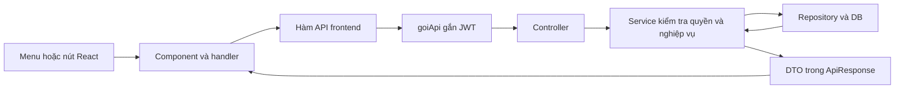

# BF-03 — Luồng thao tác của actor và source code

Ngày đối chiếu: 30/10/2026. Source trên nhánh `VuNQ` sau khi cập nhật `main`, tại commit `e75d094`.

## 1. Kết quả cập nhật nhánh và kiểm tra

- Đã cập nhật nhánh local từ `origin/VuNQ`, cập nhật `main` từ `origin/main`, sau đó merge `main` vào `VuNQ`.
- Kết quả fast-forward, không có conflict; `VuNQ`, `main`, `origin/main` cùng ở `e75d094` tại thời điểm kiểm tra.
- Chưa push. Những thay đổi chưa commit trong `application.properties`, `database/checks/unicode_write_check.sql`, `docs/DATABASE_UNICODE.md` được giữ nguyên.
- Backend compile thành công bằng Maven đi kèm IntelliJ, Java 17.
- Chạy `AppealScoreCalculatorTest` và `ReviewerDeviationCalculatorTest`: 14 test đạt, không lỗi.
- Chạy 5 file test frontend liên quan BF-03: 17 test đạt; `npm run build` thành công.
- Chưa chạy toàn bộ thao tác trên trình duyệt với API/DB thật trong phiên kiểm tra này. Các kết quả trên không thay thế kiểm thử tích hợp.

## 2. Một nút bấm đi qua những tầng nào?



- [AppRoutes.jsx](../client/src/routes/AppRoutes.jsx): URL nào mở màn nào, theo vai trò.
- Các file `ReporterLayout`, `HeadLayout`, `EditorLayout`, `AdminLayout` trong [layouts](../client/src/layouts/): nhãn menu và đường dẫn.
- [goiApi.js](../client/src/api/goiApi.js): gắn Bearer token, gửi body, lấy `data`, xử lý lỗi.
- Controller lấy người thao tác từ `jwt.getSubject()`; service kiểm tra tài khoản, vai trò và phạm vi dữ liệu.

Phân biệt ID: `articleId` là bài; `appealId` là khiếu nại; `attemptId` là phiếu chấm; `batchId` là đợt chấm chéo; `taskId` là nhiệm vụ chấm chéo. ID trong `/re-reviews/{id}` là **attemptId**, không phải appealId.

## 3. Phóng viên — gửi và theo dõi khiếu nại (UC-35)

### 3.1 Thứ tự thao tác

**Khiếu nại điểm → Gửi khiếu nại → chọn bài → Xem kết quả chấm → chọn tiêu chí và nhập lý do → Gửi khiếu nại.**

| Thao tác | Frontend | API → backend |
|---|---|---|
| Mở `/my-appeals` | `MyAppealsPage` → `layKhieuNaiCuaToi()` | GET `/api/appeals/mine` → `AppealController.getMyAppeals()` → `AppealService.getMyAppeals()` |
| Bấm Gửi khiếu nại, mở `/my-appeals/new` | `AppealCreatePage` → `layBaiCoTheKhieuNai()` | GET `/api/appeals/eligible-articles` → `getEligibleArticles()` |
| Chọn bài, bấm Xem kết quả chấm | Đổi query `articleId`; effect gọi `layDieuKienKhieuNai()` | GET `/api/articles/{articleId}/appeal-eligibility` → `AppealController.getEligibility()` → `AppealService.getEligibility()` |
| Tick tiêu chí, nhập lý do | `doiLuaChon()` / `doiLyDo()` | Chỉ thay đổi state, chưa ghi DB |
| Gửi form cuối | `guiForm()` → `guiKhieuNai()` | POST `/api/appeals` → `AppealController.submitAppeal()` → `AppealService.submitAppeal()` |

### 3.2 Xử lý nghiệp vụ và dữ liệu

`AppealService` dùng `AppealSubmissionDataProvider` / `AppealDatabaseSubmissionDataProvider`, gọi `ArticleReadService` và `ScoringReadService` để lấy bài, phiếu công bố và tiêu chí.

Trước khi lưu, kiểm tra:

1. Người gửi là tác giả chính và có role REPORTER đang ACTIVE.
2. Bài có trạng thái `SCORE_PUBLISHED` hoặc `PUBLISHED`.
3. Còn hạn tính từ `score_approvals.announced_at`, theo `appeal_window_days`; gửi đúng thời điểm hết hạn vẫn hợp lệ.
4. Bài chưa có khiếu nại trước đó.
5. Có tiêu chí hợp lệ thuộc phiếu gốc, không trùng và có lý do cho từng tiêu chí.

Sau đó tạo `appeals` trạng thái **SUBMITTED**, gắn `rule_config_id`, lưu `appeal_criteria`, ghi audit và thông báo Trưởng ban. Không sửa điểm gốc.

Thành công quay về `/my-appeals`. Khi đã RESOLVED, danh sách hiển thị điểm hiệu lực và thời điểm chốt. Mở mục tiêu chí đã khiếu nại bằng thẻ `details` không gọi API mới.

Source: [MyAppealsPage.jsx](../client/src/pages/appeal/MyAppealsPage.jsx), [AppealCreatePage.jsx](../client/src/pages/appeal/AppealCreatePage.jsx), [appealApi.js](../client/src/api/appealApi.js), [AppealController.java](../server/src/main/java/com/swp391/kpi/controller/AppealController.java), [AppealService.java](../server/src/main/java/com/swp391/kpi/service/AppealService.java).

## 4. Trưởng ban — nhận, phân công và giao lại (UC-38/43)

### 4.1 Thứ tự thao tác và code

**Khiếu nại → chọn một khiếu nại → chọn BTV → Phân công.**

| Thao tác | Frontend | API → backend |
|---|---|---|
| Mở hàng chờ, lọc, chuyển trang | `AppealManagementPage` → `layHangChoKhieuNai()` | GET `/api/appeals` → `AppealManagementController.getQueue()` → `AppealManagementService.getQueue()` |
| Mở `/appeals/{appealId}` | `AppealDetailPage` tải chi tiết và ứng viên | GET `/api/appeals/{id}` và `/api/appeals/{id}/reviewer-candidates` → `getDetail()` / `getCandidates()` |
| Phân công | `luuPhanCong()` → `phanCongKhieuNai()` | POST `/api/appeals/{id}/assign` → `AppealManagementController.assign()` → `AppealManagementService.assign()` → `ScoringAppealService.createDraft()` |
| Giao lại | `luuPhanCong()` → `giaoLaiKhieuNai()` | POST `/api/appeals/{id}/reassign` → `reassign()` → `ScoringAppealService.reassignDraft()` |

### 4.2 Điều kiện và kết quả

- Trưởng ban chỉ quản lý bài trong ban mình.
- Người nhận phải là BTV ACTIVE, chưa tham gia chấm bài. Lịch sử phân công/giao lại trong audit cũng được xét để loại ứng viên.
- Ưu tiên người cùng ban. Chỉ khi hết ứng viên cùng ban mới lấy người khác ban; phải nhập lý do.
- Phân công tạo phiếu `scoring_attempts` loại **APPEAL**, giữ phiên bản bài, thể loại, bộ tiêu chí và phân công gốc. Khiếu nại chuyển **SUBMITTED → IN_REVIEW**.
- Phiếu mới chưa có điểm hoặc `submitted_at`. Phân công không phải nộp điểm.
- Giao lại chỉ áp dụng phiếu chưa nộp và phải có lý do. Request gửi `attemptId` và `expectedReviewerId` để phát hiện dữ liệu phân công đã thay đổi.
- Nháp cũ được giữ trong audit; điểm/nhận xét nháp được xóa khỏi phiếu trước khi đổi người. Người cũ mất quyền truy cập.
- Giao lại giữ cùng phiếu, không tăng vòng S1/S2 và không đổi BTV của `assignments` gốc.

Source: [AppealManagementPage.jsx](../client/src/pages/appeal/AppealManagementPage.jsx), [AppealDetailPage.jsx](../client/src/pages/appeal/AppealDetailPage.jsx), [AppealManagementController.java](../server/src/main/java/com/swp391/kpi/controller/AppealManagementController.java), [AppealManagementService.java](../server/src/main/java/com/swp391/kpi/service/AppealManagementService.java), [ScoringAppealService.java](../server/src/main/java/com/swp391/kpi/service/ScoringAppealService.java).

## 5. BTV — chấm mù S1 hoặc S2 (UC-36/37)

### 5.1 Thứ tự thao tác

**Chấm lại & chấm chéo → mở phiếu được giao → nhập điểm → Lưu nháp hoặc Nộp phiếu chấm.**

| Thao tác | Frontend | API → backend |
|---|---|---|
| Mở `/re-reviews` | `BlindReviewQueuePage` → `layPhieuChamMu()` | GET `/api/appeal-reviews` → `AppealReviewController.queue()` → `AppealReviewService.getQueue()` → `ScoringAppealService.getAssignedTasks()` |
| Mở `/re-reviews/{attemptId}` | `BlindReviewPage` → `layChiTietChamMu()` | GET `/api/appeal-reviews/{id}` → `card()` → `getCard()` → `ScoringAppealService.getOwnedScorecard()` |
| Nhập điểm/nhận xét | `doiDong()`; `blindScorecard.js` tính tổng tạm | Chỉ thay đổi state |
| Lưu nháp | `luuPhieu(false)` → `luuNhapChamMu()` | PUT `/api/appeal-reviews/{id}` → `draft()` → `AppealReviewService.save(..., false)` |
| Nộp phiếu chấm | `luuPhieu(true)` → `nopPhieuChamMu()` | POST `/api/appeal-reviews/{id}/submit` → `submit()` → `AppealReviewService.save(..., true)` |

### 5.2 Khi lưu/nộp

```text
ScoringAppealService.saveScorecard()
 → khóa và kiểm tra đúng chủ phiếu, phiếu chưa nộp
 → đối chiếu tiêu chí của request với bộ tiêu chí đã gắn
 → AppealScoreCalculator.weightedTotal()
 → lưu scoring_attempt_details và tổng điểm
 → nếu nộp: đặt submittedAt, khóa sửa
 → ghi audit; AppealReviewService thông báo Trưởng ban khi nộp
```

- Nháp được phép thiếu tiêu chí; nộp phải đủ mọi tiêu chí.
- Điểm từng tiêu chí từ 0–100; dưới 50 bắt buộc nhận xét khi nộp.
- Tổng = `SUM(score × weight / 100)`, dùng BigDecimal, HALF_UP hai chữ số thập phân.
- Server tính lại tổng, không tin tổng tạm trên frontend.
- BTV đọc đúng phiên bản bài đã chấm gốc, không lấy nội dung mới nhất đang soạn.
- Response backend không trả điểm/nhận xét cũ, người chấm cũ, tiêu chí/lý do khiếu nại hoặc kết quả so sánh.
- S1 và S2 dùng cùng màn hình và endpoint. Phiếu APPEAL không tự tạo quyết định xuất bản ACCEPT/REVISION/REJECT.

Source: [BlindReviewQueuePage.jsx](../client/src/pages/appeal/BlindReviewQueuePage.jsx), [BlindReviewPage.jsx](../client/src/pages/appeal/BlindReviewPage.jsx), [blindScorecard.js](../client/src/pages/appeal/blindScorecard.js), [AppealReviewController.java](../server/src/main/java/com/swp391/kpi/controller/AppealReviewController.java), [AppealReviewService.java](../server/src/main/java/com/swp391/kpi/service/AppealReviewService.java), [ScoringAppealService.java](../server/src/main/java/com/swp391/kpi/service/ScoringAppealService.java).

## 6. Trưởng ban — so sánh, giao S2 và chốt điểm (UC-37/39)

### 6.1 Nút bấm đi đến đâu?

| Nút | Chuỗi code |
|---|---|
| So sánh & chốt điểm | `AppealComparisonPage` → `laySoSanhKhieuNai()` → GET `/api/appeals/{id}/comparison` → `AppealReviewController.comparison()` → `AppealReviewService.getComparison()` → `AppealScoreCalculator.compare()` |
| Phân công lần hai | `giaoLanHai()` → `phanCongLanHai()` → POST `/api/appeals/{id}/assign-second` → `AppealManagementController.assignSecond()` → `AppealManagementService.assignSecond()` → `ScoringAppealService.createSecondDraft()` |
| Xác nhận điểm hiệu lực | `xacNhan()` → `chotDiemKhieuNai()` → POST `/api/appeals/{id}/finalize` → `AppealReviewController.finalizeAppeal()` → `AppealReviewService.finalizeAppeal()` |

### 6.2 Công thức đề xuất

- `S0`: điểm gốc công bố.
- `S1`: lần chấm mù thứ nhất.
- `S2`: lần chấm mù thứ hai, do người thứ ba thực hiện.
- `T`: ngưỡng lấy từ cấu hình đã gắn với khiếu nại; mặc định nghiệp vụ là 5 điểm.

| Điều kiện | Điểm đề xuất | Mã luật |
|---|---|---|
| `ABS(S1 - S0) <= T` | S1 | `USE_S1` |
| Vượt T, chưa có S2 | Phải chấm S2, chưa được chốt | Chưa có |
| S2 gần S0 hơn | `(S0 + S2) / 2` | `AVERAGE_S0_S2` |
| S2 gần S1 hơn | `(S1 + S2) / 2` | `AVERAGE_S1_S2` |
| S2 cách đều S0 và S1 | S2 | `USE_S2_TIE` |

Ví dụ `S0=70, S1=90, S2=40` → `(70+40)/2=55`. Điểm có thể giảm; không lấy trung vị, không giữ sàn S0. Tối đa hai đợt chấm lại, không có S3.

### 6.3 Chốt kết quả

Frontend chỉ gửi `expectedAttemptId`, không gửi điểm cuối tự chọn. Server khóa/đọc lại dữ liệu, kiểm tra phiếu cuối đã nộp và đủ điều kiện chốt, rồi tự tính kết quả.

Ghi `appeal_resolutions` gồm `effective_score`, `effective_attempt_id`, `rule_applied`, người và thời điểm chốt; đổi khiếu nại thành **RESOLVED**, ghi audit, thông báo và gọi `ReviewerDeviationRefreshService.refreshSection()`.

`effective_attempt_id` chỉ là tham chiếu một phiếu. Khi kết quả là trung bình, phải dùng **effective_score**, không lấy tổng của phiếu được tham chiếu thay thế. `AppealEffectiveScoreService` cung cấp điểm hiệu lực; khi chưa RESOLVED thì vẫn dùng điểm công bố.

Source: [AppealComparisonPage.jsx](../client/src/pages/appeal/AppealComparisonPage.jsx), [AppealScoreCalculator.java](../server/src/main/java/com/swp391/kpi/service/AppealScoreCalculator.java), [AppealReviewService.java](../server/src/main/java/com/swp391/kpi/service/AppealReviewService.java), [AppealEffectiveScoreService.java](../server/src/main/java/com/swp391/kpi/service/AppealEffectiveScoreService.java).

## 7. Trưởng ban và BTV — chấm chéo (UC-40)

```text
Trưởng ban: Đợt chấm chéo
 → chọn khoảng ngày → Tìm bài đã chấm
 → chọn bài/người chấm → Tạo đợt chấm chéo
 → batch OPEN, task PENDING

BTV: Chấm lại & chấm chéo
 → mở task /cross-review-tasks/{taskId}
 → nhập điểm → Nộp phiếu
 → task DONE, lưu điểm và độ lệch

Trưởng ban: mở chi tiết đợt
 → xem tiến độ → Gỡ bài chưa nộp nếu cần
 → Đóng đợt khi không còn task PENDING
```

| Thao tác | Handler/API client | Endpoint | Controller → service |
|---|---|---|---|
| Mở danh sách đợt | `layDotChamCheo()` | GET `/api/cross-review-batches` | `batches()` → `getBatches()` |
| Tìm bài đã chấm | `taiBai()` → `layBaiChamCheoHopLe()` | GET `/api/cross-review-batches/candidates` | `candidates()` → `getCandidates()` |
| Tạo đợt | `taoDot()` → `taoDotChamCheo()` | POST `/api/cross-review-batches` | `create()` → `create()` |
| Mở chi tiết đợt | `layChiTietDotCheo()` | GET `/api/cross-review-batches/{id}` | `batch()` → `getBatch()` |
| BTV mở task | `layChiTietChamCheo()` | GET `/api/cross-review-tasks/{id}` | `task()` → `getTask()` |
| BTV nộp | `luuPhieu(true)` → `nopPhieuChamCheo()` | POST `/api/cross-review-tasks/{id}/submit` | `submit()` → `submit()` |
| Gỡ bài | `goBaiChamCheo()` | DELETE `/api/cross-review-batches/{id}/tasks/{taskId}` | `remove()` → `removeTask()` |
| Đóng đợt | `dongDotChamCheo()` | POST `/api/cross-review-batches/{id}/close` | `close()` → `close()` |

Các endpoint trên thuộc `CrossReviewController` và `CrossReviewService`.

Chấm chéo không có lưu nháp. Khi nộp, lưu `score`, `deviation = score - originalScore`, trạng thái DONE vào `cross_review_tasks`; chi tiết chấm được giữ trong audit. Không ghi điểm này thành điểm chính thức trong `scoring_attempts` hoặc kết quả khiếu nại. Chỉ gỡ task PENDING của đợt OPEN; chỉ đóng đợt khi hết PENDING.

Source: [CrossReviewBatchPage.jsx](../client/src/pages/appeal/CrossReviewBatchPage.jsx), [CrossReviewBatchDetailPage.jsx](../client/src/pages/appeal/CrossReviewBatchDetailPage.jsx), [crossReviewApi.js](../client/src/api/crossReviewApi.js), [CrossReviewController.java](../server/src/main/java/com/swp391/kpi/controller/CrossReviewController.java), [CrossReviewService.java](../server/src/main/java/com/swp391/kpi/service/CrossReviewService.java). BTV dùng lại `BlindReviewPage` với `cheo=true`.

## 8. Báo cáo, hồ sơ, cấu hình và nhật ký (UC-41–45)

| Actor / thao tác | Frontend | API → backend |
|---|---|---|
| Trưởng ban/Admin mở độ lệch, bấm Lọc báo cáo | `ReviewerDeviationPage.locBaoCao()` → `layBaoCaoDoLech()` | GET `/api/reports/reviewer-deviations` → `ReviewerDeviationController.getReport()` → `ReviewerDeviationService.getReport()` |
| Bấm tên BTV | `ReviewerProfilePage` → `layHoSoBienTapVien()` và `layLichSuCham()` | GET `/api/reviewers/{id}` và `/api/reviewers/{id}/scoring-history` → `ReviewerProfileController.getProfile()/getHistory()` → `ReviewerProfileService` |
| Đổi tháng / trang lịch sử | `doiThamSo()` → effect tải lại | Gọi lại API hồ sơ/lịch sử theo tháng và trang |
| Admin mở Cấu hình khiếu nại | `AppealRuleConfigPage.taiDuLieu()` → `getActiveConfig()` / `getAllConfigs()` | GET `/api/appeal-rule-configs/active` và GET `/api/appeal-rule-configs` → controller/service cấu hình |
| Admin tạo phiên bản mới | `handleOpenModal()` mở form; `handleFormSubmit()` → `createConfig()` | POST `/api/appeal-rule-configs` → `AppealRuleConfigController.createConfig()` → `AppealRuleConfigService.createConfig()` |
| Trưởng ban/Admin xem, lọc nhật ký | `AuditLogPage.locNhatKy()` → `layNhatKy()` | GET `/api/audit-logs` → `AuditLogController.getLogs()` → `AppealAuditQueryService.getLogs()` → `AuditLogRepository.search()` |

Các điểm cần giải thích:

- GET báo cáo độ lệch có tính lại và lưu `reviewer_deviation_indices`, không chỉ đọc chỉ số cũ.
- Độ lệch trung bình dùng trị tuyệt đối. Tỷ lệ lật điểm là tỷ lệ appeal đã giải quyết có điểm hiệu lực khác S0; không có mẫu thì tỷ lệ bằng 0.
- Workload trong báo cáo tính từ phiếu không phải APPEAL đã nộp trong tháng.
- Hồ sơ BTV tính để trả DTO; không ghi bảng chỉ số như màn báo cáo.
- Cấu hình thêm phiên bản mới theo ngày hiệu lực; không thay luật của appeal đã gắn `rule_config_id`.
- Trưởng ban bị giới hạn trong ban; Admin có phạm vi toàn hệ thống theo quyền của từng endpoint.
- `AuditService.log()` ghi nhật ký; `AppealAuditQueryService.getLogs()` đọc nhật ký có kiểm tra quyền. Không có thao tác sửa/xóa audit trong màn này.
- Mở giá trị cũ/mới bằng thẻ `details` không gọi API mới.

## 9. Danh mục source

### 9.1 Frontend

| Nhóm | File trong `client/src/` |
|---|---|
| Route và menu | `routes/AppRoutes.jsx`, `routes/RequireRole.jsx`, `layouts/ReporterLayout.jsx`, `HeadLayout.jsx`, `EditorLayout.jsx`, `AdminLayout.jsx` |
| Khiếu nại của PV | `pages/appeal/MyAppealsPage.jsx`, `AppealCreatePage.jsx` |
| Quản lý và chốt | `pages/appeal/AppealManagementPage.jsx`, `AppealDetailPage.jsx`, `AppealComparisonPage.jsx` |
| Chấm mù | `pages/appeal/BlindReviewQueuePage.jsx`, `BlindReviewPage.jsx`, `blindScorecard.js` |
| Chấm chéo | `pages/appeal/CrossReviewBatchPage.jsx`, `CrossReviewBatchDetailPage.jsx` |
| Báo cáo và audit | `pages/appeal/ReviewerDeviationPage.jsx`, `ReviewerProfilePage.jsx`, `AuditLogPage.jsx`, `appealFormat.js` |
| Cấu hình | `pages/admin/AppealRuleConfigPage.jsx` |
| API | `api/appealApi.js`, `crossReviewApi.js`, `reviewerDeviationApi.js`, `reviewerProfileApi.js`, `appealRuleConfigApi.js`, `auditLogApi.js` |
| Hạ tầng chung | `api/goiApi.js`, `auth/phienDangNhap.js` |
| CSS | `pages/appeal/AppealDetailPage.css`, `AppealManagementPage.css`, `ReviewerProfilePage.css`, `ReviewWorkflow.css`; `styles/AppealPage.css`, `AppealRuleConfig.css`, `QualityReportPage.css` |

### 9.2 Backend

Các tên dưới đây nằm trong `server/src/main/java/com/swp391/kpi/`.

| Tầng/nhóm | Class |
|---|---|
| Controller | `AppealController`, `AppealManagementController`, `AppealReviewController`, `CrossReviewController`, `ReviewerDeviationController`, `ReviewerProfileController`, `AppealRuleConfigController`, `AuditLogController` |
| Service khiếu nại | `AppealService`, `AppealManagementService`, `AppealReviewService`, `ScoringAppealService`, `AppealScoreCalculator`, `AppealEffectiveScoreService`, `AppealRuleConfigService` |
| Service chấm chéo/báo cáo | `CrossReviewService`, `ReviewerDeviationService`, `ReviewerDeviationRefreshService`, `ReviewerDeviationCalculator`, `ReviewerProfileService`, `AppealAuditQueryService` |
| Provider/context | `AppealSubmissionDataProvider`, `AppealDatabaseSubmissionDataProvider`, `AppealSubmissionContext`, `AppealSubmissionCriterion`, `ReviewerDirectoryProvider`, `ReviewerDatabaseDirectoryProvider`, `ReviewerDirectoryEntry` |
| Entity | `Appeal`, `AppealCriterion`, `AppealResolution`, `AppealRuleConfig`, `CrossReviewBatch`, `CrossReviewTask`, `ReviewerDeviationIndex` |
| Enum | `AppealStatus`, `AppealResolutionRule`, `CrossReviewBatchStatus`, `CrossReviewTaskStatus` |
| Repository | `AppealRepository`, `AppealCriterionRepository`, `AppealResolutionRepository`, `AppealRuleConfigRepository`, `CrossReviewBatchRepository`, `CrossReviewTaskRepository`, `ReviewerDeviationRepository` |
| DTO gửi/phân công | `AppealCreateRequest`, `AppealCriterionRequest`, `AppealAssignRequest`, `AppealReassignRequest`, `AppealFinalizeRequest` |
| DTO kết quả/điều kiện | `AppealResponse`, `AppealCriterionResponse`, `AppealEligibilityResponse`, `AppealScoreCriterionResponse`, `AppealManagementResponse`, `AppealReviewerCandidateResponse`, `AppealEffectiveScoreResponse` |
| DTO chấm/so sánh | `AppealScorecardRequest`, `AppealBlindScorecardResponse`, `AppealReviewTaskResponse`, `AppealComparisonResponse`, `ScoringAppealAttemptResponse` |
| DTO chấm chéo/cấu hình | `CrossReviewBatchCreateRequest`, `CrossReviewBatchResponse`, `CrossReviewCandidateResponse`, `AppealRuleConfigCreateRequest`, `AppealRuleConfigResponse` |
| DTO báo cáo/hồ sơ | `ReviewerDeviationResponse`, `ReviewerProfileResponse`, `ReviewerDirectoryResponse`, `ReviewerScoringHistoryResponse`, `ReviewerCrossReviewResponse`, `AuditLogResponse` |

Phụ thuộc dùng chung hoặc luồng khác: `ArticleReadService`/`ArticleReadRepository`, `ScoringReadService`/`ScoringReadRepository`, `UserReadService`, `AssignmentService`, entity/repository `ScoringAttempt`, `ScoringAttemptDetail`, `Criteria`, cùng `AuditService`, `AuditLogRepository`, `NotificationService`, `ApiResponse`, `GlobalExceptionHandler` và cấu hình JWT/Security.

### 9.3 Database và kiểm thử

- Bảng BF-03: `appeals`, `appeal_criteria`, `appeal_resolutions`, `appeal_rule_configs`, `cross_review_batches`, `cross_review_tasks`, `reviewer_deviation_indices`.
- Dùng thêm: `articles`, `article_authors`, `article_versions`, `scoring_attempts`, `scoring_attempt_details`, `score_approvals`, `criteria`, `criteria_set_versions`, `users`, `audit_logs`, `notifications` và quan hệ liên quan.
- Schema: [database/schema.sql](../database/schema.sql).
- Migration Iter3: [database/migrations/BF03_iter3_safe.sql](../database/migrations/BF03_iter3_safe.sql).
- Backend test tiêu biểu: `AppealServiceTest`, `AppealControllerTest`, `AppealScoreCalculatorTest`, `ReviewerDeviationCalculatorTest`, `AppealRuleConfigServiceTest`, `AppealAuditQueryServiceTest`, `ReviewerProfileServiceTest`; integration test `BF03Iteration1IT`, `BF03AppealManagementIT`, `BF03ReviewerProfileIT`, `BF03Iteration3IT`, `BF03ConcurrencyIT`.
- Frontend test đã chạy trong phiên: `appealManagementApi.test.js`, `appealIteration3.test.js`, `appealRuleConfigApi.test.js`, `blindScorecard.test.js`, `reviewerProfileApi.test.js` trong `client/tests/`.

## 10. Giới hạn cần nói đúng khi trình bày

1. BF-03 đã cung cấp điểm hiệu lực nhưng chưa tự đồng bộ tiền/KPI. Khi finalize, audit vẫn ghi `downstreamStatus=PENDING_INTEGRATION`. Không nói đã tự tính lại tiền hoặc KPI.
2. Đồng tác giả không được gửi khiếu nại. API `GET /api/articles/{articleId}/effective-score` có hỗ trợ quyền xem cho tác giả chính/đồng tác giả, Head đúng ban và Admin; UI BF-01 cho đồng tác giả chưa được nối trong phần này.
3. Chấm chéo chỉ phục vụ phân tích, không thay điểm chính thức hoặc kết quả appeal.
4. Không chạy lại `schema.sql` trên DB có dữ liệu để nâng cấp vì có phần xóa bảng. Tài liệu này không thực hiện migration hay thay đổi DB.
5. Hướng dẫn cũ có nhắc lỗi compile test BF-04 tại thời điểm trước. Kết quả kiểm tra ngày 30/10/2026 ở mục 1 là bằng chứng mới: compile main và toàn bộ test source thành công, nhưng chỉ chạy 14 unit test backend được chỉ định; chưa chạy toàn bộ test suite.

## 11. Cách đặt breakpoint để trình bày

Ví dụ nút **Nộp phiếu chấm**:

1. Mở `BlindReviewPage.jsx`, tìm `luuPhieu(true)`.
2. Mở `appealApi.js`, tìm `nopPhieuChamMu()` để biết method, URL và body.
3. Trong DevTools → Network, xem request `/submit`, payload, response và status; không đưa token thật vào tài liệu.
4. Đặt breakpoint ở `AppealReviewController.submit()`, `AppealReviewService.save()`, `ScoringAppealService.saveScorecard()`.
5. Đi tiếp vào `AppealScoreCalculator.weightedTotal()`, repository lưu detail và attempt.
6. Kiểm tra `totalScore`, `submittedAt`, audit và response về React khiến form chỉ đọc.

Các điểm khác nên đặt breakpoint: `AppealService.submitAppeal()`, `AppealManagementService.assign()/reassign()/assignSecond()`, `AppealReviewService.finalizeAppeal()`, `CrossReviewService.submit()` và `ReviewerDeviationRefreshService.calculatePeriod()`.

## 12. Tài liệu tham khảo trong repo

- [Hướng dẫn nút bấm và method BF-03](BF03_FLOW_AND_METHOD_GUIDE.md).
- [Hướng dẫn Iter3](BF03_ITER3_CODE_GUIDE.md).
- [Hướng dẫn Iter1](BF03_ITER1_CODE_GUIDE.md).
- [SRS BF-03](SRS_BF03_Appeal.md).
- [SRS BF-02](SRS_BF02_Scoring.md).
- [SRS Overview](SRS_Overview.md).
