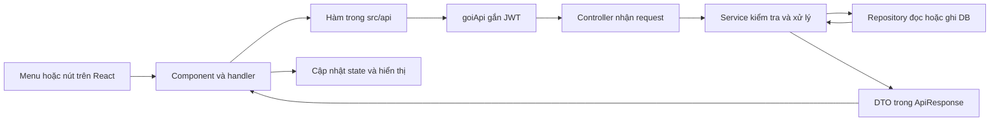

# BF3 — Bấm ở đâu, code chạy vào đâu và các method cần hiểu

Tài liệu này bao phủ **Iter1–3, UC35–45** theo source hiện có trên `VuNQ`. Đọc theo thứ tự thao tác dưới đây để chạy demo, đặt breakpoint và giải thích code. Không cần học thuộc toàn bộ class trước khi hiểu luồng.

## 1. Một lần bấm nút đi qua những tầng nào?



Các file chung cần mở trước:

| File | Hiểu điều gì? |
|---|---|
| [AppRoutes.jsx](../client/src/routes/AppRoutes.jsx) | URL nào render component nào; route theo vai trò |
| [ReporterLayout.jsx](../client/src/layouts/ReporterLayout.jsx), [HeadLayout.jsx](../client/src/layouts/HeadLayout.jsx), [EditorLayout.jsx](../client/src/layouts/EditorLayout.jsx), [AdminLayout.jsx](../client/src/layouts/AdminLayout.jsx) | Nhãn menu và đường dẫn khi bấm |
| [goiApi.js](../client/src/api/goiApi.js) | `goiApi()` gắn Bearer token, stringify body, bóc `data`, ném lỗi và xử lý401 |
| [phienDangNhap.js](../client/src/auth/phienDangNhap.js) | Đọc/lưu/xóa phiên đăng nhập; component không tự giữ userId tin cậy để gửi lên backend |
| [UserReadService.java](../server/src/main/java/com/swp391/kpi/admin/service/UserReadService.java) | `requireActive()` kiểm tra tài khoản và role thực tế trong DB |
| [ApiResponse.java](../server/src/main/java/com/swp391/kpi/common/dto/ApiResponse.java) | Vỏ JSON thống nhất gồm success/message/data/errors |
| [GlobalExceptionHandler.java](../server/src/main/java/com/swp391/kpi/exception/GlobalExceptionHandler.java) | Chuyển exception thành status và thông báo cho frontend |

Controller lấy `currentUserId` từ `jwt.getSubject()`. Không lấy người thao tác từ `reviewerId` trong form và không dùng `X-User-Id`.

## 2. Bản đồ menu và màn hình

| Người dùng / bấm vào đâu | URL | Component |
|---|---|---|
| Reporter → **Khiếu nại điểm** | `/my-appeals` | `MyAppealsPage` |
| Reporter → **Gửi khiếu nại** | `/my-appeals/new` | `AppealCreatePage` |
| Reporter → **Xem kết quả chấm** sau chọn bài | `/my-appeals/new?articleId=...` | Vẫn `AppealCreatePage`, effect tải bài được chọn |
| Head → **Khiếu nại** | `/appeals` | `AppealManagementPage` |
| Head → bấm tên/mã khiếu nại | `/appeals/:id` | `AppealDetailPage` |
| Head → **So sánh & chốt điểm** | `/appeals/:id/comparison` | `AppealComparisonPage` |
| Editor → **Chấm lại & chấm chéo** | `/re-reviews` | `BlindReviewQueuePage` |
| Editor → phiếu chấm lại | `/re-reviews/:id` | `BlindReviewPage`, `cheo=false` |
| Editor → task chấm chéo | `/cross-review-tasks/:id` | `BlindReviewPage`, `cheo=true` |
| Head → **Đợt chấm chéo** | `/cross-reviews` | `CrossReviewBatchPage` |
| Head → tên đợt | `/cross-reviews/:id` | `CrossReviewBatchDetailPage` |
| Head → **Độ lệch & hồ sơ BTV**; Admin → **Hồ sơ biên tập viên** | `/reviewers` | `ReviewerDeviationPage` |
| Bấm tên BTV trên danh bạ/báo cáo | `/reviewers/:id` | `ReviewerProfilePage` |
| Admin → **Cấu hình khiếu nại** | `/appeal-rules` | `AppealRuleConfigPage` |
| Head → **Nhật ký chấm**; Admin → **Nhật ký hệ thống** | `/audit-logs` | `AuditLogPage` |

**Đừng nhầm ID:** `articleId` là bài; `appealId` là khiếu nại; `attemptId` là phiếu chấm; `batchId` là đợt; `taskId` là bài chấm chéo được giao. `/appeals/210` và `/re-reviews/323` có thể thuộc cùng bài nhưng dùng hai loại ID khác nhau.

## 3. Reporter gửi khiếu nại — UC35

Mở [AppealCreatePage.jsx](../client/src/pages/appeal/AppealCreatePage.jsx), [appealApi.js](../client/src/api/appealApi.js), [AppealController.java](../server/src/main/java/com/swp391/kpi/appeal/controller/AppealController.java), [AppealService.java](../server/src/main/java/com/swp391/kpi/appeal/service/AppealService.java).

### 3.1 Bấm Gửi khiếu nại để mở màn chọn bài

```text
MyAppealsPage: Link /my-appeals/new
  → AppRoutes render AppealCreatePage
  → useEffect đầu tiên
  → layBaiCoTheKhieuNai()
  → GET /api/appeals/eligible-articles
  → AppealController.getEligibleArticles()
  → AppealService.getEligibleArticles()
```

Service đọc bài của tác giả chính qua `ArticleReadService.getPublishedByAuthor()`, kiểm tra từng bài bằng logic điều kiện khiếu nại. Bài hết hạn, đã khiếu nại hoặc chưa công bố điểm không được đưa vào danh sách hợp lệ.

### 3.2 Chọn bài và bấm Xem kết quả chấm

Form chọn bài gọi `setSearchParams({ articleId: maBaiViet })`, **chưa tạo khiếu nại**. URL đổi khiến effect thứ hai chạy:

```text
layDieuKienKhieuNai(articleId)
  → GET /api/articles/{articleId}/appeal-eligibility
  → AppealController.getEligibility()
  → AppealService.getEligibility()
  → AppealSubmissionDataProvider.getSubmissionContext()
  → AppealDatabaseSubmissionDataProvider
  → ArticleReadService + ScoringReadService
```

[AppealDatabaseSubmissionDataProvider.java](../server/src/main/java/com/swp391/kpi/appeal/service/AppealDatabaseSubmissionDataProvider.java) ghép thông tin bài, lần chấm công bố, thời điểm công bố và từng tiêu chí. `ScoringReadService.getPublishedAttempt()` tìm lần đã công bố; `getCriteria()` lấy điểm/nhận xét của lần đó.

Repository phía sau: `ArticleReadRepository` đọc `articles`; `ScoringReadRepository.findSubmitted()` đọc `scoring_attempts`/`score_approvals`; `findCriteria()` đọc `scoring_attempt_details`/`criteria`. Cấu hình đọc qua `AppealRuleConfigService.getActiveConfigEntity()`.

### 3.3 Tick tiêu chí, nhập lý do rồi bấm Gửi khiếu nại

`doiLuaChon()` và `doiLyDo()` chỉ đổi state React. Bấm nút cuối mới đi vào:

```text
AppealCreatePage.guiForm(event)
  → guiKhieuNai(articleId, criteria)
  → POST /api/appeals
  → AppealController.submitAppeal(@Valid request, jwt)
  → AppealService.submitAppeal(request, currentUserId)
```

Các method service cần hiểu theo thứ tự:

| Method | Làm gì? |
|---|---|
| `validateSubmission()` | Điều phối kiểm tra điều kiện và tiêu chí |
| `validateArticleAndWindow()` | Kiểm tra tác giả chính, trạng thái, hạn công bố và giới hạn khiếu nại |
| `validateCriteria()` | Không rỗng/trùng, lý do hợp lệ, tiêu chí phải thuộc phiếu gốc |
| `saveCriteria()` | Tạo các dòng tiêu chí/lý do gắn với appeal |
| `toResponse()` | Đổi dữ liệu nghiệp vụ thành DTO, không trả entity thẳng |

`AppealRepository.save()` tạo `appeals` với SUBMITTED và `rule_config_id` đã đóng băng. `AppealCriterionRepository.saveAll()` ghi `appeal_criteria`. Cùng transaction còn có `AuditService.log()` và `NotificationService.notifyHeads()`.

Thành công trả201; frontend `navigate('/my-appeals', ...)` để về danh sách. Việc chọn tiêu chí không sửa điểm gốc.

### 3.4 Mở Khiếu nại của tôi và xem kết quả

```text
MyAppealsPage.useEffect
  → layKhieuNaiCuaToi()
  → GET /api/appeals/mine
  → AppealController.getMyAppeals()
  → AppealService.getMyAppeals()
  → AppealRepository.findAllByAppellantIdOrderBySubmittedAtDesc()
```

Khi RESOLVED, `toResponse()` gọi `AppealEffectiveScoreService.getEffectiveScore()` để bổ sung điểm hiệu lực; React hiển thị `effectiveScore`/`resolvedAt`. Mở/đóng **Tiêu chí đã khiếu nại** là thẻ HTML `details`, không gọi API mới.

## 4. Head nhận và phân công khiếu nại — UC38

Mở [AppealManagementPage.jsx](../client/src/pages/appeal/AppealManagementPage.jsx), [AppealDetailPage.jsx](../client/src/pages/appeal/AppealDetailPage.jsx), [AppealManagementController.java](../server/src/main/java/com/swp391/kpi/appeal/controller/AppealManagementController.java), [AppealManagementService.java](../server/src/main/java/com/swp391/kpi/appeal/service/AppealManagementService.java).

### 4.1 Bấm menu Khiếu nại, lọc hoặc đổi trang

`locDanhSach()` và `doiTrang()` cập nhật query URL. Effect theo query gọi `layHangChoKhieuNai()` → `GET /api/appeals?...` → controller `getQueue()` → service `getQueue()`.

Service kiểm tra Head đang ACTIVE, giới hạn trong ban, lọc trạng thái/ngày/bài/BTV và trả `Page`. Nó đọc `AppealRepository.findAll()`, gọi các service đọc bài/phiếu/user để ghép DTO. Đây là màn xem hàng chờ, chưa phân công.

### 4.2 Bấm tên/mã khiếu nại

`Link` chuyển sang `/appeals/:id`, giữ bộ lọc danh sách trong `location.state`. Effect ở màn chi tiết gọi song song:

| API client | Endpoint | Controller → service |
|---|---|---|
| `layChiTietKhieuNai(id)` | GET `/api/appeals/{id}` | `getDetail()` → `getDetail()` |
| `layNguoiChamHopLe(id)` | GET `/api/appeals/{id}/reviewer-candidates` | `getCandidates()` → `getCandidates()` |

`scopedAppeal()` chặn Head khác ban; `currentAttempt()` tìm phiếu APPEAL mới nhất; `candidates()` loại người không ACTIVE/không EDITOR/người đã tham gia. `addHistoricalReviewer()` còn đọc audit để không chọn lại người đã bị giao khỏi phiếu.

### 4.3 Chọn BTV và bấm Phân công

```text
AppealDetailPage.luuPhanCong(event)
  → phanCongKhieuNai(id, reviewerId, reason)
  → POST /api/appeals/{id}/assign
  → AppealManagementController.assign()
  → AppealManagementService.assign()
  → requireCandidate()
  → ScoringAppealService.createDraft()
```

`createDraft()` tạo `ScoringAttempt` loại APPEAL và giữ nguyên article/version/category/criteria-set/assignment từ S0. `ScoringAttemptRepository.save()` ghi `scoring_attempts`; service đổi appeal SUBMITTED → IN_REVIEW, ghi audit ASSIGN và thông báo đúng BTV.

**Phân công không phải chấm điểm:** phiếu mới chưa có `total_score`, `decision` hoặc `submitted_at`.

## 5. Head giao lại phiếu chưa nộp — UC43

Vẫn ở `/appeals/:id`, chọn BTV khác và nhập lý do, bấm **Giao lại**:

```text
AppealDetailPage.luuPhanCong()
  → giaoLaiKhieuNai(id, {attemptId, expectedReviewerId, reviewerId, reason})
  → POST /api/appeals/{id}/reassign
  → AppealManagementController.reassign()
  → AppealManagementService.reassign()
  → ScoringAppealService.reassignDraft()
```

`attemptId` xác định phiếu; `expectedReviewerId` phát hiện phân công đã đổi trước khi request tới server. Service kiểm tra lý do, ứng viên và trạng thái sau khi có khóa.

`reassignDraft()` dùng `lockedDraft()` và `EntityManager.refresh()`; `snapshot()` lưu nháp cũ vào audit trước khi xóa detail/điểm/nhận xét riêng và đổi người. Hai BTV nhận thông báo. **Vẫn cùng một phiếu, không tăng số vòng S1/S2**; không đổi người của phân công gốc trong `assignments`.

Nếu đã nộp thì409. Nếu request frontend nhận409, màn tải lại dữ liệu thay vì báo thành công giả.

## 6. Editor mở, lưu nháp và nộp chấm mù — UC36

Mở [BlindReviewQueuePage.jsx](../client/src/pages/appeal/BlindReviewQueuePage.jsx), [BlindReviewPage.jsx](../client/src/pages/appeal/BlindReviewPage.jsx), [AppealReviewController.java](../server/src/main/java/com/swp391/kpi/appeal/controller/AppealReviewController.java), [AppealReviewService.java](../server/src/main/java/com/swp391/kpi/appeal/service/AppealReviewService.java), [ScoringAppealService.java](../server/src/main/java/com/swp391/kpi/appeal/service/ScoringAppealService.java).

### 6.1 Bấm Chấm lại & chấm chéo

Effect gọi hai API: `layPhieuChamMu()` → GET `/api/appeal-reviews`, và `layPhieuChamCheo()` → GET `/api/cross-review-tasks`.

Nhánh appeal: controller `queue()` → `AppealReviewService.getQueue()` → `ScoringAppealService.getAssignedTasks()` → `ScoringAttemptRepository.findByReviewerIdAndAttemptTypeOrderByOpenedAtDesc()`.

### 6.2 Bấm phiếu chấm lại

```text
Link /re-reviews/{attemptId}
  → BlindReviewPage → BlindReviewForm.useEffect
  → layChiTietChamMu(attemptId)
  → GET /api/appeal-reviews/{attemptId}
  → AppealReviewController.card()
  → AppealReviewService.getCard()
  → ScoringAppealService.getOwnedScorecard()
  → getComparisonCard()
```

`getCard()` khóa appeal trước; `getOwnedScorecard()` khóa/refresh attempt và kiểm tra chủ hiện tại. Khóa giữ tới khi đọc xong detail để không lọt điểm của người được giao mới sang request đang đọc của người cũ.

`getComparisonCard()` là hàm nội bộ tạo card, **không phải endpoint công khai cho mọi người**. Nó gọi:

- `ArticleReadService.getVersion(articleId, versionId)` → `ArticleReadRepository.findVersion()` đọc đúng `article_versions`, không lấy nội dung mới nhất đang soạn.
- `CriteriaRepository.findByCriteriaSetVersionIdOrderBySortOrderAsc()` đọc bộ đã gắn.
- `ScoringAttemptDetailRepository.findByScoringAttemptId()` đọc điểm/nhận xét của chính phiếu đó.

DTO Editor không có điểm cũ, tên reviewer cũ, lý do/tiêu chí khiếu nại hoặc bảng so sánh. Quyền và dữ liệu ẩn được kiểm soát ở backend.

### 6.3 Nhập điểm/nhận xét

`doiDong()` chỉ đổi state. [blindScorecard.js](../client/src/pages/appeal/blindScorecard.js) có `tinhTongTam()` và `kiemTraPhieuCham()` để hiển thị/kiểm tra trước nộp. Tổng ở frontend chỉ tạm tính; server tính lại.

### 6.4 Bấm Lưu nháp hoặc Nộp phiếu chấm

| Thao tác | Handler/API client | HTTP | Controller | Service |
|---|---|---|---|---|
| Lưu nháp | `luuPhieu(false)` → `luuNhapChamMu()` | PUT `/api/appeal-reviews/{id}` | `draft()` | `save(..., false)` |
| Nộp | `luuPhieu(true)` → `nopPhieuChamMu()` | POST `/api/appeal-reviews/{id}/submit` | `submit()` | `save(..., true)` |

Sau đó đều vào `ScoringAppealService.saveScorecard()`:

1. Khóa/kiểm tra đúng chủ và phiếu còn mở.
2. Ghép request vào rubric, từ chối tiêu chí lạ/trùng.
3. Gọi `AppealScoreCalculator.weightedTotal(items, submit)`.
4. Xóa/flush detail nháp cũ, lưu detail mới và tổng đã tính.
5. Nếu nộp: đặt `submittedAt`; APPEAL không tự gán ACCEPT/REVISION/REJECT.
6. Ghi audit SAVE_DRAFT hoặc SUBMIT_SCORE. Khi nộp, `AppealReviewService.save()` thông báo Head và ghi COMPARE.

Draft có thể thiếu tiêu chí. Khi nộp phải đủ, điểm0–100, nhận xét bắt buộc dưới50. Nộp xong form khóa và lần ghi tiếp theo bị từ chối.

## 7. Head so sánh, giao S2 và xác nhận — UC37/39

Mở [AppealComparisonPage.jsx](../client/src/pages/appeal/AppealComparisonPage.jsx), [AppealScoreCalculator.java](../server/src/main/java/com/swp391/kpi/appeal/service/AppealScoreCalculator.java), cùng các service/controller ở mục4 và6.

### 7.1 Bấm So sánh & chốt điểm

```text
AppealDetailPage: Link /appeals/{appealId}/comparison
  → AppealComparisonPage → ComparisonContent.useEffect
  → laySoSanhKhieuNai(id) + layNguoiChamHopLe(id)
  → GET /api/appeals/{id}/comparison
  → AppealReviewController.comparison()
  → AppealReviewService.getComparison()
  → comparison()
  → AppealScoreCalculator.compare(S0,S1,S2,T)
```

`comparison()` lấy S0 từ phiếu bị khiếu nại; đếm các phiếu cùng `appealId` để xác định S1/S2; đọc T bằng `rule_config_id`. Không dùng `attemptNo=2` để đoán S1 vì bài có thể đã chấm lại nhiều lần trước appeal.

| Điều kiện | Kết quả |
|---|---|
| `ABS(S1-S0) <= T` | Đề xuất S1, không cần S2 |
| Vượt T và chưa có S2 | Chờ giao/nộp S2, chưa được chốt |
| Có S2 | Trung vị của S0, S1, S2 (S2 kẹp vào khoảng `min(S0,S1)` đến `max(S0,S1)`), mã `MEDIAN_S0_S1_S2` |

Ví dụ S0=70, S1=90, S2=40 → trung vị `70`. Khi S1 thấp hơn S0 (ví dụ S0=70, S1=50, S2=40) điểm cuối là `50`, thấp hơn S0; không có sàn giữ S0. Ngay khi S1 nộp xong mà lệch quá T, màn so sánh hiện khoảng `min(S0,S1)`–`max(S0,S1)` trong lúc chờ S2. `weightedTotal()` và `compare()` dùng BigDecimal, HALF_UP hai chữ số thập phân.

### 7.2 Bấm Phân công S2

```text
ComparisonContent.giaoLanHai(event)
  → phanCongLanHai(id, reviewerId, reason)
  → POST /api/appeals/{id}/assign-second
  → AppealManagementController.assignSecond()
  → AppealManagementService.assignSecond()
  → requiresSecond() + requireCandidate()
  → ScoringAppealService.createSecondDraft()
```

Ghi thêm APPEAL attempt giữ snapshot gốc. BTV thứ ba chấm bằng **cùng màn và endpoint như S1**; không có form cho người chấm xem S0/S1. Tối đa hai đợt chấm lại. Giao lại S2 chưa nộp vẫn theo mục5.

### 7.3 Bấm Xác nhận điểm hiệu lực

```text
ComparisonContent.xacNhan()
  → xuLy(() => chotDiemKhieuNai(id, phieuCuoi.id), ...)
  → POST /api/appeals/{id}/finalize {expectedAttemptId}
  → AppealReviewController.finalizeAppeal()
  → AppealReviewService.finalizeAppeal()
```

Service khóa/refresh dữ liệu, kiểm tra IN_REVIEW, đúng phiếu cuối đã nộp và đủ điều kiện chốt. Điểm được tính ở server, client không gửi số điểm cuối tự chọn.

Ghi `AppealResolutionRepository.save()` vào `appeal_resolutions` với `effectiveScore`, `ruleApplied`, `effectiveAttemptId`, `finalizedBy`, `finalizedAt`; đổi `appeals` sang RESOLVED và đặt `resolvedAt`. Sau audit/thông báo, `ReviewerDeviationRefreshService.refreshSection()` tính lại chỉ số tháng.

`effective_attempt_id` chỉ tham chiếu một phiếu; nếu kết quả là trung vị hoặc trung bình thì phải dùng **effective_score**, không đọc tổng của FK thay cho55. Dữ liệu lịch sử thiếu effective_score dùng fallback của `AppealEffectiveScoreService.getEffectiveScore()`.

## 8. Tạo và thực hiện chấm chéo — UC40

Mở [CrossReviewBatchPage.jsx](../client/src/pages/appeal/CrossReviewBatchPage.jsx), [CrossReviewBatchDetailPage.jsx](../client/src/pages/appeal/CrossReviewBatchDetailPage.jsx), [crossReviewApi.js](../client/src/api/crossReviewApi.js), [CrossReviewController.java](../server/src/main/java/com/swp391/kpi/appeal/controller/CrossReviewController.java), [CrossReviewService.java](../server/src/main/java/com/swp391/kpi/appeal/service/CrossReviewService.java).

| Bấm/thao tác | Frontend chạy | HTTP | Controller → service |
|---|---|---|---|
| Mở Đợt chấm chéo | Effect → `layDotChamCheo()` | GET `/api/cross-review-batches` | `batches()` → `getBatches()` |
| Tìm bài đã chấm | `taiBai()` → `layBaiChamCheoHopLe(fromDate,toDate)` | GET `/api/cross-review-batches/candidates` | `candidates()` → `getCandidates()` |
| Chọn người/lý do | `doiLuaChon()` | Chưa gọi server | Chỉ đổi state |
| Tạo đợt chấm chéo | `taoDot()` → `taoDotChamCheo()` | POST `/api/cross-review-batches` | `create()` → `create()` |
| Bấm tên đợt | Link → effect → `layChiTietDotCheo(id)` | GET `/api/cross-review-batches/{id}` | `batch()` → `getBatch()` |
| Editor bấm task | `BlindReviewForm`, `cheo=true` → `layChiTietChamCheo(id)` | GET `/api/cross-review-tasks/{id}` | `task()` → `getTask()` |
| Editor nộp task | `luuPhieu(true)` → `nopPhieuChamCheo()` | POST `/api/cross-review-tasks/{id}/submit` | `submit()` → `submit()` |
| Head gỡ task | `BatchDetail.xuLy(...)` → `goBaiChamCheo()` | DELETE `/api/cross-review-batches/{id}/tasks/{taskId}` | `remove()` → `removeTask()` |
| Head đóng đợt | `BatchDetail.xuLy(...)` → `dongDotChamCheo()` | POST `/api/cross-review-batches/{id}/close` | `close()` → `close()` |

Các method phải hiểu trong `CrossReviewService`:

- `getCandidates()`: lấy phiếu đã nộp không phải APPEAL, đúng khoảng ngày/ban; gọi `eligible()` để tìm người hợp lệ.
- `create()`: khóa tên bằng `CrossReviewBatchRepository.findNameLocked()`, kiểm tra trùng bài/người/phạm vi; tạo `cross_review_batches` OPEN và `cross_review_tasks` PENDING, audit/thông báo cùng transaction.
- `getTask()` và `blind()`: kiểm tra đúng Editor, lấy snapshot theo original_scoring_id, bỏ điểm/nhận xét gốc trước khi trả card.
- `submit()`: tính điểm từ mọi tiêu chí; lưu `score`, `deviation=score-originalScore`, DONE và submittedAt vào **cross_review_tasks**; audit giữ chi tiết chấm. Không ghi điểm này vào scoring_attempts hoặc appeal_resolutions.
- `close()`: từ chối nếu còn PENDING, chỉ đổi batch sang CLOSED.
- `removeTask()`: chỉ gỡ task PENDING của đúng đợt đang OPEN; audit snapshot giữ liên kết lịch sử sau khi xóa task.

Task chấm chéo không có draft. Sau nộp, màn chỉ hiện tổng của mình; bảng so sánh/độ lệch là dữ liệu cho Head.

## 9. Xem độ lệch và hồ sơ — UC41/42

Mở [ReviewerDeviationPage.jsx](../client/src/pages/appeal/ReviewerDeviationPage.jsx), [ReviewerProfilePage.jsx](../client/src/pages/appeal/ReviewerProfilePage.jsx), [ReviewerDeviationService.java](../server/src/main/java/com/swp391/kpi/appeal/service/ReviewerDeviationService.java), [ReviewerProfileService.java](../server/src/main/java/com/swp391/kpi/appeal/service/ReviewerProfileService.java).

### 9.1 Mở báo cáo hoặc bấm Lọc báo cáo

```text
ReviewerDeviationPage.useEffect / locBaoCao()
  → layBaoCaoDoLech(boLoc)
  → GET /api/reports/reviewer-deviations
  → ReviewerDeviationController.getReport()
  → ReviewerDeviationService.getReport()
  → ReviewerDeviationRefreshService.getPeriods()/refresh()
  → ReviewerDeviationRepository.findAllByOrderByPeriodDescEditorIdAsc()
```

**Điểm dễ nhầm:** endpoint GET báo cáo có tính lại và lưu bảng `reviewer_deviation_indices`; nó không phải chỉ đọc bảng chỉ số cũ. `calculatePeriod()` ghép các lần so sánh hợp lệ, `ReviewerDeviationCalculator.calculate()` tính:

- Độ lệch trung bình theo trị tuyệt đối.
- Số appeal đã giải quyết và tỷ lệ điểm hiệu lực khác S0; mẫu số0 trả0.
- Workload từ phiếu không phải APPEAL đã nộp trong tháng.

`ReviewerDirectoryProvider`/`ReviewerDatabaseDirectoryProvider.findEditor()` ghép tên và ban. Không biến báo cáo thành xếp hạng hay tự khóa tài khoản.

### 9.2 Bấm tên BTV, đổi tháng hoặc đổi trang

```text
Link /reviewers/{editorId}?period=YYYY-MM
  → ReviewerProfilePage.useEffect
  → layHoSoBienTapVien() + layLichSuCham()
  → GET /api/reviewers/{editorId}
  → GET /api/reviewers/{editorId}/scoring-history
  → ReviewerProfileController.getProfile()/getHistory()
  → ReviewerProfileService.getProfile()/getHistory()
```

`requireEditor()` kiểm tra scope; `normalizePeriod()` chuẩn hóa đầu tháng; `calculateDeviation()` tính dữ liệu hồ sơ. Workload còn gọi `AssignmentService.getAssignmentsByEditorId()`, `ScoringAppealService.getPendingCount()` và đọc task chấm chéo.

Hồ sơ tính để trả DTO, không ghi bảng chỉ số như màn báo cáo. Đổi tháng/Trang trước/Trang sau dùng `doiThamSo()` để effect tải lại; giữ `location.state` để khi **Quay lại báo cáo độ lệch** không mất bộ lọc.

## 10. Admin cấu hình luật — UC44

Mở [AppealRuleConfigPage.jsx](../client/src/pages/admin/AppealRuleConfigPage.jsx), [appealRuleConfigApi.js](../client/src/api/appealRuleConfigApi.js), [AppealRuleConfigController.java](../server/src/main/java/com/swp391/kpi/appeal/controller/AppealRuleConfigController.java), [AppealRuleConfigService.java](../server/src/main/java/com/swp391/kpi/appeal/service/AppealRuleConfigService.java).

| Bấm/thao tác | Chuỗi chạy |
|---|---|
| Mở Cấu hình khiếu nại | `useEffect` → `taiDuLieu()` → `getActiveConfig()` + `getAllConfigs()` → GET active/history → controller/service cùng tên |
| + Tạo phiên bản cấu hình mới | `handleOpenModal()` mở form và điền mặc định, chưa ghi DB |
| Gửi form tạo cấu hình | `handleFormSubmit()` → API `createConfig()` → POST `/api/appeal-rule-configs` → controller `createConfig()` → service `createConfig()` |

`getActiveConfigEntity()` chọn `is_active=true`, effective_from<=hôm nay và ngày hiệu lực lớn nhất. `createConfig()` kiểm tra ngày trùng, `AppealRuleConfigRepository.save()` **thêm dòng mới**, rồi ghi audit CREATE. Không sửa ngược cấu hình của appeal cũ vì appeal giữ rule_config_id.

Chưa có active config trả404; frontend xử lý trạng thái trống và vẫn tải lịch sử. Người dùng ngoài Admin bị chặn ở service.

## 11. Xem nhật ký — UC45

Mở [AuditLogPage.jsx](../client/src/pages/appeal/AuditLogPage.jsx), [auditLogApi.js](../client/src/api/auditLogApi.js), [AuditLogController.java](../server/src/main/java/com/swp391/kpi/common/controller/AuditLogController.java), [AppealAuditQueryService.java](../server/src/main/java/com/swp391/kpi/appeal/service/AppealAuditQueryService.java).

```text
Menu nhật ký / Link từ appeal / Link nhật ký đợt
  → AuditLogPage đọc appealId hoặc entityType/entityId từ URL
  → AuditLogContent.useEffect
  → layNhatKy(boLoc)
  → GET /api/audit-logs
  → AuditLogController.getLogs()
  → AppealAuditQueryService.getLogs()
  → AuditLogRepository.search()
```

Bấm **Lọc nhật ký** chạy `locNhatKy()` với form hiện tại. `findArticle()`, `matchesAppeal()`, `matchesEditor()` và `cannotView()` giới hạn đúng phạm vi; Head không được dùng filter trực tiếp để đọc ban khác. `articleFromSnapshot()` giữ được liên kết sau khi task đã bị gỡ.

`AuditService.log()` là đường **ghi** audit từ nghiệp vụ. `AppealAuditQueryService.getLogs()` là đường **đọc** có kiểm tra quyền. Đừng nhầm hai service hoặc biến audit thành endpoint sửa/xóa.

Bấm **Xem giá trị cũ/mới** là mở thẻ `details`, không gọi API mới. Quay lại menu nhật ký bỏ filter URL sẽ remount nội dung để không giữ scope cũ.

## 12. Các method nền tảng nên hiểu trước khi bảo vệ

| Method / khái niệm | Câu giải thích ngắn |
|---|---|
| `UserReadService.requireActive()` | JWT xác định ID; service kiểm tra user đang ACTIVE và đúng role |
| `AppealManagementService.scopedAppeal()` | Chỉ Head của ban chứa bài mới quản lý được appeal |
| `ReviewerDeviationRefreshService.lockWorkflow()` | Application lock trong transaction để các workflow ghi điểm/tổng hợp không tranh chấp |
| `ScoringAppealService.lockReviewSnapshots()` / `lockedDraft()` | Khóa và refresh dữ liệu phiếu, không tin entity cache trước đó |
| `AppealScoreCalculator.weightedTotal()` | Điểm nhân trọng số phần trăm, kiểm tra đủ tiêu chí/comment khi nộp |
| `AppealScoreCalculator.compare()` | Luật ngưỡng và trọng tài S2; không tự chốt thay Head |
| `AppealReviewService.finalizeAppeal()` | Ghi điểm hiệu lực và RESOLVED một lần, kiểm tra expectedAttemptId |
| `AppealEffectiveScoreService.getEffectiveScore()` | Chưa RESOLVED dùng điểm công bố; RESOLVED dùng điểm số đã xác nhận, có fallback lịch sử |
| `@Transactional` | Lỗi ở bước audit/thông báo cũng rollback nghiệp vụ cùng transaction |
| DTO và mapping | Chỉ trả trường cần dùng; đặc biệt không trả entity/lịch sử nhạy cảm cho Editor |

Thứ tự khóa của workflow ghi điểm/phân công/chấm chéo là application lock → appeal → attempt, hoặc application lock → batch → task. GET card chấm mù giữ appeal → attempt để đọc đúng chủ và detail một cách nguyên tử. Application lock hiện tuần tự hóa ghi ở quy mô bài tập; chờ quá15giây trả thông báo thử lại.

## 13. Đặt breakpoint và lần theo trên VS Code/IntelliJ

Ví dụ cần giải thích nút **Nộp phiếu chấm**:

1. Ctrl+P mở `BlindReviewPage.jsx`, Ctrl+F tìm `luuPhieu`.
2. Mở `appealApi.js`, tìm `nopPhieuChamMu` để biết URL/method/body.
3. DevTools trình duyệt → Network → bấm nút, chọn request `/submit`, xem Payload/Response/status. Không chép token thật vào tài liệu.
4. Đặt breakpoint tại `AppealReviewController.submit()`, `AppealReviewService.save()` và `ScoringAppealService.saveScorecard()`.
5. Theo tiếp vào `AppealScoreCalculator.weightedTotal()` rồi repository lưu detail/attempt.
6. Xem `submittedAt`, `totalScore`, actor từ JWT và audit. Response trở về `setPhieu()`, form thành chỉ đọc.

Các breakpoint hữu ích khác: `AppealService.submitAppeal()`, `AppealManagementService.assign()/reassign()/assignSecond()`, `AppealReviewService.finalizeAppeal()`, `CrossReviewService.submit()`, `ReviewerDeviationRefreshService.calculatePeriod()`.

Các tên method là điểm tìm chính; số dòng có thể đổi sau merge. Dùng F12/Go to Definition hoặc Ctrl+Shift+F tìm `TênClass`/`tênMethod` thay vì học thuộc số dòng.

## 14. Giới hạn phải nói đúng khi trình bày

- BF03 cung cấp điểm hiệu lực; **BF04/BF05 chưa tự nối việc tính lại tiền/KPI**. Audit finalize ghi `PENDING_INTEGRATION`. Không nói chốt appeal đã đồng bộ tài chính tự động.
- API điểm hiệu lực `/api/articles/{id}/effective-score` đã kiểm tra tác giả chính/đồng tác giả, Head và Admin; UI bài của đồng tác giả thuộc BF01 chưa được sửa. Editor không dùng API này để nhìn điểm kết quả khi đang chấm mù.
- Database có dữ liệu chỉ chạy [BF03_iter3_safe.sql](../database/migrations/BF03_iter3_safe.sql), không chạy lại [schema.sql](../database/schema.sql) vì file schema có phần xóa bảng.
- Mẫu DB và ID demo chỉ có trên máy đã tạo, không phải dữ liệu hard-code của frontend.
- Test BF04 `RoyaltyGradingServiceTest` còn lỗi chữ ký cũ sau merge main. Bộ kiểm chứng riêng loại đúng file đó; không tuyên bố Maven test chuẩn đã xanh.

Xem thêm [hướng dẫn triển khai Iter3](BF03_ITER3_CODE_GUIDE.md), [hướng dẫn Iter1](BF03_ITER1_CODE_GUIDE.md), [SRS BF03](SRS_BF03_Appeal.md) và [checkpoint kiểm chứng](superpowers/checkpoints/2026-10-26-bf03-iter3-checkpoint.md).
