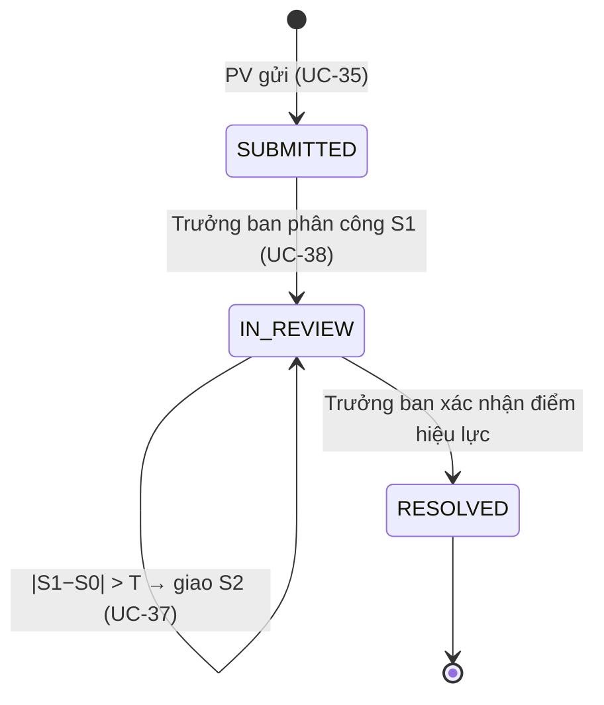

# BF-03 — Đánh giá hiện trạng và luồng đi của hệ thống

Đối chiếu ngày 31/10/2026 trên nhánh `VuNQ` (commit `e75d094`, đã trùng `origin/main`).
Phạm vi: chỉ luồng `appeal` (UC-35…45). Phần đánh giá (mục 1–6) được viết trước khi sửa; hai vấn đề #3 và #4 ở mục 5 sau đó đã được sửa (ghi rõ trong bảng).

Đã đọc: `database/schema.sql` (bảng `scoring_attempts`, `scoring_attempt_details`, `score_approvals`, `appeals`, `appeal_criteria`, `appeal_resolutions`, `appeal_rule_configs`, `cross_review_*`, `reviewer_deviation_indices`, `audit_logs`, `notifications`), `docs/SRS_Overview.md`, `docs/SRS_BF03_Appeal.md`, `docs/SRS_BF02_Scoring.md`, `docs/CODING_PLAN.md`, và toàn bộ service/controller/API/trang React của BF-03.

## 1. Kết luận ngắn

- **Về nghiệp vụ: luồng ổn.** UC-35…45 đều có code, công thức S0/S1/S2 đúng BR-QC-06/07, chấm mù không lộ điểm cũ, một bài một khiếu nại, hạn tính từ `announced_at`, cấu hình luật bị đóng băng vào `appeals.rule_config_id`, mọi thao tác ghi `audit_logs`.
- **Test đã chạy:** 37 test backend (`AppealScoreCalculatorTest`, `AppealServiceTest`, `ScoringAppealServiceTest`, `ReviewerDeviation*Test`, `AppealRuleConfigServiceTest`, `AppealAuditQueryServiceTest`, `AppealControllerTest`) đạt; 15 test frontend BF-03 đạt. **Chưa chạy** 5 file `BF03*IT` (cần SQL Server) và chưa thử bằng trình duyệt với DB thật, nên các kết luận dưới đây về hành vi thật là từ đọc code.
- **Chưa tối ưu ở 3 chỗ chính:** (1) đọc cả bảng rồi lọc bằng Java, (2) trang báo cáo độ lệch vừa ghi DB vừa khoá toàn hệ thống, (3) cấu hình `max_appeals_per_article` không có tác dụng. Chi tiết và cách sửa ở mục 5.
- **Chưa nối BF-04/BF-05:** điểm hiệu lực có sẵn nhưng tiền và KPI chưa tự tính lại (audit ghi `PENDING_INTEGRATION`). Đây là việc của chủ luồng BF-04/05, không phải lỗi của BF-03.

## 2. Vòng đời một khiếu nại



Trạng thái chi tiết (đợi S1, đã có S1, đợi S2…) **không lưu**, được suy ra từ số phiếu `scoring_attempts` có `appeal_id` và `submitted_at` (BR-QC-11). Chỉ ba trạng thái `SUBMITTED / IN_REVIEW / RESOLVED` nằm trong bảng `appeals`.

Công thức (class `AppealScoreCalculator`, không dùng Spring):

| Điều kiện | Kết quả | `rule_applied` |
|---|---|---|
| `\|S1−S0\| ≤ T` | điểm = S1, không có S2 | `USE_S1` |
| `\|S1−S0\| > T`, chưa có S2 | bắt buộc chấm S2 | (chưa có) |
| có S2 | trung vị của S0, S1, S2 (S2 kẹp vào `min(S0,S1)`..`max(S0,S1)`) | `MEDIAN_S0_S1_S2` |

Ba mã `AVERAGE_S0_S2`, `AVERAGE_S1_S2`, `USE_S2_TIE` của luật trung bình cũ chỉ còn để đọc dữ liệu lịch sử (đổi luật ngày 04/11/2026).

`T` lấy từ `appeal_rule_configs.variance_threshold` của cấu hình gắn với khiếu nại (mặc định 5). Làm tròn `HALF_UP`, 2 chữ số, toàn bộ `BigDecimal`.

## 3. Từ màn hình đến code

Một lần bấm nút đi qua: **trang React → hàm trong `client/src/api/` → `goiApi()` (gắn JWT) → Controller (lấy `userId` từ `jwt.getSubject()`) → Service (kiểm tra quyền và nghiệp vụ) → Repository/DB → DTO trong `ApiResponse`**. Controller không có logic; role được kiểm trong service bằng `UserReadService.requireActive(userId, "ROLE")`.

### 3.1 Phóng viên (REPORTER)

| Bấm ở đâu | Trang React → hàm API | Endpoint → Service |
|---|---|---|
| Menu *Khiếu nại điểm* (`/my-appeals`) | `MyAppealsPage` → `layKhieuNaiCuaToi()` | `GET /api/appeals/mine` → `AppealService.getMyAppeals()` |
| *Gửi khiếu nại* (`/my-appeals/new`) | `AppealCreatePage` → `layBaiCoTheKhieuNai()` | `GET /api/appeals/eligible-articles` → `getEligibleArticles()` |
| Chọn bài, *Xem kết quả chấm* | đổi `?articleId=` → `layDieuKienKhieuNai()` | `GET /api/articles/{id}/appeal-eligibility` → `getEligibility()` |
| Tick tiêu chí, nhập lý do | `doiLuaChon()` / `doiLyDo()` | chỉ đổi state, chưa gọi server |
| *Gửi khiếu nại* | `guiForm()` → `guiKhieuNai()` | `POST /api/appeals` → `submitAppeal()` |

### 3.2 Trưởng ban (HEAD_OF_DEPARTMENT)

| Bấm ở đâu | Trang React → hàm API | Endpoint → Service |
|---|---|---|
| Menu *Khiếu nại* (`/appeals`), lọc, đổi trang | `AppealManagementPage` → `layHangChoKhieuNai()` | `GET /api/appeals?…` → `AppealManagementService.getQueue()` |
| Bấm một khiếu nại (`/appeals/:id`) | `AppealDetailPage` → `layChiTietKhieuNai()` + `layNguoiChamHopLe()` | `GET /api/appeals/{id}`, `GET …/reviewer-candidates` → `getDetail()`, `getCandidates()` |
| *Phân công* | `luuPhanCong()` → `phanCongKhieuNai()` | `POST /api/appeals/{id}/assign` → `assign()` → `ScoringAppealService.createDraft()` |
| *Giao lại* (phiếu chưa nộp) | `luuPhanCong()` → `giaoLaiKhieuNai()` | `POST …/reassign` → `reassign()` → `ScoringAppealService.reassignDraft()` |
| *So sánh & chốt điểm* (`/appeals/:id/comparison`) | `AppealComparisonPage` → `laySoSanhKhieuNai()` | `GET …/comparison` → `AppealReviewService.getComparison()` |
| *Phân công S2* | `giaoLanHai()` → `phanCongLanHai()` | `POST …/assign-second` → `assignSecond()` → `createSecondDraft()` |
| *Xác nhận điểm hiệu lực* | `xacNhan()` → `chotDiemKhieuNai()` | `POST …/finalize` → `AppealReviewService.finalizeAppeal()` |
| Menu *Đợt chấm chéo* (`/cross-reviews`) | `CrossReviewBatchPage` → `layDotChamCheo()`, `layBaiChamCheoHopLe()`, `taoDotChamCheo()` | `GET/POST /api/cross-review-batches[/candidates]` → `CrossReviewService.getBatches()/getCandidates()/create()` |
| Chi tiết đợt, *Gỡ bài*, *Đóng đợt* | `CrossReviewBatchDetailPage` → `goBaiChamCheo()`, `dongDotChamCheo()` | `DELETE …/{id}/tasks/{taskId}`, `POST …/{id}/close` → `removeTask()`, `close()` |
| Menu *Độ lệch & hồ sơ BTV* (`/reviewers`) | `ReviewerDeviationPage` → `layBaoCaoDoLech()` | `GET /api/reports/reviewer-deviations` → `ReviewerDeviationService.getReport()` |
| Bấm tên BTV (`/reviewers/:id`) | `ReviewerProfilePage` → hồ sơ + lịch sử chấm | `GET /api/reviewers/{id}`, `…/scoring-history` → `ReviewerProfileService` |
| Menu *Nhật ký chấm* (`/audit-logs`) | `AuditLogPage` → `layNhatKy()` | `GET /api/audit-logs` → `AppealAuditQueryService.getLogs()` |

### 3.3 Biên tập viên (EDITOR)

| Bấm ở đâu | Trang React → hàm API | Endpoint → Service |
|---|---|---|
| Menu *Chấm lại & chấm chéo* (`/re-reviews`) | `BlindReviewQueuePage` → `layPhieuChamMu()` + `layPhieuChamCheo()` | `GET /api/appeal-reviews`, `GET /api/cross-review-tasks` |
| Mở phiếu chấm lại (`/re-reviews/:id`, **id là attemptId**) | `BlindReviewPage` → `layChiTietChamMu()` | `GET /api/appeal-reviews/{id}` → `AppealReviewService.getCard()` → `ScoringAppealService.getOwnedScorecard()` |
| *Lưu nháp* | `luuPhieu(false)` → `luuNhapChamMu()` | `PUT /api/appeal-reviews/{id}` → `AppealReviewService.save(…, false)` → `saveScorecard()` |
| *Nộp phiếu chấm* | `luuPhieu(true)` → `nopPhieuChamMu()` | `POST …/{id}/submit` → `save(…, true)` |
| Mở/nộp phiếu chấm chéo (`/cross-review-tasks/:id`) | `BlindReviewPage cheo` → `layChiTietChamCheo()`, `nopPhieuChamCheo()` | `GET/POST /api/cross-review-tasks/{id}[/submit]` → `CrossReviewService.getTask()/submit()` |

### 3.4 Admin

| Bấm ở đâu | Trang React → hàm API | Endpoint → Service |
|---|---|---|
| Menu *Cấu hình khiếu nại* (`/appeal-rules`) | `AppealRuleConfigPage.taiDuLieu()` | `GET /api/appeal-rule-configs/active`, `GET /api/appeal-rule-configs` → `AppealRuleConfigService` |
| *+ Tạo phiên bản cấu hình mới* → *Lưu cấu hình* | `handleFormSubmit()` → `createConfig()` | `POST /api/appeal-rule-configs` → `createConfig()` |
| Hồ sơ BTV, Nhật ký hệ thống | dùng lại `ReviewerDeviationPage`, `ReviewerProfilePage`, `AuditLogPage` | phạm vi toàn hệ thống thay vì theo ban |

## 4. Các method chính làm gì

**`AppealService` (UC-35)**
- `submitAppeal()`: `requireActive(REPORTER)` → lấy ngữ cảnh phiếu đã công bố → lấy cấu hình hiệu lực → `validateSubmission()` → tạo `appeals` (SUBMITTED, gắn `rule_config_id`) → `saveCriteria()` ghi `appeal_criteria` → `notifyHeads()` → `audit CREATE`. Tất cả trong một `@Transactional`.
- `validateArticleAndWindow()`: đúng tác giả chính; bài `SCORE_PUBLISHED`/`PUBLISHED`; `announced_at` có và không ở tương lai; `now ≤ announced_at + appeal_window_days`.
- `validateCriteria()`: không rỗng, không trùng, mỗi tiêu chí phải thuộc phiếu đã công bố, mỗi tiêu chí có lý do.
- `getEligibility()` / `getEligibleArticles()`: dùng chung các kiểm tra trên để hiện kết quả chấm và hạn còn lại; bài hết hạn hoặc đã khiếu nại bị loại khỏi danh sách.

**`AppealManagementService` (UC-38, 43)**
- `scopedAppeal()`: chỉ Head của đúng ban chứa bài; khi ghi thì lấy khoá ứng dụng + khoá dòng.
- `candidates()`: BTV ACTIVE, role EDITOR, chưa từng chấm bài này (phiếu gốc, S1, S2, và cả người từng bị giao rồi bị giao lại, đọc từ audit). Nếu còn BTV cùng ban thì chỉ liệt kê cùng ban; hết mới liệt kê khác ban (khi đó bắt buộc nhập lý do).
- `assign()`: chỉ khi `SUBMITTED` → `createDraft()` tạo phiếu `APPEAL` rỗng, giữ nguyên phiên bản bài, thể loại, bộ tiêu chí của S0 → khiếu nại sang `IN_REVIEW` → audit `ASSIGN` + thông báo BTV.
- `reassign()`: chỉ phiếu chưa nộp; so `attemptId` + `expectedReviewerId` để phát hiện dữ liệu đã đổi; bắt buộc lý do; `reassignDraft()` lưu nháp cũ vào audit rồi xoá điểm nháp, đổi người.
- `assignSecond()` / `requiresSecond()`: chỉ khi đúng một phiếu S1 đã nộp và `|S1−S0| > T`; `createSecondDraft()` loại người đã chấm S0/S1; không bao giờ tạo S3.

**`ScoringAppealService` (dữ liệu phiếu chấm dùng chung với BF-02)**
- `getOwnedScorecard()`: khoá phiếu, chỉ chủ phiếu được đọc; `getComparisonCard()` đọc đúng `article_versions` đã chấm và bộ tiêu chí đã gắn, **chỉ trả điểm của chính phiếu đó** nên BTV không thấy điểm cũ.
- `saveScorecard()`: kiểm tra chủ phiếu và phiếu chưa nộp → ghép request với bộ tiêu chí (từ chối tiêu chí lạ/trùng) → `AppealScoreCalculator.weightedTotal()` → xoá và ghi lại `scoring_attempt_details` → nếu nộp thì đặt `submitted_at` (phiếu `APPEAL` không có decision) → audit `SAVE_DRAFT`/`SUBMIT_SCORE`.

**`AppealReviewService` (UC-36/37/39)**
- `save()`: khoá khiếu nại trước khi khoá phiếu (tránh deadlock với giao lại/chốt); khiếu nại phải còn `IN_REVIEW`; khi nộp thì báo Head và ghi audit `COMPARE` kèm đề xuất.
- `comparison()`: S0 là phiếu bị khiếu nại, S1/S2 là các phiếu `APPEAL` theo thứ tự `attempt_no`; chỉ tính đề xuất khi các phiếu cần thiết đã nộp.
- `finalizeAppeal()`: chỉ khi `IN_REVIEW` và chưa có `appeal_resolutions`; `expectedAttemptId` phải là phiếu cuối đã nộp; đề xuất không được ở trạng thái "cần S2". Điểm do **server tính**, client không gửi điểm. Ghi `appeal_resolutions`, đặt `RESOLVED` + `resolved_at`, audit `FINALIZE` (có `downstreamStatus=PENDING_INTEGRATION`), báo tác giả và Head, rồi tính lại chỉ số độ lệch của ban.

**`CrossReviewService` (UC-40)**: `create()` (khoá tên đợt, kiểm tra ngày, mỗi bài một lần, BTV không phải người chấm gốc, khác ban phải có lý do; tạo batch `OPEN` + task `PENDING`), `submit()` (tính tổng như chấm mù, lưu `score` và `deviation = score − điểm gốc` vào `cross_review_tasks`, **không** đụng điểm chính thức), `removeTask()` (chỉ task `PENDING`), `close()` (từ chối nếu còn `PENDING`).

**`ReviewerDeviationRefreshService` / `ReviewerDeviationCalculator` (UC-41)**: gom hiệu số từ task chấm chéo `DONE` và khiếu nại `RESOLVED` theo BTV gốc và theo tháng; `avg_deviation` dùng trị tuyệt đối; `overturn_rate` = số khiếu nại có điểm hiệu lực ≠ S0 / số khiếu nại đã giải quyết (mẫu số 0 → 0); `workload_count` = số phiếu không phải `APPEAL` đã nộp trong tháng. Ghi đè dòng `reviewer_deviation_indices`.

**`AppealRuleConfigService` (UC-44)**: `createConfig()` luôn **thêm dòng mới** (không sửa dòng cũ), từ chối trùng `effective_from`; `getActiveConfigEntity()` chọn dòng `is_active` có `effective_from` lớn nhất ≤ hôm nay.

**`AppealAuditQueryService` (UC-45)**: chỉ Admin/Head; Head bị giới hạn theo ban của bài; lọc theo bài, khiếu nại, BTV, hành động, thời gian. Ghi audit là việc của `AuditService.log()` (tách riêng).

**`AppealEffectiveScoreService`**: chưa `RESOLVED` → điểm đã công bố; `RESOLVED` → `appeal_resolutions.effective_score` (dữ liệu cũ thiếu cột này thì lấy tổng của `effective_attempt_id`). Đây là nguồn điểm hiệu lực duy nhất cho BF-04/05.

## 5. Vấn đề phát hiện và giải pháp đề xuất

Đã kiểm lại từng điểm bằng đọc code. Xếp theo mức ưu tiên.

| # | Mức | Vấn đề (có bằng chứng) | Giải pháp tối ưu |
|---|---|---|---|
| 1 | Cao | **`max_appeals_per_article` là cấu hình giả.** Admin nhập được ở `/appeal-rules` và lưu vào DB, nhưng không có dòng code nào đọc giá trị này (`getMaxAppealsPerArticle` chỉ xuất hiện khi lưu và ghi audit). Việc giới hạn thật là `existsByArticleId()` + `UNIQUE(appeals.article_id)`, luôn bằng 1. Đặt giá trị 3 vẫn chỉ khiếu nại được 1 lần. | Đây là mâu thuẫn schema–SRS (UC-44 nói cấu hình được, UC-35 và schema chỉ cho 1). **Không tự chọn, cần nhóm chốt.** Cách rẻ nhất: giữ 1 lần, trên màn Admin khoá ô này bằng 1 hoặc ghi chú "hiện hệ thống chỉ hỗ trợ 1". Nếu muốn nhiều lần thì phải đổi schema (bỏ UNIQUE) và `CÓ ĐỔI DB`. |
| 2 | Cao — **MỘT PHẦN** | **Đọc cả bảng rồi lọc bằng Java.** `ScoringReadRepository.findSubmitted()` kéo toàn bộ `scoring_attempts` đã nộp; `ScoringReadService.getAttempt(id)` và `getPublishedAttempt()` gọi nó rồi duyệt vòng lặp. `UserReadService.requireActive()` kéo toàn bộ `users` ở **mỗi request**; `AppealManagementService.response()` còn gọi `users.getUsers()` cho **từng dòng** hàng chờ. `getQueue()` dùng `appeals.findAll()` rồi lọc và phân trang trong bộ nhớ, mỗi dòng thêm vài query. `AppealAuditQueryService.getLogs()` gọi `getAttempt` cho từng log. Với dữ liệu lớp học thì chạy được, nhưng chậm theo cấp số nhân khi dữ liệu tăng. | Thêm query có điều kiện: `ScoringReadRepository.findById/findByArticleId`, `UserReadRepository.findById`, và `AppealRepository` lọc theo ban + trạng thái bằng JPQL có `Pageable`. Trong `response()` chỉ tra một lần người nộp. **Các file `ScoringRead*`, `UserRead*`, `ArticleRead*` thuộc luồng khác → báo chủ luồng trước khi sửa.** *Đã làm phần BF-03:* `AppealManagementService.getQueue()` đọc bảng `users` một lần cho cả danh sách thay vì một lần mỗi dòng. *Chưa làm (cần chủ luồng BF-02 / admin):* thêm `ScoringReadRepository.findById/findByArticleId` và `UserReadRepository.findById`; hiện `ScoringReadService.getAttempt()` vẫn đọc toàn bộ `scoring_attempts` mỗi lần gọi. |
| 3 | Trung bình — **ĐÃ SỬA** | **GET báo cáo độ lệch vừa ghi DB vừa khoá toàn hệ thống.** `ReviewerDeviationService.getReport()` gọi `refresh()` → `lockWorkflow()` (`sp_getapplock` mức Exclusive, chờ tối đa 15 giây) cho **từng tháng**; khi không chọn tháng thì tính lại mọi tháng. Một người mở báo cáo có thể làm người khác nộp phiếu chấm bị báo "Đang có thao tác khác". | Mở báo cáo chỉ **đọc** bảng `reviewer_deviation_indices` (đã được tính lại tự động sau khi chốt khiếu nại và sau khi nộp phiếu chấm chéo). Thêm nút "Tính lại" gọi `POST` riêng nếu cần. *Đã làm:* `getReport()` chỉ đọc; thêm `POST /api/reports/reviewer-deviations/refresh` và nút "Tính lại chỉ số" trên `/reviewers`. |
| 4 | Trung bình — **ĐÃ SỬA** | **Logic UC-41 bị chép hai nơi:** `ReviewerProfileService.calculateDeviation()` và `ReviewerDeviationRefreshService.calculatePeriod()` có cùng vòng tính hiệu số, số khiếu nại, số bị lật. Sửa một nơi quên nơi kia sẽ làm hồ sơ và báo cáo ra hai con số khác nhau. | Rút phần gom hiệu số thành một hàm dùng chung trong `ReviewerDeviationRefreshService`, hồ sơ BTV gọi lại hàm đó (vẫn không ghi DB). Đã có test của hai bên nên đổi an toàn. *Đã làm:* hàm `ReviewerDeviationRefreshService.computeIndexes()`. |
| 5 | Thấp — **ĐÃ SỬA** | **Hai tab gửi khiếu nại cùng lúc:** service chỉ kiểm tra `existsByArticleId`, bản ghi thứ hai bị `UNIQUE` chặn và người dùng nhận thông báo chung "Dữ liệu bị trùng…" thay vì "Mỗi bài viết chỉ được khiếu nại một lần." Dữ liệu vẫn đúng. | Chấp nhận được. *Đã làm:* `submitAppeal()` bắt `DataIntegrityViolationException` khi lưu và trả đúng câu UC-35 E2 (409). |
| 6 | Thấp | **Phân quyền chỉ ở tầng service.** `SecurityConfig` không có luật nào cho `/api/appeals/**`, `/api/appeal-reviews/**`, `/api/cross-review-*`; người sai role vẫn vào được controller và bị `requireActive` trả 403. An toàn nhưng thiếu lớp chặn sớm (AGENTS 3.8 gợi ý dùng `hasRole`). | Thêm `requestMatchers(...).hasRole(...)` cho từng nhóm đường dẫn. `SecurityConfig` là file dùng chung → phải báo cả nhóm. |
| 7 | Chưa làm (ngoài BF-03) | **BF-04/05 chưa nhận điểm hiệu lực** (UC-39 bước 7, BR-QC-10): kỳ nhuận bút `OPEN` chưa tính lại, kỳ `LOCKED/PAID` chưa sinh dòng điều chỉnh, KPI `FINALIZED` chưa được chặn. | Việc của chủ BF-04/05. BF-03 chỉ cần giữ `AppealEffectiveScoreService.getEffectiveScore()` ổn định làm điểm vào; hai luồng kia gọi hàm này. Khi trình bày phải nói đúng: chưa tự đồng bộ tiền/KPI. |

Khi chạy thật trên DB còn phát hiện thêm một lỗi do chính việc sửa #3: báo cáo mất bước kiểm tra tháng không phải ngày đầu tháng (phải trả 400). Đã bổ sung lại trong `ReviewerDeviationService.getReport()` và cập nhật `BF03Iteration1IT` theo cách báo cáo mới (bấm tính lại rồi mới đọc).

Không phát hiện lỗi sai công thức, lộ dữ liệu chấm mù hay vượt quyền trong các đường dẫn đã đọc.

## 6. Cái gì đúng SRS (đã đối chiếu)

- UC-35: tác giả chính, `SCORE_PUBLISHED`/`PUBLISHED`, hạn từ `announced_at` (đúng thời điểm hết hạn vẫn hợp lệ), tiêu chí thuộc phiếu gốc, thông báo Head, audit.
- UC-36/37: phiếu cùng phiên bản bài, thể loại, bộ tiêu chí; dưới 50 điểm bắt buộc nhận xét khi nộp; nộp thì khoá; tối đa hai đợt; người S2 khác người S0 và S1.
- UC-38/43: Head chỉ quản lý ban mình; ưu tiên cùng ban, khác ban phải có lý do; không giao lại phiếu đã nộp; người cũ mất quyền.
- UC-39: Head xác nhận, kết quả có thể tăng hoặc giảm, không có sàn S0, chốt hai lần bị chặn.
- UC-40/41/42: điểm chấm chéo chỉ để phân tích; trị tuyệt đối cho `avg_deviation`; hồ sơ BTV không ghi bảng chỉ số.
- UC-44/45: cấu hình thêm dòng mới theo ngày hiệu lực; nhật ký chỉ đọc, giới hạn theo ban.

## 7. SQL Server hoạt động thế nào: bấm đâu thì chạm bảng nào

### 7.1 Cách ứng dụng nói chuyện với SQL Server

- Server Spring Boot kết nối `localhost:1433`, database **`swp391_kpi`** (`application-local.properties`). React **không** nối DB, chỉ gọi REST.
- Có hai đường vào SQL:
  1. **JPA/Hibernate** (entity + repository): `Appeal`, `ScoringAttempt`, `CrossReviewTask`… tự sinh `SELECT/INSERT/UPDATE/DELETE`. `ddl-auto=validate` nên entity phải khớp `schema.sql`, lệch là app không khởi động.
  2. **`JdbcTemplate` viết SQL tay**, dùng để đọc dữ liệu của luồng khác: `ArticleReadRepository` (bảng `articles`, `article_authors`, `article_versions`), `ScoringReadRepository` (`scoring_attempts` JOIN `score_approvals`, `scoring_attempt_details` JOIN `criteria`), `UserReadRepository` (`users` JOIN `roles` LEFT JOIN `sections`).
- **Mỗi API ghi là một transaction** (`@Transactional`): `appeals`, `scoring_attempts`, `audit_logs`, `notifications`… cùng `COMMIT`, lỗi ở bất kỳ bước nào thì cùng `ROLLBACK`. Vì vậy không có chuyện khiếu nại đã đổi sang `IN_REVIEW` mà phiếu chấm chưa được tạo.
- **Khoá để hai người không ghi đè nhau:**
  - `PESSIMISTIC_WRITE` trên `appeals`, `scoring_attempts`, `cross_review_batches`, `cross_review_tasks` → SQL Server dùng `UPDLOCK` giữ dòng đến hết transaction.
  - `findNameLocked()` chạy `SELECT * FROM cross_review_batches WITH (UPDLOCK, HOLDLOCK) WHERE batch_name = ?` để hai request không tạo trùng tên đợt.
  - `lockWorkflow()` gọi `sp_getapplock @Resource='BF03_SCORE_WRITES', Exclusive` (khoá ứng dụng, **không nằm trong bảng nào**), chờ tối đa 15 giây. Nó chỉ có trong các API **ghi** (phân công, giao lại, nộp phiếu, chốt, tạo/đóng đợt chấm chéo, tính lại chỉ số). Các API đọc không dùng nó.
- **Ràng buộc DB là lưới an toàn cuối:** `UNIQUE(appeals.article_id)` (một bài một khiếu nại), `UNIQUE(scoring_attempts.article_id, attempt_no)`, `ck_scoring_attempts_appeal` (chỉ phiếu `APPEAL` mới có `appeal_id`), `ck_appeals_resolved` (`RESOLVED` phải có `resolved_at`), `UNIQUE(appeal_resolutions.appeal_id)`, `UNIQUE(appeal_rule_configs.effective_from)`… Vi phạm thì `GlobalExceptionHandler` trả 409 "Dữ liệu bị trùng hoặc không còn hợp lệ".

Entity ↔ bảng: `Appeal`→`appeals`, `AppealCriterion`→`appeal_criteria`, `AppealResolution`→`appeal_resolutions`, `AppealRuleConfig`→`appeal_rule_configs`, `CrossReviewBatch`→`cross_review_batches`, `CrossReviewTask`→`cross_review_tasks`, `ReviewerDeviationIndex`→`reviewer_deviation_indices`, `ScoringAttempt`→`scoring_attempts`, `ScoringAttemptDetail`→`scoring_attempt_details`, `Notification`→`notifications`, `AuditLog`→`audit_logs`.

### 7.2 Quan hệ giữa các bảng của một khiếu nại

```text
articles ──< scoring_attempts >── score_approvals           (S0 = lần chấm đã công bố, announced_at mở cửa sổ khiếu nại)
   │              ▲   │
   │              │   └──< scoring_attempt_details >── criteria
   │   appeals.scoring_attempt_id  → S0
   │   scoring_attempts.appeal_id  → appeals   (chỉ S1, S2: attempt_type = 'APPEAL')
   └──< appeals >──< appeal_criteria >── criteria            (tiêu chí + lý do bị khiếu nại)
          │  └── appeal_rule_configs                          (luật đóng băng lúc gửi: rule_config_id)
          └── appeal_resolutions  (effective_score, rule_applied, effective_attempt_id → S1 hoặc S2)
audit_logs: entity_type='appeals', entity_id = appeals.id cho mọi hành động của một khiếu nại
```

S0, S1, S2 không có bảng riêng: đều là các dòng `scoring_attempts` của cùng `article_id`, phân biệt bằng `appeal_id` và `attempt_no`.

### 7.3 Bấm ở đâu → bảng nào (**R** = đọc, **W** = ghi)

Mọi API đều đọc thêm `users` + `roles` (+ `sections`) để kiểm tài khoản `ACTIVE` và role; bảng dưới không lặp lại.

**Phóng viên**

| Bấm | Đọc (R) | Ghi (W) |
|---|---|---|
| Menu *Khiếu nại điểm* | `appeals`, `appeal_criteria`, `articles`, `scoring_attempts` + `score_approvals`, `scoring_attempt_details` + `criteria`; nếu `RESOLVED` thêm `appeal_resolutions` | — |
| *Gửi khiếu nại* (mở màn) | `articles` (`author_id`, status `SCORE_PUBLISHED`/`PUBLISHED`), `scoring_attempts` + `score_approvals` (`announced_at`), `scoring_attempt_details` + `criteria`, `appeal_rule_configs`, `appeals` (đã có chưa) | — |
| *Xem kết quả chấm* | như trên, cho một bài | — |
| *Gửi khiếu nại* (nút cuối) | như trên + `appeal_rule_configs` | **INSERT** `appeals` (SUBMITTED, `rule_config_id`), **INSERT** `appeal_criteria` (mỗi tiêu chí một dòng), **INSERT** `notifications` (mỗi Trưởng ban của ban), **INSERT** `audit_logs` (`CREATE`, `appeals`) |

**Trưởng ban**

| Bấm | Đọc (R) | Ghi (W) |
|---|---|---|
| Menu *Khiếu nại* (lọc, đổi trang) | `appeals`, `articles`, `scoring_attempts` (tìm phiếu `APPEAL` mới nhất), `appeal_rule_configs`, `score_approvals`, `users` | — |
| Mở một khiếu nại | như trên + `appeal_criteria`, `scoring_attempt_details` + `criteria`, `audit_logs` (loại người từng bị giao) | — |
| *Phân công* | `appeals`, `scoring_attempts` (khoá `UPDLOCK`) | **INSERT** `scoring_attempts` (`APPEAL`, `appeal_id`, `reviewer_id`, `attempt_no` kế tiếp, sao chép `version_id`, `assignment_id`, `criteria_set_version_id`, `category_id` từ S0, chưa có điểm), **UPDATE** `appeals.status` → `IN_REVIEW`, **INSERT** `audit_logs` (`ASSIGN`), **INSERT** `notifications` (BTV) |
| *Giao lại* | `appeals`, `scoring_attempts`, `scoring_attempt_details` | **UPDATE** `scoring_attempts` (`reviewer_id`, `is_cross_department`, `total_score`→NULL), **DELETE** `scoring_attempt_details` của phiếu nháp, **INSERT** `audit_logs` (`REASSIGN`, lưu nháp cũ ở `old_value`), **INSERT** `notifications` (2 người) |
| *So sánh & chốt điểm* (mở màn) | `appeals`, `scoring_attempts` (S0, S1, S2), `scoring_attempt_details` + `criteria`, `article_versions`, `appeal_rule_configs` (`variance_threshold`), `appeal_resolutions` | — |
| *Phân công S2* | như *Phân công* | **INSERT** `scoring_attempts` (S2), **INSERT** `audit_logs` (`ASSIGN`), **INSERT** `notifications` |
| *Xác nhận điểm hiệu lực* | `appeals`, `scoring_attempts`, `appeal_rule_configs` | **INSERT** `appeal_resolutions`, **UPDATE** `appeals` (`RESOLVED`, `resolved_at`), **INSERT** `audit_logs` (`FINALIZE`), **INSERT** `notifications` (tác giả + Head), rồi tính lại chỉ số: đọc `scoring_attempts` + `score_approvals`, `cross_review_tasks`, `appeal_resolutions`, `appeals` và **INSERT/UPDATE** `reviewer_deviation_indices` |
| *Đợt chấm chéo* (danh sách, chi tiết) | `cross_review_batches`, `cross_review_tasks`, `articles`, `scoring_attempts`, `article_versions`, `criteria`, `users` | — |
| *Tìm bài đã chấm* | `scoring_attempts` + `score_approvals`, `articles`, `article_versions`, `criteria`, `users` | — |
| *Tạo đợt chấm chéo* | như trên, khoá `cross_review_batches` theo tên | **INSERT** `cross_review_batches` (OPEN), **INSERT** `cross_review_tasks` (PENDING, mỗi bài một dòng), **INSERT** `audit_logs` (`ASSIGN` mỗi task, `CREATE` đợt), **INSERT** `notifications` |
| *Gỡ bài* | `cross_review_batches`, `cross_review_tasks` | **DELETE** `cross_review_tasks` (chỉ PENDING), **INSERT** `audit_logs` (`REMOVE_TASK`), **INSERT** `notifications` |
| *Đóng đợt* | `cross_review_batches`, `cross_review_tasks` | **UPDATE** `cross_review_batches.status` → `CLOSED`, **INSERT** `audit_logs` (`CLOSE`) |
| *Độ lệch & hồ sơ BTV* (mở báo cáo) | `reviewer_deviation_indices`, `users`, `sections` | — (chỉ đọc) |
| *Tính lại chỉ số* | `scoring_attempts` + `score_approvals`, `cross_review_tasks`, `appeal_resolutions`, `appeals`, `users` | **INSERT/UPDATE** `reviewer_deviation_indices` (dùng khoá `BF03_SCORE_WRITES`) |
| Bấm tên BTV (hồ sơ) | `users`, `assignments`, `articles`, `cross_review_tasks`, `scoring_attempts`, `appeals`, `appeal_resolutions` | — (tính tại chỗ, không ghi) |
| *Nhật ký chấm* | `audit_logs` (lọc theo `actor_id`, `action_type`, `entity_type`, `entity_id`, thời gian) + `appeals`, `appeal_criteria`, `appeal_resolutions`, `scoring_attempts`, `cross_review_tasks`, `articles` để biết log thuộc bài/ban nào | — |

**Biên tập viên**

| Bấm | Đọc (R) | Ghi (W) |
|---|---|---|
| Menu *Chấm lại & chấm chéo* | `scoring_attempts` (`reviewer_id` = mình, `attempt_type='APPEAL'`), `article_versions`, `cross_review_tasks`, `scoring_attempts` (phiếu gốc, chỉ lấy tiêu đề bài) | — |
| Mở phiếu chấm lại | `appeals` (khoá), `scoring_attempts` (khoá), `article_versions` (đúng bản đã chấm), `criteria`, `scoring_attempt_details` **của chính phiếu này** | — |
| *Lưu nháp* | `appeals`, `scoring_attempts`, `criteria` | **DELETE** rồi **INSERT** `scoring_attempt_details`, **UPDATE** `scoring_attempts.total_score` (NULL nếu thiếu tiêu chí), **INSERT** `audit_logs` (`SAVE_DRAFT`) |
| *Nộp phiếu chấm* | như trên | như *Lưu nháp* + **UPDATE** `scoring_attempts.submitted_at`, **INSERT** `notifications` (Head), **INSERT** `audit_logs` (`SUBMIT_SCORE`, rồi `COMPARE` kèm đề xuất). `ck_scoring_attempts_submitted` đòi `total_score` khác NULL khi có `submitted_at` |
| Nộp phiếu chấm chéo | `cross_review_tasks` (khoá), `cross_review_batches` (khoá), phiếu gốc + `criteria` | **UPDATE** `cross_review_tasks` (`score`, `deviation = score − điểm gốc`, `DONE`, `submitted_at`), **INSERT** `audit_logs` (`SUBMIT_SCORE`, `cross_review_tasks`), **INSERT** `notifications`, tính lại và **INSERT/UPDATE** `reviewer_deviation_indices`. **Không** ghi `scoring_attempts` |

**Admin**

| Bấm | Đọc (R) | Ghi (W) |
|---|---|---|
| Menu *Cấu hình khiếu nại* | `appeal_rule_configs` (dòng `is_active=1`, `effective_from ≤ hôm nay`, lớn nhất; và toàn bộ lịch sử) | — |
| *Lưu cấu hình* | `appeal_rule_configs` (kiểm trùng `effective_from`) | **INSERT** `appeal_rule_configs` (dòng mới, không sửa dòng cũ), **INSERT** `audit_logs` (`CREATE`, `appeal_rule_configs`) |
| Hồ sơ BTV, Nhật ký hệ thống | như Trưởng ban nhưng không giới hạn theo ban | — |

### 7.4 Câu SQL để tự kiểm trong SSMS

Đã chạy cả 9 câu trên DB `swp391_kpi` ngày 31/10/2026 (khiếu nại #210: S0=70, S1=90, S2=40 → `AVERAGE_S0_S2` = 55): kết quả khớp mô tả ở 7.3.

Thay `@id` bằng mã khiếu nại (xem ở `/appeals`). Chạy sau mỗi thao tác trên giao diện để thấy bảng thay đổi.

```sql
USE swp391_kpi;
DECLARE @id INT = 1;

-- 1) Khiếu nại + luật đã đóng băng (sau khi PV bấm Gửi khiếu nại)
SELECT a.id, a.article_id, a.status, a.submitted_at, a.resolved_at,
       r.appeal_window_days, r.variance_threshold
FROM appeals a JOIN appeal_rule_configs r ON r.id = a.rule_config_id
WHERE a.id = @id;

-- 2) Tiêu chí và lý do bị khiếu nại
SELECT c.name, ac.reason
FROM appeal_criteria ac JOIN criteria c ON c.id = ac.criterion_id
WHERE ac.appeal_id = @id;

-- 3) S0, S1, S2 của khiếu nại (sau Phân công / Nộp phiếu)
SELECT CASE WHEN s.id = a.scoring_attempt_id THEN 'S0 (gốc)'
            WHEN s.appeal_id = a.id THEN 'chấm lại (S1/S2)' ELSE 'lần chấm khác' END AS vai_tro,
       s.id, s.attempt_no, s.attempt_type, s.reviewer_id, s.total_score, s.submitted_at
FROM appeals a JOIN scoring_attempts s ON s.article_id = a.article_id
WHERE a.id = @id ORDER BY s.attempt_no;

-- 4) Điểm từng tiêu chí của các phiếu trên
SELECT d.scoring_attempt_id, c.name, d.score, d.comment
FROM scoring_attempt_details d JOIN criteria c ON c.id = d.criterion_id
WHERE d.scoring_attempt_id IN (SELECT id FROM scoring_attempts
                               WHERE appeal_id = @id
                                  OR id = (SELECT scoring_attempt_id FROM appeals WHERE id = @id))
ORDER BY d.scoring_attempt_id, c.id;

-- 5) Kết quả sau khi Trưởng ban bấm Xác nhận
SELECT * FROM appeal_resolutions WHERE appeal_id = @id;

-- 6) Toàn bộ nhật ký của khiếu nại, theo thời gian (ASSIGN, SAVE_DRAFT, SUBMIT_SCORE, COMPARE, REASSIGN, FINALIZE)
SELECT id, actor_id, action_type, created_at, old_value, new_value
FROM audit_logs WHERE entity_type = 'appeals' AND entity_id = @id ORDER BY id;

-- 7) Thông báo sinh ra
SELECT user_id, message, created_at FROM notifications
WHERE article_id = (SELECT article_id FROM appeals WHERE id = @id) ORDER BY id;

-- 8) Chấm chéo và chỉ số độ lệch
SELECT * FROM cross_review_batches; SELECT * FROM cross_review_tasks;
SELECT * FROM reviewer_deviation_indices ORDER BY period DESC, editor_id;

-- 9) Có ai đang giữ khoá ghi BF-03 không (chỉ có kết quả khi một thao tác ghi đang chạy)
SELECT resource_description, request_mode, request_status, request_session_id
FROM sys.dm_tran_locks WHERE resource_type = 'APPLICATION';
```

Muốn xem đúng câu SQL mà Hibernate gửi đi, bật `spring.jpa.show-sql=true` trong `application-local.properties` (không commit file này).

## 8. Cách kiểm lại

```bash
git fetch origin && git merge origin/main
```

Backend (máy này không có `mvn` trong PATH, dùng Maven đi kèm IntelliJ; trong PowerShell phải đặt `-D...` trong dấu nháy đơn):

```powershell
$env:JAVA_HOME='C:\Program Files\Java\jdk-17'
& 'C:\Program Files\JetBrains\IntelliJ IDEA 2026.2.3\plugins\maven-plugin\lib\maven3\bin\mvn.cmd' -f server/pom.xml '-Dtest=Appeal*Test,ScoringAppealServiceTest,ReviewerDeviation*Test' test
```

Frontend: `node --test client/tests/appealIteration3.test.js client/tests/appealManagementApi.test.js client/tests/appealRuleConfigApi.test.js client/tests/blindScorecard.test.js`.

Muốn đi từng bước bằng breakpoint: `AppealService.submitAppeal()` → `AppealManagementService.assign()` → `ScoringAppealService.saveScorecard()` → `AppealReviewService.finalizeAppeal()`. Hướng dẫn chi tiết từng nút xem thêm [BF03_FLOW_AND_METHOD_GUIDE.md](BF03_FLOW_AND_METHOD_GUIDE.md) và [BF03_ACTOR_BUTTON_CODE_GUIDE.md](BF03_ACTOR_BUTTON_CODE_GUIDE.md).
