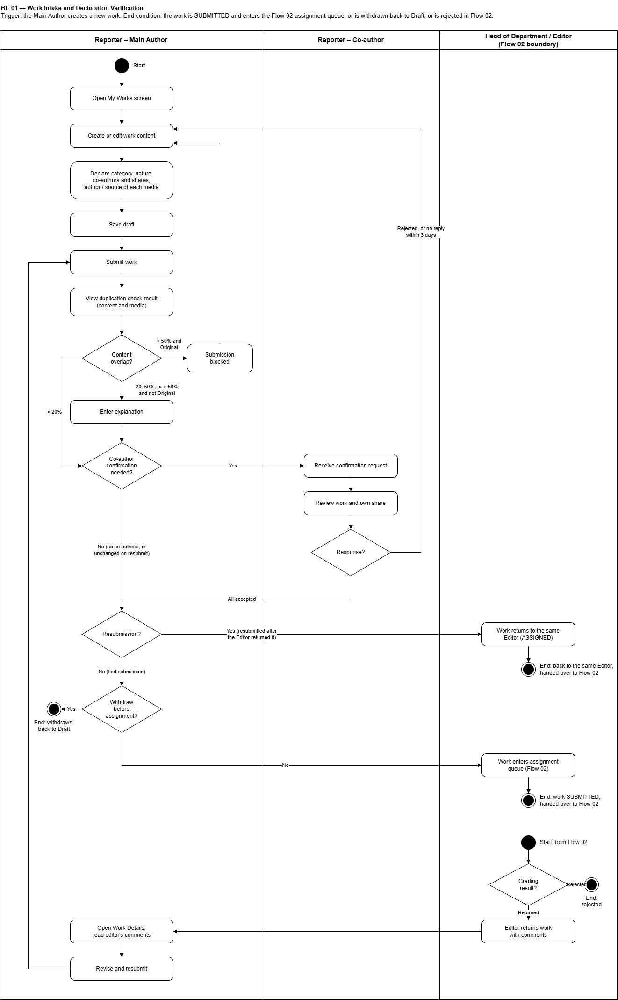
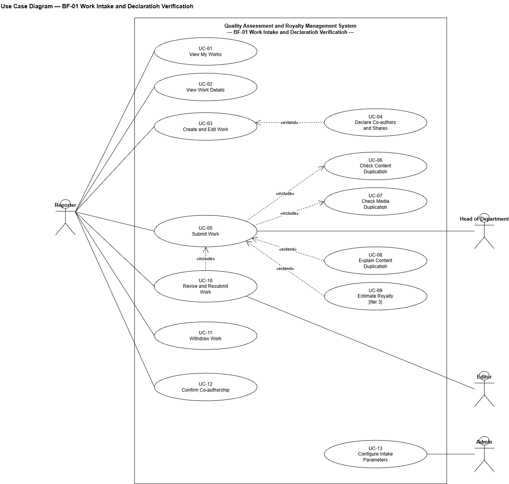

# SRS — BF-01 Viết và nộp bài (Work Intake and Declaration Verification)

> Chuyển từ `SRS.pdf`, đồng bộ lại theo bản SRS trên Google Docs ngày 2026-10-12. Luồng `article` (tiền tố class `Article`, `Duplication`). Đọc kèm `docs/SRS_Overview.md` (mục **Vấn đề đã biết**, GBR, Constraints) và `database/schema.sql`.

- **Trigger (mục 2.1):** Phóng viên tạo bài mới.
- **End condition (mục 2.1):** Bài ở trạng thái SUBMITTED và vào hàng chờ phân công của Flow 02; hoặc tác giả chính rút bài về DRAFT; hoặc bài bị từ chối ở Flow 02.
- **Theo swimlane:** *Trigger: the Main Author creates a new work. End condition: the work is SUBMITTED and enters the Flow 02 assignment queue, or is withdrawn back to Draft, or is rejected in Flow 02.*

> **Ghi chú (Vấn đề #1 — đã chốt):** `PENDING_CONFIRMATION` (UC-05, UC-10, UC-12) đã được thêm vào `ck_articles_status` trong `schema.sql`. Ngưỡng kiểm trùng trong `data.sql` đã sửa theo BR-IN-04/05: `DUP_WARN_PERCENT` = 20, `DUP_BLOCK_PERCENT` = 50, `DHASH_MAX_BITS` = 5, `SHINGLE_SIZE` = 5; kết quả kiểm trùng là `NORMAL` / `NEED_EXPLAIN` / `BLOCKED`.

## Swimlane

Mô tả sơ đồ (3 làn: Reporter – Main Author | Reporter – Co-author | Head of Department / Editor (Flow 02 boundary)):

1. Main Author: Open My Works screen → Create or edit work content → Declare category, nature, co-authors and shares, author / source of each media → Save draft → Submit work → View duplication check result (content and media).
2. Quyết định **Content overlap?**
   - `> 50% and Original` → Submission blocked → quay lại Create or edit work content.
   - `20–50%` → Enter explanation → sang bước 3.
   - `< 20%` → sang bước 3.
3. Quyết định **Co-author confirmation needed?**
   - Yes → Co-author: Receive confirmation request → Review work and own share → **Response?**
     - Rejected, or no reply within 3 days → quay lại Create or edit work content (bài về Draft).
     - All accepted → sang bước 4.
   - No (no co-authors, or unchanged on resubmit) → sang bước 4.
4. Quyết định **Withdraw before assignment?**
   - Yes → End: withdrawn, back to Draft.
   - No → Work enters assignment queue (Flow 02) → End: work SUBMITTED, handed over to Flow 02.
5. Start: from Flow 02 → **Grading result?**
   - Rejected → End: rejected.
   - Returned → Editor returns work with comments → Main Author: Open Work Details, read editor's comments → Revise and resubmit → quay lại Submit work.

## Use Case Diagram

- Reporter: UC-01, 02, 03, 05, 10, 11, 12.
- UC-04 Declare Co-authors and Shares «extend» UC-03 Create and Edit Work.
- UC-05 Submit Work «include» UC-06 Check Content Duplication, UC-07 Check Media Duplication.
- UC-08 Explain Content Duplication và UC-09 Estimate Royalty [Iter 3] «extend» UC-05.
- UC-10 Revise and Resubmit Work «include» UC-05; Editor liên quan UC-10.
- Head of Department liên quan UC-05 (nhận bài đã nộp).
- Admin: UC-13 Configure Intake Parameters.

## Use Cases (4.2.1 Work Intake and Declaration Verification)

Primary Actor: Reporter, Admin · 13 use cases · ID 01–13

| ID | Use Case | Feature | Use Case Description |
|---|---|---|---|
| 01 | View My Works | Work Management | The Reporter views all works where they are the main author or a co-author, filters by status, and sees works waiting for their confirmation. |
| 02 | View Work Details | Work Management | The Reporter views the content, the locked declarations, each co-author's confirmation status and the status history of a work. |
| 03 | Create and Edit Work | Work Management | The Reporter creates or edits a work in DRAFT status and declares its category, its nature (original / translation / compilation / repost) and the author or source of each image/video. |
| 04 | Declare Co-authors and Shares | Co-authorship | The main author adds up to 5 authors and sets each share; every share must be above 0% and the total must be 100%. |
| 05 | Submit Work | Work Submission | The Reporter submits the work; declarations are locked and duplication is checked. The work goes to PENDING_CONFIRMATION if it has co-authors, otherwise to SUBMITTED. |
| 06 | Check Content Duplication | Declaration Verification | The system compares the content with all non-draft works using 5-syllable shingles: under 20% is normal, 20–50% requires an explanation, over 50% with the "original" nature blocks submission. |
| 07 | Check Media Duplication | Declaration Verification | The system compares images by dHash (5 bits or less means duplicate) and videos by link or file hash; reused or external media receive no royalty. |
| 08 | Explain Content Duplication | Declaration Verification | The Reporter compares the overlapping passages side by side and enters an explanation when the overlap is between 20% and 50%. |
| 09 | Estimate Royalty | Work Submission | The Reporter previews the estimated royalty of the work before submitting, using the same calculation as BF-04 (Iteration 3). |
| 10 | Revise and Resubmit Work | Work Submission | The Reporter revises a returned work based on the Editor's feedback; content-only changes are resubmitted directly to the same Editor, while changes to authors or shares require confirmation again. |
| 11 | Withdraw Work | Work Management | The main author withdraws a submitted work before it is assigned to an Editor; the work returns to DRAFT. |
| 12 | Confirm Co-authorship | Co-authorship | A co-author accepts or rejects the declared share. The work becomes SUBMITTED when all co-authors accept, and returns to DRAFT if anyone rejects or does not reply within 3 days. |
| 13 | Configure Intake Parameters | Intake Configuration | The Admin sets the maximum authors per work, the confirmation deadline, the content duplication thresholds and the image-hash threshold. |

## Use cases full dressed (II.1.2.1 — Flow 1)

### UC-04: Declare Co-authors and Shares

| Field | Value |
|---|---|
| Actor | Reporter (main author) |
| Trigger | The main author opens the Co-authors section of a draft work and adds an author. |
| Preconditions | The work is DRAFT or REVISION_REQUESTED and the user is its main author. |
| Postconditions | The author list and shares are saved with the draft; each co-author is stored with confirmation status PENDING. Co-authors are not notified until the work is submitted. |
| Business Rules | BR-IN-01, 02, 05 |

**Normal Flow**
1. System shows the main author with a 100% share.
2. Main author selects a reporter as co-author and enters each share.
3. System checks the shares as they are typed and shows the running total (BR-IN-02).
4. Main author selects the author of each image/video from the author list (BR-IN-05).
5. Main author clicks Save draft; system saves the authors and shares.

**Alternative / Exceptions**
- A1 Main author removes a co-author: the share must be reassigned before saving.
- E1 Adding a 6th author: "A work can have at most 5 authors."
- E2 A share is 0% or the total is not 100%: "Each share must be above 0% and the total must be 100%." The draft cannot be submitted.

### UC-05: Submit Work

| Field | Value |
|---|---|
| Actor | Reporter (main author) |
| Trigger | The main author clicks Check & Submit on a draft work. |
| Preconditions | The work is DRAFT; title, content, category and nature are filled in; author shares are valid. |
| Postconditions | Declarations and the saturation rate are locked; duplication results are saved; the work is PENDING_CONFIRMATION (with co-authors) or SUBMITTED (single author); a status log entry is written. |
| Business Rules | BR-IN-02 … 06 |

**Normal Flow**
1. System checks the required fields and the author shares (BR-IN-02).
2. System runs the content duplication check (UC-06) and the media duplication check (UC-07) and shows the results (BR-IN-04, 05).
3. The highest overlap is under 20%: the Reporter clicks Confirm submit.
4. System locks the declarations and the saturation rate of the tagged event (BR-IN-03).
5. The work has co-authors: system sets PENDING_CONFIRMATION, notifies each co-author and sets the 3-day deadline (BR-IN-06).

**Alternative / Exceptions**
- A1 Overlap 20–50% (or above 50% with a nature other than Original): the Reporter compares the passages and enters an explanation (UC-08) before confirming.
- A2 Single-author work: system sets SUBMITTED directly and notifies the Head of Editorial Department.
- A3 Reused or external media: shown with 0 VND royalty; submission continues.
- A4 The Reporter previews the estimated royalty (UC-09) before confirming.
- E1 Overlap above 50% and nature Original: submission is blocked; the Reporter must change the content or the nature.
- E2 Missing field or invalid shares: system lists the errors; the work stays DRAFT.

### UC-10: Revise and Resubmit Work

| Field | Value |
|---|---|
| Actor | Reporter (main author) |
| Trigger | The main author opens a returned work and clicks Revise. |
| Preconditions | The work is REVISION_REQUESTED and has the Editor's comment. |
| Postconditions | A new version is saved; the work goes back to the same Editor (ASSIGNED), or to PENDING_CONFIRMATION if authors or shares changed. |
| Business Rules | BR-IN-03, 04, 05, 06, 07 |

**Normal Flow**
1. System shows the work with the Editor's general comment and the comments on criteria scored below 50.
2. Reporter edits the content.
3. Reporter clicks Resubmit; system runs the duplication checks again (BR-IN-04, 05).
4. Only the content changed: system saves a new version, sets the work back to ASSIGNED for the same Editor and notifies the Editor (BR-IN-07).

**Alternative / Exceptions**
- A1 Authors or shares changed: system sets PENDING_CONFIRMATION and all co-authors confirm again (UC-12).
- A2 Overlap 20–50%: the Reporter enters an explanation (UC-08).
- E1 Overlap above 50% and nature Original: resubmission is blocked.
- E2 The work is REJECTED: it cannot be revised.

> **Ghi chú (đã chốt 2026-10-12, người phụ trách BF-01):** A1 — khi tất cả đồng tác giả xác nhận lại xong, bài **về `ASSIGNED` cho đúng Biên tập viên cũ** (theo BR-IN-07), không về `SUBMITTED` để Trưởng ban phân công lại. Nhận biết bài nộp lại: bài đã có dòng trong `assignments`.

### UC-12: Confirm Co-authorship

| Field | Value |
|---|---|
| Actor | Reporter (co-author) · System (Timer) |
| Trigger | The co-author opens a work from "Waiting for my confirmation" or from the notification. |
| Preconditions | The work is PENDING_CONFIRMATION; the user is a co-author of the work with confirmation status PENDING; the 3-day confirmation deadline has not passed. |
| Postconditions | The answer is recorded. All accepted: the work is SUBMITTED. One rejected or deadline passed: the work returns to DRAFT. |
| Business Rules | BR-IN-06 |

**Normal Flow**
1. System shows the work (read-only), all authors and shares, the images/videos authored by this co-author and the time left.
2. Co-author clicks Accept.
3. System records ACCEPTED with the time.
4. All co-authors have accepted: system sets SUBMITTED, writes the status log and notifies the main author and the Head of Editorial Department (BR-IN-06).

**Alternative / Exceptions**
- A1 Co-author clicks Reject with a mandatory reason: the work returns to DRAFT, the other answers are cleared and the main author is notified with the reason.
- A2 No reply within 3 days: the scheduled job returns the work to DRAFT and notifies all authors.
- E1 The co-author has already answered or the work is no longer pending: the work is shown read-only.

> **Ghi chú (đã chốt 2026-10-12):** bước 4 "system sets SUBMITTED" áp dụng cho lần nộp đầu. Nếu đợt xác nhận này đến từ nộp lại có đổi tác giả/tỷ lệ (UC-10 A1) thì tất cả đồng ý → bài về `ASSIGNED` cho đúng Biên tập viên cũ (BR-IN-07).

UC-01, 02, 03, 06, 07, 08, 09, 11, 13 chỉ có mô tả trong bảng Use Cases ở trên.

## Business Rules for Work Intake (BR-IN)

> **Ghi chú (Vấn đề #3 — đã sửa):** bản PDF cũ in bảng này với mã `BR-RY-01…08`; bản SRS trên Google đã đổi thành `BR-IN-01…08`, khớp với tham chiếu trong UC-04/05/10/12.

| BR-ID | Rule |
|---|---|
| BR-IN-01 | Only the main author creates and edits a work, and only while it is DRAFT or REVISION_REQUESTED; co-authors can only view it. |
| BR-IN-02 | A work has at most 5 authors (parameter) and exactly one main author; every share is above 0% and the total is 100%. |
| BR-IN-03 | Category, nature, authors and shares, media authors/sources and the event saturation rate (100% / 80% / 60%) are locked when the work is submitted; they change only through Revise and Resubmit. |
| BR-IN-04 | Content duplication = coverage of 5-syllable shingles against all non-draft works: under 20% normal, 20–50% explanation required, above 50% with nature Original blocked. The check runs before co-author confirmation. |
| BR-IN-05 | Images match when their dHash differs by 5 bits or less; a match with an image already paid is reused and gets no royalty. Videos match by link or file hash. External media get no royalty. Each media author must be one of the work's authors. |
| BR-IN-06 | Every co-author must accept within 3 days; when all accept the work becomes SUBMITTED. One rejection or no reply within 3 days returns the work to DRAFT. |
| BR-IN-07 | Resubmission with content-only changes goes directly back to the same Editor; changes to authors or shares require confirmation again. The saturation rate locked at the first submission is kept. |
| BR-IN-08 | The main author may withdraw a SUBMITTED work only before an Editor is assigned; it returns to DRAFT. A REJECTED work is final. |

## Luật chung liên quan

GBR-01 (tối đa 5 tác giả, tổng 100%), GBR-02 (trùng lặp nội dung/ảnh), GBR-03 (đồng tác giả xác nhận trong 3 ngày) — xem `SRS_Overview.md`.
