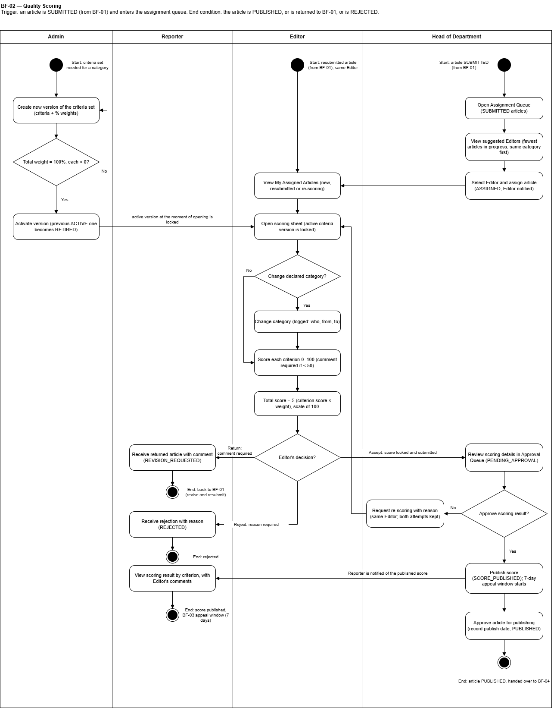
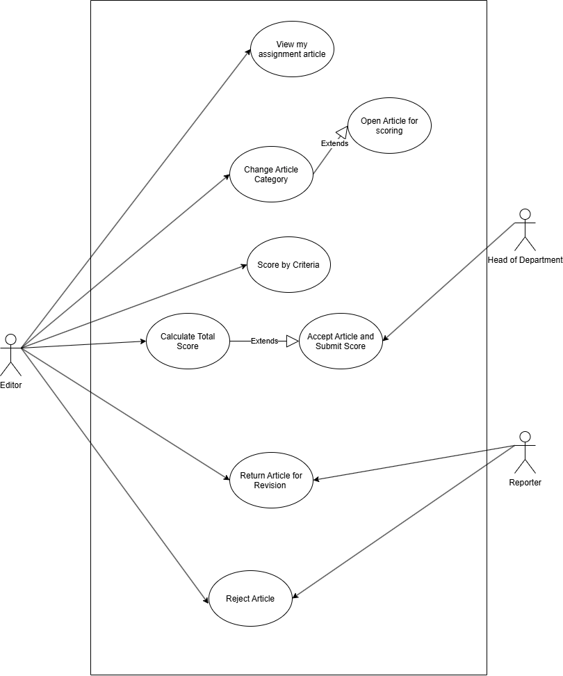

# SRS — BF-02 Chấm điểm & xếp loại chất lượng (Quality Scoring)

> Chuyển từ `SRS.pdf`. Package code: `assessment` (chấm điểm). Duyệt đăng UC-33 cũng thuộc luồng này (đã chốt, Vấn đề #5 trong `SRS_Overview.md`). Đọc kèm `docs/SRS_Overview.md` và `database/schema.sql`.

- **Trigger (mục 2.2):** Bài chuyển sang PUBLISHED, trưởng ban phân công người chấm.
- **End condition (mục 2.2):** Bài được chốt hạng A, B, C hoặc D.
- **Theo swimlane:** *Trigger: an article is SUBMITTED (from BF-01) and enters the assignment queue. End condition: the article is PUBLISHED, or is returned to BF-01, or is REJECTED.*

> **Ghi chú:** mục 2.2 và swimlane mâu thuẫn nhau (Vấn đề #8). UC chi tiết bên dưới đi theo swimlane.
> UC-27 ghi decision `RETURN`, nhưng `schema.sql` dùng `REVISION` (Vấn đề #2).

## Swimlane

Mô tả sơ đồ (4 làn: Admin | Reporter | Editor | Head of Department):

- **Admin** (Start: criteria set needed for a category): Create new version of the criteria set (criteria + % weights) → **Total weight = 100%, each > 0?** No → sửa lại; Yes → Activate version (previous ACTIVE one becomes RETIRED). Phiên bản ACTIVE tại thời điểm Editor mở phiếu chấm sẽ bị khoá cho lần chấm đó.
- **Head of Department** (Start: article SUBMITTED from BF-01): Open Assignment Queue (SUBMITTED articles) → View suggested Editors (fewest articles in progress, same category first) → Select Editor and assign article (ASSIGNED, Editor notified).
- **Editor** (Start khác: resubmitted article from BF-01, same Editor): View My Assigned Articles (new, resubmitted or re-scoring) → Open scoring sheet (active criteria version is locked) → **Change declared category?** Yes → Change category (logged: who, from, to) → Score each criterion 0–100 (comment required if < 50) → Total score = Σ (criterion score × weight), scale of 100 → **Editor's decision?**
  - Return (comment required) → Reporter: Receive returned article with comment (REVISION_REQUESTED) → End: back to BF-01 (revise and resubmit).
  - Reject (reason required) → Reporter: Receive rejection with reason (REJECTED) → End: rejected.
  - Accept (score locked and submitted) → Head: Review scoring details in Approval Queue (PENDING_APPROVAL) → **Approve scoring result?**
    - No → Request re-scoring with reason (same Editor; both attempts kept) → quay lại Open scoring sheet.
    - Yes → Publish score (SCORE_PUBLISHED); 7-day appeal window starts → Reporter is notified → Reporter: View scoring result by criterion, with Editor's comments → End: score published, BF-03 appeal window (7 days).
    - Head tiếp tục: Approve article for publishing (record publish date, PUBLISHED) → End: article PUBLISHED, handed over to BF-04.

## Use Case Diagram

- Editor: View my assignment article, Change Article Category, Score by Criteria, Calculate Total Score, Return Article for Revision, Reject Article.
- Change Article Category «extends» Open Article for scoring.
- Calculate Total Score «extends» Accept Article and Submit Score.
- Head of Department liên quan Accept Article and Submit Score; Reporter liên quan Return Article for Revision và Reject Article.

## Use Cases (4.2.2 Editor Scoring)

Actor chính: Editor · 21 use case · ID 14-34

| ID | Use Case | Feature | Use Case Description |
|---|---|---|---|
| 14 | View Criteria Sets | Criteria Management | The Admin views the criteria sets of every category, with version number, status (DRAFT / ACTIVE / RETIRED) and the weight of each criterion. |
| 15 | Create Criteria Set Version | Criteria Management | The Admin creates a new version of the criteria set of a category (criterion names and percentage weights). A version that has been used is never edited; a change always creates a new version. |
| 16 | Validate Total Criteria Weight | Criteria Management | The system checks that the weights of all criteria in a version add up to 100% (each weight > 0) before the version can be saved. |
| 17 | Activate Criteria Set Version | Criteria Management | The Admin sets a saved version as the active version of its category. The version used for a scoring is the one active at the moment the Editor opens the scoring sheet. |
| 18 | View Assignment Queue | Assignment | The Head of Department views the articles in SUBMITTED status that are waiting for an Editor, with category, author and submission date. |
| 19 | View Suggested Editors | Assignment | The system suggests Editors for an article: those currently scoring the fewest articles first, with priority to Editors who have already scored the same category. |
| 20 | Assign Editor to Article | Assignment | The Head of Department selects an Editor for the article. The system saves the assignment, changes the status to ASSIGNED and notifies the Editor. |
| 21 | View My Assigned Articles | Scoring | The Editor views the articles assigned to them, including articles returned to them for re-scoring, with status and assignment date. |
| 22 | Open Article for Scoring | Scoring | The Editor opens an assigned article and its scoring sheet. The system loads the criteria set version that is active at that moment and locks it for this scoring. |
| 23 | Change Article Category | Scoring | Before scoring, the Editor may change the category the Reporter declared. The system logs who changed it, from which category and to which. After scoring, the category is locked. |
| 24 | Score by Criteria | Scoring | The Editor enters a score (0–100) for each criterion of the sheet. A comment is mandatory for every criterion scored below 50. |
| 25 | Calculate Total Score | Scoring | The system calculates the total score of the article = Σ (criterion score × criterion weight), on a scale of 100. |
| 26 | Accept Article and Submit Score | Scoring | The Editor chooses Accept and submits the scoring sheet. The system saves the scoring attempt, locks it and changes the status to PENDING_APPROVAL. |
| 27 | Return Article for Revision | Scoring | The Editor returns the article to the Reporter with a mandatory comment. The system saves the attempt, changes the status to REVISION_REQUESTED and notifies the Reporter (back to Flow 01). |
| 28 | Reject Article | Scoring | The Editor rejects the article with a mandatory reason. The system saves the attempt, changes the status to REJECTED (final) and notifies the Reporter. |
| 29 | View Approval Queue | Score Approval | The Head of Department views the scoring results waiting for approval (status PENDING_APPROVAL). |
| 30 | Review Scoring Details | Score Approval | The Head of Department opens a scoring result to see the score of each criterion, the comments and the total score before deciding. |
| 31 | Approve Scoring Result | Score Approval | The Head of Department approves the scoring result. The system publishes the score (status SCORE_PUBLISHED), starts the 7-day complaint deadline (Flow 03) and notifies the Reporter. |
| 32 | Request Re-scoring | Score Approval | The Head of Department does not approve the score and sends the article back to the same Editor with a reason. The new score replaces the old one; both attempts are kept. |
| 33 | Approve Article for Publishing | Publishing | The Head of Department approves the article for publishing. The system records the publish date (status PUBLISHED). This date decides the unit rate and the payment deadline in Flow 04. |
| 34 | View Scoring Result by Criterion | Score Viewing | The main author or a co-author views the published score of their article, criterion by criterion, with the Editor's comments. |

## Use cases full dressed (II.1.2.2 — Flow 2)

### UC-15: Create Criteria Set Version

| Field | Value |
|---|---|
| Actor | Admin |
| Trigger | The Admin opens the criteria set of a category and clicks Create New Version. |
| Preconditions | The user is authenticated with the Admin role; the category exists. |
| Postconditions | A new version is saved as DRAFT with the next version number of the category. Existing versions are not changed. |
| Business Rules | BR-SC-01, 02 |

**Normal Flow**
1. System shows the current ACTIVE version of the category (criterion names and weights) as a starting point (UC-14).
2. Admin adds, removes or renames criteria and enters the percentage weight of each criterion.
3. System shows the running total of the weights while the Admin types (UC-16, BR-SC-01).
4. Admin clicks Save; system saves the version as DRAFT.

**Alternative / Exceptions**
- A1 Admin edits a DRAFT version that has never been used: the changes are saved on the same version.
- A2 Admin clicks Activate after saving: the version becomes ACTIVE and the previous ACTIVE version becomes RETIRED (UC-17, BR-SC-02).
- A3 Admin cancels: the unsaved changes are discarded.
- E1 A weight is 0% or the total is not 100%: "Each weight must be above 0% and the total must be 100%." The version is not saved.
- E2 Admin tries to edit a version that has already been used in a scoring: the edit is refused and the system offers to create a new version instead (BR-SC-02).

### UC-20: Assign Editor to Article

| Field | Value |
|---|---|
| Actor | Head of Editorial Department |
| Trigger | The Head of Department selects an article from the assignment queue (UC-18) and clicks Assign. |
| Preconditions | The article is SUBMITTED and has not been assigned to an Editor. |
| Postconditions | The assignment is saved (Editor, assigning Head, time, and whether the Editor was one of the suggestions); the article is ASSIGNED; the Editor is notified; a status log entry is written. |
| Business Rules | BR-SC-04 |

**Normal Flow**
1. System shows the article (title, category, author, submission date) and the suggested Editors (UC-19, BR-SC-04).
2. Head of Department selects an Editor from the list.
3. Head of Department clicks Assign.
4. System saves the assignment, sets the article to ASSIGNED, writes the status log and notifies the Editor.

**Alternative / Exceptions**
- A1 Head of Department selects an Editor who is not in the suggestions: the assignment is allowed and is marked as manual.
- A2 A returned article that the Reporter resubmits goes back to the same Editor automatically; no new assignment is needed (UC-10).
- E1 The article was withdrawn or is already assigned: "This article is no longer waiting for assignment."
- E2 The selected Editor account is LOCKED: the Editor cannot be selected.

### UC-24: Score by Criteria

| Field | Value |
|---|---|
| Actor | Editor |
| Trigger | The Editor opens an assigned article from "My Assigned Articles" (UC-21) and starts scoring. |
| Preconditions | The article is ASSIGNED to this Editor; the category of the article has an ACTIVE criteria set version. |
| Postconditions | The score and comment of each criterion and the total score are kept on the scoring attempt, which is not yet locked. |
| Business Rules | BR-SC-03, 05, 06, 07, 08 |

**Normal Flow**
1. System shows the article (content, declared category, nature, authors) and the scoring sheet. System loads the criteria set version that is ACTIVE at this moment and locks it for this scoring (UC-22, BR-SC-03).
2. Editor enters a score from 0 to 100 for each criterion.
3. For every criterion scored below 50, Editor enters a comment (BR-SC-06).
4. System recalculates the total score after each entry: Σ (criterion score × criterion weight), on a scale of 100 (UC-25, BR-SC-07).
5. Editor reviews the total and chooses Accept (UC-26), Return (UC-27) or Reject (UC-28).

**Alternative / Exceptions**
- A1 Before scoring, Editor changes the category declared by the Reporter: system logs who changed it, from which category and to which, and loads the ACTIVE version of the new category (UC-23, BR-SC-05).
- A2 Re-scoring after the Head of Department's request (UC-32) or after the Reporter resubmitted: system opens a new scoring attempt on the latest version of the article, shows the previous attempt as read-only, and the category cannot be changed (BR-SC-05, 08).
- E1 A score is outside 0–100: "A score must be between 0 and 100."
- E2 A criterion below 50 has no comment: "A comment is required for every criterion scored below 50."
- E3 The category has no ACTIVE version: "No active criteria set for this category. Please contact the Admin."

### UC-26: Accept Article and Submit Score

| Field | Value |
|---|---|
| Actor | Editor |
| Trigger | The Editor has scored every criterion and clicks Accept and Submit. |
| Preconditions | The article is ASSIGNED to this Editor; every criterion has a score; every score below 50 has a comment. |
| Postconditions | The scoring attempt is saved and locked with decision ACCEPT; the article is PENDING_APPROVAL; a status log entry is written; the result appears in the approval queue of the Head of Department (UC-29). |
| Business Rules | BR-SC-06, 08, 09 |

**Normal Flow**
1. System shows a summary: the score and comment of each criterion and the total score.
2. Editor clicks Accept.
3. System checks that all criteria are scored and all required comments are entered (BR-SC-06).
4. System saves the attempt (article version, Editor, criteria version, scores, total score, time) and locks it (BR-SC-08).
5. System sets the article to PENDING_APPROVAL and writes the status log.

**Alternative / Exceptions**
- A1 Editor chooses Return instead: the flow continues in UC-27.
- A2 Editor chooses Reject instead (UC-28): a mandatory reason is entered, the attempt is saved and locked, the article becomes REJECTED (final) and the Reporter is notified (BR-SC-09).
- E1 A criterion is not scored or a required comment is missing: system lists the missing items; the attempt stays open.
- E2 The attempt is already locked: it is shown read-only and cannot be changed.

### UC-27: Return Article for Revision

| Field | Value |
|---|---|
| Actor | Editor · Reporter (notified) |
| Trigger | The Editor clicks Return while scoring an article. |
| Preconditions | The article is ASSIGNED to this Editor; every criterion has a score and every score below 50 has a comment. |
| Postconditions | The scoring attempt is saved and locked with decision RETURN and the Editor's general comment; the article is REVISION_REQUESTED; the Reporter is notified; a status log entry is written. The flow continues in BF-01 (UC-10). |
| Business Rules | BR-SC-08, 09 |

**Normal Flow**
1. Editor clicks Return.
2. System asks for a general comment.
3. Editor enters the comment and confirms.
4. System saves and locks the attempt (BR-SC-08), sets the article to REVISION_REQUESTED, writes the status log and notifies the Reporter with the general comment and the comments on criteria scored below 50 (BR-SC-09).

**Alternative / Exceptions**
- A1 Editor cancels: the attempt stays open and the article stays ASSIGNED.
- A2 The Reporter revises and resubmits: the article goes back to the same Editor as ASSIGNED and a new scoring attempt is opened (UC-10, UC-24 A2).
- E1 No comment entered: "A comment is required to return an article."

### UC-31: Approve Scoring Result

| Field | Value |
|---|---|
| Actor | Head of Editorial Department |
| Trigger | The Head of Department opens a scoring result from the approval queue (UC-29), reviews it (UC-30) and clicks Approve. |
| Preconditions | The article is PENDING_APPROVAL and its scoring attempt is locked. |
| Postconditions | The score is published (SCORE_PUBLISHED); the approval is recorded with the approver and the time; the 7-day complaint deadline starts (BF-03); the Reporter is notified; a status log entry is written. |
| Business Rules | BR-SC-08, 10 |

**Normal Flow**
1. System shows the score and comment of each criterion, the total score, the Editor, the criteria version and the attempt number (and the previous attempt when it is a re-scoring).
2. Head of Department reviews the result.
3. Head of Department clicks Approve.
4. System records the approval, sets the article to SCORE_PUBLISHED, starts the 7-day complaint deadline (BR-SC-10), writes the status log and notifies the Reporter, who can then view the result by criterion (UC-34).

**Alternative / Exceptions**
- A1 Head of Department does not approve and clicks Request Re-scoring with a mandatory reason (UC-32): the article goes back to the same Editor as ASSIGNED, the Editor is notified, and the new score replaces the old one; both attempts are kept (BR-SC-08, 10).
- A2 After approving, Head of Department can continue with UC-33.
- E1 The result has already been processed: "This scoring result has already been decided."
- E2 Request Re-scoring without a reason: "A reason is required."

### UC-33: Approve Article for Publishing

| Field | Value |
|---|---|
| Actor | Head of Editorial Department |
| Trigger | The Head of Department selects an article with a published score and clicks Approve for Publishing. |
| Preconditions | The article has a published scoring result; the appeal deadline has not expired. The article may be in SCORE_PUBLISHED or PUBLISHED status. |
| Postconditions | The article is PUBLISHED; the publish date and the approver are recorded; a status log entry is written; the article becomes available for royalty grading in BF-04. |
| Business Rules | BR-SC-11 |

**Normal Flow**
1. System lists the articles in SCORE_PUBLISHED with title, category, authors and total score.
2. Head of Department selects an article and checks it.
3. Head of Department clicks Approve for Publishing.
4. System records the publish date and the approver, sets the article to PUBLISHED and writes the status log (BR-SC-11).
5. System adds the article to the pending grading list of the royalty period of its publish month (BF-04).

**Alternative / Exceptions**
- A1 Head of Department leaves the article for later: it stays SCORE_PUBLISHED.
- E1 The article is not SCORE_PUBLISHED (for example it was sent back for re-scoring): "Only articles with a published score can be approved for publishing."

UC-14, 16, 17, 18, 19, 21, 22, 23, 25, 28, 29, 30, 32, 34 chỉ có mô tả trong bảng Use Cases ở trên.

## Business Rules for Scoring (BR-SC)

> **Ghi chú (Vấn đề #4):** PDF **không có** bảng định nghĩa BR-SC. Bảng dưới do người chuyển đổi **tổng hợp lại từ chính các UC** có tham chiếu mã đó, không thêm luật mới. Khi nhóm có bảng BR-SC chính thức thì thay bảng này.

| BR-ID | Nội dung (suy ra từ UC) | Nguồn |
|---|---|---|
| BR-SC-01 | Weights of all criteria in a version add up to 100%, each weight > 0. | UC-15, UC-16 |
| BR-SC-02 | A version that has been used is never edited; a change creates a new version. Activating a version makes the previous ACTIVE version RETIRED. | UC-15, UC-17 |
| BR-SC-03 | The criteria set version ACTIVE when the Editor opens the scoring sheet is locked for that scoring. | UC-22, UC-24 |
| BR-SC-04 | Suggested Editors: fewest articles currently being scored first, priority to Editors who already scored the same category. Choosing a non-suggested Editor is allowed and marked manual. | UC-19, UC-20 |
| BR-SC-05 | The Editor may change the declared category only before scoring; the change is logged (who, from, to). On re-scoring the category cannot be changed. | UC-23, UC-24 |
| BR-SC-06 | Each criterion is scored 0–100; a comment is mandatory for every criterion scored below 50. | UC-24, UC-26 |
| BR-SC-07 | Total score = Σ (criterion score × criterion weight), scale of 100. | UC-25, UC-24 |
| BR-SC-08 | A submitted scoring attempt is locked; re-scoring creates a new attempt, the new score replaces the old one and all attempts are kept. | UC-24, 26, 27, 31 |
| BR-SC-09 | Return requires a general comment (article → REVISION_REQUESTED); Reject requires a reason (article → REJECTED, final). The Reporter is notified. | UC-26, UC-27, UC-28 |
| BR-SC-10 | Approving publishes the score (SCORE_PUBLISHED) and starts the 7-day appeal window; Request Re-scoring requires a reason and goes back to the same Editor. | UC-31, UC-32 |
| BR-SC-11 | Approve for Publishing records the publish date and approver (PUBLISHED); the publish date decides the unit price and royalty period in BF-04. | UC-33 |

## Luật chung liên quan

GBR-04 (tổng trọng số 100%, khoá phiên bản khi mở phiếu), GBR-05 (tiêu chí < 50 bắt buộc nhận xét; bài bị REJECTED không tính nhuận bút) — xem `SRS_Overview.md`.

## Mockup liên quan

`srs-images/mockup-03.png` (hàng chờ phân công), `mockup-04.png` (chỉ định BTV), `mockup-05.png` (phiếu chấm — lưu ý thang điểm trong mockup khác SRS), `mockup-06.png`, `mockup-07.png` (duyệt xuất bản).
