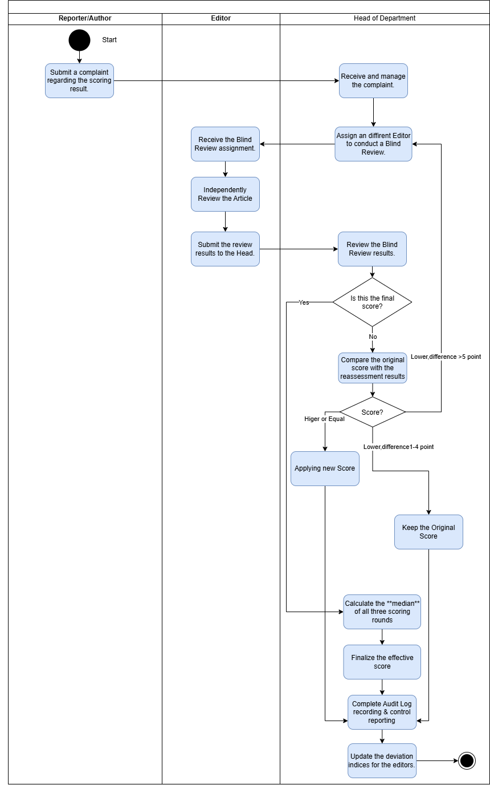
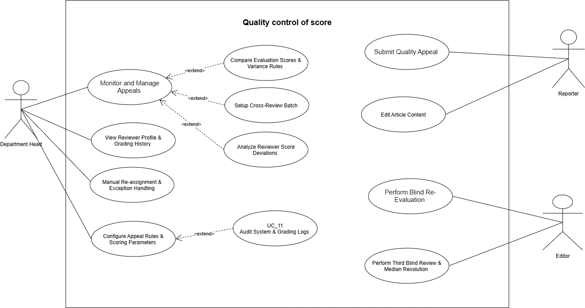

# SRS — BF-03 Kiểm soát chất lượng chấm (Quality control of scores)

> Chuyển từ `SRS.pdf`. Đọc kèm `docs/SRS_Overview.md` và `database/schema.sql` (bảng `appeals`, `appeal_criteria`, `appeal_resolutions`, `appeal_rule_configs`, `cross_review_batches`, `cross_review_tasks`, `reviewer_deviation_indices`, `audit_logs`).
>
> **Ghi chú (Vấn đề #5 — đã chốt):** BF-03 là luồng `appeal` (khiếu nại / chấm mù dưới đây), tiền tố class `Appeal`, `CrossReview`, `ReviewerDeviation`. Duyệt đăng (UC-33) thuộc `assessment` (BF-02). Xem `AGENTS.md` mục 2.

> **Phạm vi tài liệu:** file này đặc tả nghiệp vụ BF-03 và các điểm tích hợp cần có với BF-01, BF-02, BF-04, BF-05. Các điểm tích hợp được mô tả để các luồng dùng cùng một quy tắc; file này không thay thế tài liệu hoặc schema thuộc luồng khác.

**Các quyết định nghiệp vụ đã chốt cho BF-03:**

- Chỉ **tác giả chính** (`articles.author_id`) được gửi khiếu nại. Đồng tác giả được xem kết quả nhưng không được dùng lượt khiếu nại của bài.
- Bài được khiếu nại khi đã công bố điểm, ở trạng thái `SCORE_PUBLISHED` hoặc `PUBLISHED`.
- Hạn khiếu nại tính từ `score_approvals.announced_at`. Gửi đúng thời điểm hết hạn vẫn hợp lệ; sau thời điểm đó bị từ chối.
- Người chấm mù không được thấy tiêu chí bị khiếu nại hoặc lý do khiếu nại, ngoài các dữ liệu đã bị ẩn theo BR-QC-03.
- Hệ thống tính kết quả đề xuất; Trưởng ban là người xác nhận và hoàn tất khiếu nại.
- Một khiếu nại có nhiều nhất **hai đợt chấm lại**: `S1` là điểm chấm lại lần 1, `S2` là điểm chấm lại lần 2. `S0` là điểm gốc đã công bố và không tính là một đợt chấm lại.
- Cả `S0`, `S1`, `S2` dùng cùng phiên bản bài, thể loại, bộ tiêu chí và trọng số; mỗi tiêu chí và tổng điểm đều theo thang 0–100.
- Nếu `ABS(S1 - S0) <= T`, điểm đề xuất cuối là `S1`. Nếu `ABS(S1 - S0) > T`, bắt buộc có `S2` và dùng quy tắc trọng tài `S2` tại BR-QC-07.
- Điểm cuối có thể tăng hoặc giảm so với `S0`; không có sàn bảo vệ điểm gốc. Điểm không được trung vị chọn chỉ được coi là **điểm lệch so với nhóm** để tính kết quả, không tự động kết luận người chấm vi phạm.

- **Trigger (mục 2.3):** Phóng viên gửi khiếu nại.
- **End condition (mục 2.3):** Nhận khiếu nại và chấm lại, sau đó cập nhật chỉ số.

## Swimlane

Mô tả sơ đồ (3 làn: Reporter/Author | Editor | Head of Department):

1. Reporter: Submit a complaint regarding the scoring result.
2. Head: Receive and manage the complaint → Assign a different Editor to conduct a Blind Review.
3. Editor: Receive the Blind Review assignment → Independently Review the Article → Submit the review results to the Head.
4. Head: Review the Blind Review results → **Is this the final score?**
   - Chỉ có `S0` và `S1`: nếu `ABS(S1 - S0) <= T` → dùng `S1`; nếu lớn hơn `T` → quay lại bước 2 để giao BTV thứ ba thực hiện đợt chấm lại lần 2 (`S2`).
   - Đã có `S2` → điểm đề xuất là trung vị của `S0`, `S1`, `S2`, tức `S2` kẹp vào khoảng từ `min(S0, S1)` đến `max(S0, S1)`.
5. Mọi nhánh → Complete Audit Log recording & control reporting → Update the deviation indices for the editors → End.

> **Quy tắc chốt:** `T` là `variance_threshold` của cấu hình được gắn với khiếu nại, giá trị nghiệp vụ mặc định là 5 điểm. Chênh lệch được lấy theo trị tuyệt đối nên cả trường hợp tăng và giảm quá `T` đều phát sinh `S2`. Nếu chênh lệch đúng bằng `T` thì dùng `S1` và không chấm lại lần 2. Kiểm tra ngày 26/10/2026: `database/data.sql` đã đặt mặc định 5 điểm; cấu hình cũ gắn với từng appeal vẫn được giữ nguyên.

## Use Case Diagram

- Department Head: Monitor and Manage Appeals, View Reviewer Profile & Grading History, Manual Re-assignment & Exception Handling.
- Admin: Configure Appeal Rules & Scoring Parameters. Ảnh use-case gốc gắn UC-44 với Department Head, nhưng đặc tả BF-03 giao cho Admin vì `appeal_rule_configs` là cấu hình toàn hệ thống, không có `section_id`.
- «extend» Monitor and Manage Appeals: Compare Evaluation Scores & Variance Rules, Setup Cross-Review Batch, Analyze Reviewer Score Deviations.
- «extend» Configure Appeal Rules & Scoring Parameters: Audit System & Grading Logs.
- Reporter: Submit Quality Appeal. "Edit Article Content" trong ảnh là UC-10 của BF-01, không phải chức năng của BF-03.
- Editor: Perform Blind Re-Evaluation, Perform Second Re-Evaluation & Third-Reviewer Arbitration.

## Use Cases (4.2.3)

Actor chính: Reporter, Head of ED, Editor · 11 use case · ID 35–45

| ID | Use Case | Feature | Use Case Description |
|---|---|---|---|
| 35 | Submit Quality Appeal | Submit & Track Appeal | Allows the main author to submit one formal quality appeal for an article within the configured number of days after `score_approvals.announced_at`, requiring specific criteria selection and detailed reasoning |
| 36 | Perform Blind Re-Evaluation | Re-evaluation Scorecard - Blind Review | Assigned editor conducts an independent blind re-grading without seeing prior scores or comments, applying the same criteria version and category as the initial evaluation |
| 37 | Perform Second Re-Evaluation & Third-Reviewer Arbitration | Re-evaluation Scorecard - Blind Review | Triggered when the absolute difference between `S0` and `S1` exceeds the bound threshold `T`, requiring a second re-evaluation by a third independent Editor and Head confirmation of the `S2` arbitration result |
| 38 | Monitor and Manage Appeals | Complaint List & Management | Enables Department Head to monitor all submitted quality appeals, oversee reviewer assignments, and track resolution workflows |
| 39 | Compare Evaluation Scores & Variance Rules | Score Comparison & Evaluation Detail | Displays detailed comparison across evaluation rounds and applies decision rules to finalize the effective score |
| 40 | Setup Cross-Review Batch | Setup Cross-Review Batch | Configures peer cross-review campaigns to measure reviewer grading variance. Scores from cross-reviews are strictly analytical and do not alter official article scores |
| 41 | Analyze Reviewer Score Deviations | Reviewer Score Deviation Report | Generates analytical reporting on reviewer grading consistency, updating deviation indices to maintain grading quality control |
| 42 | View Reviewer Profile & Grading History | Reviewer Profile / Details | Displays comprehensive profiles and grading history of editors, tracking evaluation reliability, past appeal rates, and workload distribution |
| 43 | Manual Re-assignment & Exception Handling | Manual Re-assignment / Exception | Allows the Head to reassign an unfinished blind review or select an eligible cross-department Editor when the home department has no eligible Editor; a reason and audit entry are mandatory |
| 44 | Configure Appeal Rules & Scoring Parameters | Configure Appeal Rules & Scoring Scale | Allows the Admin to create a new effective-dated appeal-rule version; existing versions and in-progress appeal rules are not edited retroactively |
| 45 | Audit System & Grading Logs | System Audit Log / Grading Audit Log | Allows authorized users to inspect immutable appeal and grading audit records without exposing hidden information to blind reviewers |

## Use cases full dressed (II.1.2.3 — Flow 3)

### UC-35: Submit Quality Appeal

| Field | Value |
|---|---|
| Actor | Reporter (main author of the article) |
| Trigger | The Reporter opens a published scoring result and clicks Submit Appeal. |
| Preconditions | The Reporter is `articles.author_id`; the article is SCORE_PUBLISHED or PUBLISHED; the appealed scoring attempt has an APPROVED `score_approvals` record with `announced_at`; the configured appeal window has not expired; no appeal has previously been submitted for this article. |
| Postconditions | A quality appeal is saved as SUBMITTED; the selected disputed criteria and detailed reason are recorded; the Head of Editorial Department is notified; an audit log entry is written. |
| Business Rules | BR-QC-01, 02 |

**Normal Flow**
1. System shows the published result by criterion, the Editor's comments, the publication time of the score, and the remaining appeal time.
2. Reporter selects one or more disputed criteria and enters a detailed reason for each disputed item.
3. Reporter clicks Submit Appeal.
4. System validates that the current user is the main author, the article status is eligible, and `currentTime <= announced_at + appeal_window_days`.
5. System validates the one-appeal limit and verifies that every selected criterion belongs to the `criteria_set_version_id` of the appealed scoring attempt (BR-QC-01, 02).
6. System binds the active appeal-rule version, saves the appeal as SUBMITTED, writes the audit log, and notifies the Head of Editorial Department.

**Alternative / Exceptions**
- A1 Reporter cancels before submitting: no appeal is created.
- E1 The appeal window has expired: "Thời hạn khiếu nại đã kết thúc."
- E2 An appeal already exists for the article: "Mỗi bài viết chỉ được khiếu nại một lần."
- E3 No criterion is selected or a reason is blank: "Phải chọn ít nhất một tiêu chí và nhập lý do cho từng tiêu chí."
- E4 A co-author or another Reporter attempts to submit: "Chỉ tác giả chính được gửi khiếu nại."
- E5 A selected criterion does not belong to the appealed scorecard: "Tiêu chí khiếu nại không thuộc phiếu chấm đã công bố."

### UC-36: Perform Blind Re-Evaluation

| Field | Value |
|---|---|
| Actor | Assigned Editor |
| Trigger | The assigned Editor opens a blind re-evaluation task. |
| Preconditions | The appeal is IN_REVIEW; the Editor is ACTIVE, is assigned to this appeal, has not performed an earlier evaluation of this appeal, and the appealed article version and criteria set version are available. |
| Postconditions | The first re-evaluation attempt (`S1`) is saved and locked; the system records its total score and sends the result to variance comparison in UC-39; prior scores and comments remain hidden from the Editor. |
| Business Rules | BR-QC-03, 04, 05, 09 |

**Normal Flow**
1. System shows the appealed article version and the same category and criteria set version used in the original scoring, but hides all previous scores, comments, reviewer identities, comparison results, disputed criteria, appeal reasons, and appeal outcomes (BR-QC-03).
2. Editor independently enters a score from 0 to 100 for every criterion.
3. Editor enters a comment for every criterion scored below 50.
4. System calculates `total = SUM(criterion score * criterion weight / 100)` using the locked criteria weights, validates that the total is from 0 to 100, and stores at most two decimal places using `HALF_UP` rounding (BR-QC-05).
5. Editor reviews and submits the re-evaluation.
6. System validates the scorecard, saves and locks `S1`, writes the audit log, and continues to UC-39.

**Alternative / Exceptions**
- A1 Editor saves the scorecard as an incomplete draft and resumes it later; no comparison runs until submission.
- E1 A criterion is not scored or a required comment is missing: system lists the missing items and keeps the attempt open.
- E2 The task is assigned to another Editor or the attempt is already locked: the scorecard is read-only and cannot be submitted.
- E3 The Editor account is no longer ACTIVE: submission is refused and the Head uses UC-43 to reassign the unfinished review.

### UC-37: Perform Second Re-Evaluation and Third-Reviewer Arbitration

| Field | Value |
|---|---|
| Actor | Third assigned Editor; Head of Editorial Department |
| Trigger | UC-39 determines that `ABS(S1 - S0) > T`, where `S0` is the original score and `S1` is the first re-evaluation score. |
| Preconditions | The original attempt and first re-evaluation attempt are locked; the appeal is IN_REVIEW; a third eligible Editor who did not perform either earlier evaluation can be assigned. |
| Postconditions | The second re-evaluation attempt (`S2`) is saved and locked; the system proposes the final score from the `S2` arbitration rule; the Head confirms the effective score; the appeal is RESOLVED; affected users and downstream processes are notified. |
| Business Rules | BR-QC-03, 04, 05, 06, 07, 09, 10 |

**Normal Flow**
1. System flags the appeal for the second and final re-evaluation and creates a new blind-review task (BR-QC-06).
2. Head of Department assigns a third eligible Editor using the same eligibility rules as UC-38.
3. System shows the third Editor the same article version, category, and criteria set version while hiding all prior scores, comments, reviewer identities, and variance information.
4. Third Editor completes and submits the scorecard under the same validation rules as UC-36.
5. System saves and locks `S2`. No further re-evaluation can be created for this appeal.
6. System proposes the median of `S0`, `S1`, and `S2`: `S2` if it lies between `S0` and `S1`, otherwise the nearer of `min(S0, S1)` and `max(S0, S1)` (BR-QC-07).
7. Head confirms the proposed numeric score. System records `finalized_by`, resolves the appeal, writes the audit log, notifies the main author and affected roles, and propagates the effective score to BF-04 and BF-05 where applicable (BR-QC-10).

**Alternative / Exceptions**
- A1 No eligible Editor is available in the home department: Head of Department uses UC-43 for cross-department assignment.
- E1 The `S2` scorecard is incomplete: system lists the missing items and does not calculate the arbitration result.
- E2 The appeal was resolved by another valid operation before submission: the third attempt is shown read-only and no score is overwritten.

### UC-38: Monitor and Manage Appeals

| Field | Value |
|---|---|
| Actor | Head of Editorial Department |
| Trigger | The Head of Department opens the complaint list after a quality appeal is submitted. |
| Preconditions | The appeal exists in SUBMITTED or IN_REVIEW status; the Head manages the article's department; the article, appealed scoring attempt, and disputed criteria are available. |
| Postconditions | The appeal status and assignment are updated; an eligible Editor is assigned for blind re-evaluation; the assigned Editor is notified; the assignment is audited. |
| Business Rules | BR-QC-03, 04, 09 |

**Normal Flow**
1. System shows the appeal queue with article, Reporter, submission time, deadline status, assigned reviewer, and appeal status.
2. Head of Department opens an appeal and reviews the disputed criteria and the Reporter's reasons.
3. System lists eligible Editors: ACTIVE account, role EDITOR, did not perform the original scoring, and did not perform any earlier review of the same appeal. Same-department Editors are listed first (BR-QC-03, 04).
4. Head of Department selects an Editor and confirms the assignment.
5. System sets the appeal to IN_REVIEW, creates a blind re-evaluation task, writes the audit log, and notifies the assigned Editor.

**Alternative / Exceptions**
- A1 No eligible Editor is available in the home department: Head of Department uses UC-43 to assign a qualified Editor from another department.
- A2 Head of Department filters the queue by status, date, department, article, or assigned reviewer.
- E1 The selected Editor performed an earlier evaluation of the same article: the assignment is refused.
- E2 The appeal has already been RESOLVED: it is displayed read-only.

### UC-39: Compare Evaluation Scores and Apply Variance Rules

| Field | Value |
|---|---|
| Actor | Head of Editorial Department; System |
| Trigger | A blind re-evaluation attempt is submitted and locked. |
| Preconditions | The original scoring attempt and at least one blind re-evaluation attempt are locked; the appeal is IN_REVIEW. |
| Postconditions | The bound variance rule is applied; either `S2` is required or the Head confirms the proposed resolution; the numeric effective score and resolution history are recorded. |
| Business Rules | BR-QC-06, 07, 09, 10 |

**Normal Flow**
1. System displays the original and completed re-evaluation results by criterion to the Head of Department and identifies `S0`, `S1`, and `S2` when available.
2. System reads the variance threshold `T` bound when the appeal was submitted and calculates `difference = ABS(S1 - S0)` (BR-QC-06).
3. If `difference <= T`, system proposes `S1` as the final score and does not create `S2`. If `difference > T`, system requires UC-37 and keeps the appeal IN_REVIEW.
4. When `S2` exists, system applies the `S2` arbitration rule in BR-QC-07. For example, `S0 = 50`, `S1 = 90`, `S2 = 40` produces the median `50`; the score 40 is outside the range of `S0` and `S1`, but this does not automatically establish reviewer misconduct. As soon as `S1` is submitted and `ABS(S1 - S0) > T`, the screen also shows the range `min(S0, S1)` to `max(S0, S1)` while it waits for `S2`.
5. The proposed score may be higher or lower than `S0`; the system does not apply a floor based on the original score.
6. Head reviews and confirms the proposal. System records the numeric effective score, sets the appeal to RESOLVED, preserves every attempt, writes the audit log, and notifies the main author and Head of Department.
7. System sends the effective score to royalty and KPI calculations; if the related royalty period is already LOCKED, BF-04 creates an adjustment line in the next OPEN period (BR-QC-10).

**Alternative / Exceptions**
- A1 Head of Department opens the criterion-level comparison to inspect where the variance occurred before resolution.
- A2 The effective score is unchanged: system resolves the appeal without creating a downstream adjustment.
- E1 A required attempt is incomplete or not locked: comparison is not finalized.
- E2 The appeal is already RESOLVED: the comparison is read-only and cannot be run again.
- E3 Another valid operation resolves the appeal before confirmation: the Head receives "Khiếu nại đã được xử lý trước đó." and no result is overwritten.

### UC-40: Setup Cross-Review Batch

| Field | Value |
|---|---|
| Actor | Head of Editorial Department |
| Trigger | The Head opens quality-control campaigns and clicks Create Batch. |
| Preconditions | The Head is ACTIVE; the date range is valid; eligible submitted scoring attempts exist in the Head's department. |
| Postconditions | An OPEN cross-review batch and its PENDING tasks are created; assigned Editors are notified; the creation is audited. |
| Business Rules | BR-QC-03, 04, 08, 09 |

**Normal Flow**
1. Head enters a unique batch name, period start and period end.
2. System lists eligible official scoring attempts from articles in the Head's department and excludes unfinished attempts.
3. Head selects articles and assigns one eligible Editor to each article. The Editor must not be the original reviewer.
4. System creates the OPEN batch and PENDING tasks. Each task uses the article version and criteria version of `original_scoring_id`.
5. The assigned Editor performs an analytical blind review using the same 0–100 criterion scale and weighted-total formula in BR-QC-05. The system hides the original score, comments and reviewer identity.
6. On submission, system stores the analytical total, calculates `deviation = analytical score - original score`, marks the task DONE and updates quality-control statistics.
7. Head closes the batch only after every task is DONE.

**Alternative / Exceptions**
- A1 Head removes an unstarted task while the batch is OPEN; the removal is audited.
- E1 The selected Editor is the original reviewer or is not ACTIVE: "Biên tập viên không đủ điều kiện chấm chéo."
- E2 The date range is invalid: "Ngày bắt đầu phải trước hoặc bằng ngày kết thúc."
- E3 A batch still has PENDING tasks: "Không thể đóng đợt khi vẫn còn bài chưa chấm."

### UC-41: Analyze Reviewer Score Deviations

| Field | Value |
|---|---|
| Actor | Head of Editorial Department; System |
| Trigger | A cross-review task is completed, an appeal is resolved, or the Head opens the deviation report. |
| Preconditions | At least one valid comparison exists for the selected period. |
| Postconditions | Reviewer deviation indicators are recalculated for the selected month; no official article score is changed by cross-review data. |
| Business Rules | BR-QC-08, 09 |

**Normal Flow**
1. System groups comparison records by original reviewer and calendar month.
2. For a cross-review, absolute deviation is `ABS(cross-review score - original score)`.
3. For a resolved appeal, absolute deviation is `ABS(effective score - original score)`.
4. `avg_deviation` is the average of all valid absolute deviations in the period. Signed `cross_review_tasks.deviation` remains available for detailed analysis.
5. `appeal_count` is the number of appeals against that reviewer's original attempts that were resolved in the period.
6. `overturn_rate = overturned resolved appeals / resolved appeals * 100`; an appeal is overturned when its confirmed effective score differs from `S0`. If the denominator is zero, the rate is 0.
7. `workload_count` is the number of submitted non-APPEAL scoring attempts completed by the Editor in the period.
8. System updates `reviewer_deviation_indices` and shows the report. The report is analytical and does not automatically lock an account or change an assignment.

**Alternative / Exceptions**
- A1 Head filters by month, Editor or department.
- E1 No comparison data exists: system shows "Chưa có dữ liệu độ lệch trong kỳ đã chọn." without creating a misleading index.

### UC-42: View Reviewer Profile and Grading History

| Field | Value |
|---|---|
| Actor | Head of Editorial Department; Admin |
| Trigger | An authorized user opens an Editor from an assignment, appeal or deviation report. |
| Preconditions | The Editor exists; a Head may view Editors in the Head's department, while Admin may view all departments. |
| Postconditions | None; this is read-only. |
| Business Rules | BR-QC-09 |

**Normal Flow**
1. System shows the Editor's account status, department and current workload.
2. System shows submitted scoring history, appeal count, overturn rate, average deviation and cross-review history by period.
3. Head uses the information to support assignment decisions; the system does not automatically rank or punish Editors.

**Alternative / Exceptions**
- A1 User changes the reporting period.
- E1 A Head requests an out-of-scope profile: "Bạn không có quyền xem hồ sơ biên tập viên này."

### UC-43: Manual Re-assignment and Exception Handling

| Field | Value |
|---|---|
| Actor | Head of Editorial Department |
| Trigger | No eligible same-department Editor exists, or an assigned Editor cannot finish an unlocked blind review. |
| Preconditions | The appeal is IN_REVIEW; the current blind attempt is not submitted; the Head manages the article's department. |
| Postconditions | An eligible Editor is assigned; cross-department assignment is marked when applicable; reason, old assignment and new assignment are audited; affected Editors are notified. |
| Business Rules | BR-QC-04, 09 |

**Normal Flow**
1. Head selects Reassign and enters a mandatory reason.
2. System lists ACTIVE Editors who did not perform the original scoring or any earlier review of this appeal.
3. Same-department Editors are preferred. If none exists, Head selects an eligible Editor from another department.
4. System invalidates access of the previous Editor to the unfinished attempt, assigns the new Editor and marks the review as cross-department when sections differ.
5. System writes an immutable audit entry and sends notifications.

**Alternative / Exceptions**
- A1 The previous Editor has not opened the task: reassignment still requires a reason.
- E1 The attempt was already submitted: "Không thể đổi người chấm cho phiếu đã nộp."
- E2 The selected Editor reviewed this appeal before: "Biên tập viên đã tham gia chấm khiếu nại này."

### UC-44: Configure Appeal Rules and Scoring Parameters

| Field | Value |
|---|---|
| Actor | Admin |
| Trigger | Admin opens Appeal Rule Configuration and clicks Create New Version. |
| Preconditions | The user is ACTIVE with the Admin role. |
| Postconditions | A new effective-dated configuration is created; existing configurations and in-progress appeals keep their bound rules; the change is audited. |
| Business Rules | BR-QC-01, 06, 09, 12 |

**Normal Flow**
1. System shows configuration history: appeal window, maximum appeals per article, variance threshold, effective date and active state.
2. Admin enters values for a new version. The business defaults are 7 days, one appeal per article and a 5-point variance threshold.
3. System validates positive values, threshold from 0 to 100, and a non-duplicate effective date.
4. Admin saves. System creates a new configuration row rather than editing a version already bound to an appeal.
5. System writes the old/new configuration values to the audit log.

**Alternative / Exceptions**
- A1 Admin schedules a future effective date.
- E1 Invalid values: "Giá trị cấu hình khiếu nại không hợp lệ."
- E2 Duplicate effective date: "Đã có cấu hình áp dụng từ ngày này."

### UC-45: Audit System and Grading Logs

| Field | Value |
|---|---|
| Actor | Head of Editorial Department; Admin |
| Trigger | An authorized user opens the audit view from an appeal, scoring attempt or configuration version. |
| Preconditions | Head may view records for the Head's department; Admin may view all records. |
| Postconditions | None; audit records are read-only and are never exposed through blind-review endpoints. |
| Business Rules | BR-QC-03, 09 |

**Normal Flow**
1. User filters by article, appeal, Editor, action type or time range.
2. System shows append-only events for appeal submission, assignment, reassignment, score submission, comparison, finalization, configuration change and downstream synchronization.
3. Each event shows actor, action, entity, timestamp and relevant old/new values.
4. Sensitive prior-score data is visible only in this authorized audit view and never to an Editor performing a blind review.

**Alternative / Exceptions**
- A1 A system job created the event: actor is displayed as "Hệ thống" when `actor_id` is NULL.
- E1 User lacks scope: "Bạn không có quyền xem nhật ký này."

## Business Rules for Quality Control of Scores (BR-QC)

| BR-ID | Rule |
|---|---|
| BR-QC-01 | Only the article's main author may appeal. The article must be SCORE_PUBLISHED or PUBLISHED. Submission is valid when `currentTime <= score_approvals.announced_at + appeal_window_days`; each article is limited to one appeal. |
| BR-QC-02 | An appeal must identify at least one criterion from the appealed attempt's criteria-set version and include a detailed reason for each selected criterion. Submitting an appeal does not erase or modify the original scoring attempt. |
| BR-QC-03 | Every re-evaluation is strictly blind. The assigned Editor sees the appealed article version and the same category and criteria-set version as the original attempt, but cannot see prior scores, comments, reviewer identities, comparison results, disputed criteria, appeal reasons, or appeal outcomes. |
| BR-QC-04 | An eligible blind reviewer is an ACTIVE user with role EDITOR who did not perform the original scoring or any earlier evaluation of the same appeal. Same-department Editors are preferred. A cross-department assignment through UC-43 requires a reason and must be audited. |
| BR-QC-05 | Every evaluation uses the same article version, category, criteria-set version, and locked weights as the appealed attempt. Each criterion score is from 0 to 100; a comment is mandatory below 50. The total is `SUM(criterion score * criterion weight / 100)`, must be from 0 to 100, and is stored with at most two decimal places using `HALF_UP` rounding. |
| BR-QC-06 | Let `S0` be the original total, `S1` the first re-evaluation total, and `T` the variance threshold bound to the appeal, with a business default of 5 points. Calculate `difference = ABS(S1 - S0)`. If `difference <= T`, propose `S1` as final and create no more review; if `difference > T`, require exactly one second re-evaluation (`S2`). An appeal may therefore have no more than two re-evaluation attempts. |
| BR-QC-07 | `S2` is the arbitration score. The proposed final score is the median of `S0`, `S1`, and `S2`, which equals `S2` limited to the range from `min(S0, S1)` to `max(S0, S1)`: if `S2` lies between `S0` and `S1` the result is `S2`; if `S2` is lower than both the result is `min(S0, S1)`; if `S2` is higher than both the result is `max(S0, S1)`. No average is calculated, so the result is always one of the three scores and does not jump when `S2` changes slightly. The result may increase or decrease from `S0`; no original-score floor applies. A score not chosen by the median is an analytical outlier only and does not by itself prove reviewer misconduct. The Head confirms the numeric result before the appeal becomes RESOLVED. Resolutions saved before 04/11/2026 keep the earlier codes `AVERAGE_S0_S2`, `AVERAGE_S1_S2` and `USE_S2_TIE` for history. |
| BR-QC-08 | Cross-review campaign scores are analytical only and never change an official or effective article score. `avg_deviation` uses absolute deviations; `overturn_rate` is the percentage of resolved appeals whose confirmed effective score differs from `S0`, or 0 when there is no resolved appeal in the period. |
| BR-QC-09 | All appeal submissions, reviewer assignments, scoring attempts, comparisons, score updates, configuration changes, and workflow transitions are stored in immutable audit logs. Historical scores remain stored but are hidden from blind reviewers. |
| BR-QC-10 | The resolved numeric effective score is the canonical score source for royalty and KPI processes. A LOCKED or PAID royalty period never changes; a score difference discovered after locking creates an adjustment line in the next OPEN period. A FINALIZED KPI snapshot remains immutable. |
| BR-QC-11 | The persisted appeal lifecycle is SUBMITTED to IN_REVIEW to RESOLVED. Detailed working phases are derived from the number of APPEAL scoring attempts and their `submitted_at` values. A RESOLVED appeal is read-only and cannot be evaluated again. |
| BR-QC-12 | The rule configuration is bound when the appeal is submitted. A later configuration version must not change an in-progress or resolved appeal. Configuration changes create new effective-dated versions and are audited. |

## Điểm tích hợp với các luồng liên quan

| Luồng | Dữ liệu BF-03 cần / cung cấp | Quy tắc tích hợp |
|---|---|---|
| BF-01 `article` | `articles.author_id`, trạng thái bài và quan hệ tác giả | Chỉ `articles.author_id` được gửi khiếu nại. BF-03 không sửa nội dung hoặc phiên bản bài. |
| BF-02 `assessment` | Lần chấm được duyệt, `score_approvals.announced_at`, article version, category và criteria-set version | Hạn khiếu nại bắt đầu từ `announced_at`. Lần chấm mù dùng đúng version/category/criteria-set của lần bị khiếu nại. BF-03 không sửa lần chấm gốc. |
| BF-04 `royalty` | Điểm hiệu lực số của appeal sau khi RESOLVED | Chưa chấm nhuận bút thì dùng điểm hiệu lực mới. Kỳ OPEN tính lại bằng phiên bản grading mới. Kỳ LOCKED/PAID giữ nguyên và tạo ADJUSTMENT ở kỳ OPEN tiếp theo. Cách xử lý kỳ CLOSED cần người phụ trách BF-04 xác nhận. |
| BF-05 `kpi` | Điểm hiệu lực của bài đã xuất bản | KPI DRAFT được tính lại. KPI FINALIZED không đổi; người phụ trách BF-05 cần chặn finalize khi còn cửa sổ khiếu nại hoặc appeal chưa RESOLVED. |
| Dùng chung | `notifications`, `audit_logs` | BF-03 gọi service dùng chung; không tự truy cập repository thuộc phần dùng chung. Blind-review API không trả dữ liệu điểm/lý do bị ẩn. |

**Nguồn điểm hiệu lực duy nhất:**

1. Nếu chưa có appeal RESOLVED, dùng scoring attempt đã được `score_approvals` APPROVED và công bố.
2. Nếu có appeal RESOLVED, dùng điểm số hiệu lực đã được Trưởng ban xác nhận trong `appeal_resolutions`; điểm này có thể là `S1`, `S2`, hoặc trung vị của `S0`, `S1`, `S2` (từ 04/11/2026; khiếu nại cũ có thể là trung bình của cặp gồm `S2` và điểm gần `S2` hơn).
3. Trong khi appeal còn SUBMITTED hoặc IN_REVIEW, điểm cũ tạm thời vẫn có hiệu lực; quy trình xuất bản không bị dừng.
4. Appeal chỉ thay điểm hiệu lực, không tự thay đổi quyết định xuất bản hoặc trạng thái bài.

## Tình trạng phụ thuộc — cập nhật 26/10/2026

Người dùng đã duyệt đề xuất Iter3, bao gồm thay đổi CHECK và tích hợp BF02/snapshot tối thiểu:

1. `data.sql` đã đặt ngưỡng mặc định 5. Không ghi đè cấu hình của appeal đang xử lý.
2. Đã có `effective_score DECIMAL(5,2) NULL`: NULL chỉ dùng cho dữ liệu lịch sử; kết quả mới luôn ghi điểm số. `effective_attempt_id` tham chiếu S1 hoặc S2, không thay thế điểm trung bình đã chốt.
3. Enum bổ sung `USE_S1`, `AVERAGE_S0_S2`, `AVERAGE_S1_S2`, `USE_S2_TIE`; giữ hai mã cũ để đọc lịch sử. Cập nhật 04/11/2026: thêm `MEDIAN_S0_S1_S2` cho BR-QC-07 (trung vị); ba mã `AVERAGE_S0_S2`, `AVERAGE_S1_S2`, `USE_S2_TIE` chỉ còn để đọc lịch sử. Migration giữ dữ liệu: `database/migrations/BF03_median_rule.sql`.
4. APPEAL đã nộp không bắt buộc decision; INITIAL/RESCORE vẫn bắt buộc. `assignment_id` giữ FK của phân công gốc, không tạo quyết định xuất bản giả.
5. Đã có `appeals.rule_config_id` và UNIQUE `appeals(article_id)` từ Iter1.
6. Migration giữ dữ liệu: `database/migrations/BF03_iter3_safe.sql`. Không chạy lại `schema.sql` trên database chung.
7. **Chưa tích hợp ghi BF04/BF05:** cần chủ luồng chốt hợp đồng tính lại OPEN, điều chỉnh LOCKED/PAID, xử lý CLOSED và bảo vệ FINALIZED. BF03 cung cấp `AppealEffectiveScoreService`, ghi audit `PENDING_INTEGRATION`; không tuyên bố đã tự đồng bộ tiền/KPI.
8. GBR-07 trong Overview đã đồng bộ công thức S2 (trung vị từ 04/11/2026). Ảnh gốc dùng làm tham khảo, không được dùng để suy ra luật khác với đặc tả này.

## Luật chung liên quan

GBR-06 (khiếu nại trong 7 ngày, 1 lần/bài, chấm mù), GBR-07 (trị tuyệt đối, tối đa hai đợt chấm lại và trọng tài S2), GBR-11 (kỳ đã khoá không đổi, sinh dòng điều chỉnh) — xem `SRS_Overview.md`. Việc ghi tiền/KPI thuộc hợp đồng BF04/BF05 chưa triển khai trong lần này.
