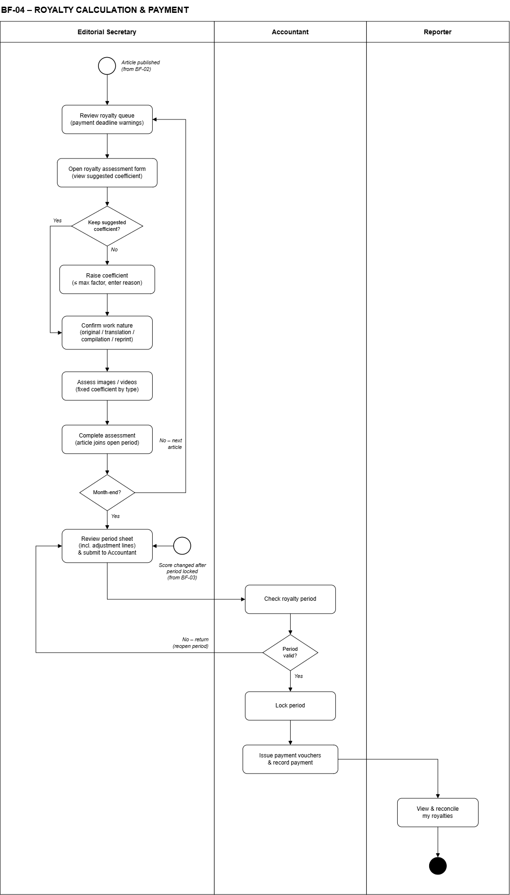
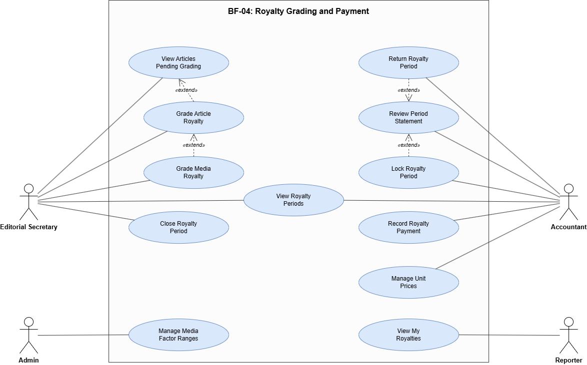

# SRS — BF-04 Chốt kỳ & chi trả nhuận bút (Royalty Calculation & Payment)

> Chuyển từ `SRS.pdf`. Package code: `royalty`. Đọc kèm `docs/SRS_Overview.md` (GBR-08…12, Constraints về tiền) và `database/schema.sql` (bảng `royalty_rates`, `royalty_periods`, `royalty_gradings`, `royalty_media_items`, `royalty_payments`, `royalty_lines`, `genres`, `media_factors`, `events`).

- **Trigger (mục 2.4):** Trưởng ban duyệt đăng bài, hệ thống đưa bài vào kỳ nhuận bút của tháng xuất bản.
- **End condition (mục 2.4):** Kỳ nhuận bút đạt PAID (mọi người trong kỳ đã được chi).

## Swimlane

Mô tả sơ đồ (3 làn: Editorial Secretary | Accountant | Reporter):

1. Secretary (Start: Article published, from BF-02): Review royalty queue (payment deadline warnings) → Open royalty assessment form (view system-calculated coefficient) → Confirm work nature (original / translation / compilation / repost) → Assess images / videos (fixed coefficient by type) → Complete assessment (article joins open period) → **Month-end?** No → bài tiếp theo (quay lại bước 1).
2. Yes → Review period sheet (incl. adjustment lines) & submit to Accountant. Một điểm vào khác: *Score changed after period locked (from BF-03)* cũng đi vào bước xem bảng kỳ.
3. Accountant: Check royalty period → **Period valid?**
   - No → return (reopen period) → quay lại bước 2 của Secretary.
   - Yes → Lock period → Issue payment vouchers & record payment.
4. Reporter: View & reconcile my royalties → End.

## Use Case Diagram

- Editorial Secretary: View Articles Pending Grading, Grade Article Royalty, Grade Media Royalty, View Royalty Periods, Close Royalty Period.
- Grade Article Royalty «extend» View Articles Pending Grading; Grade Media Royalty «extend» Grade Article Royalty.
- Accountant: Return Royalty Period, Review Period Statement, Lock Royalty Period, View Royalty Periods, Record Royalty Payment, Manage Unit Prices.
- Return Royalty Period «extend» Review Period Statement; Lock Royalty Period «extend» Review Period Statement.
- Admin: Manage Media Factor Ranges. Reporter: View My Royalties.

## Use Cases (4.2.4)

Primary actors: Editorial Secretary, Accountant · Others: Reporter, Admin · 12 use cases · ID 46–57

| ID | Use Case | Feature | Use Case Description |
|---|---|---|---|
| 46 | View Articles Pending Grading | Royalty Grading | The Editorial Secretary views published articles that have not been graded yet, with payment-deadline warnings. |
| 47 | Grade Article Royalty | Royalty Grading | The system calculates the coefficient = category base factor × score / 100, minimum 1, and the Secretary confirms the nature (translation 70%, compilation 50%, repost 30%). Saturated events reduce the coefficient by submission order. When grading is complete, the article joins the open period. |
| 48 | Grade Media Royalty | Royalty Grading | The Secretary grades each image/video with the fixed coefficient of its media type. Reused or external media receive no royalty. |
| 49 | View Royalty Periods | Royalty Period | The Secretary and the Accountant view monthly royalty periods with status and total amount. |
| 50 | Close Royalty Period | Royalty Period | At month-end, the Secretary reviews the period sheet (including adjustment lines) and submits it to the Accountant. |
| 51 | Review Period Statement | Royalty Period | The Accountant reviews each person's lines: article amount = applied coefficient × unit price effective on the publish date, split by co-author shares, rounded to 1,000 VND with the remainder going to the main author. |
| 52 | Return Royalty Period | Royalty Period | The Accountant returns the period to the Secretary with a mandatory note. |
| 53 | Lock Royalty Period | Royalty Period | The Accountant locks the period. Locked data cannot change; later score changes (from BF-03) create adjustment lines in the next open period. |
| 54 | Record Royalty Payment | Payment | The Accountant records payment for each person. When everyone is paid, the period becomes PAID. |
| 55 | Manage Unit Prices | Royalty Configuration | The Accountant creates a new unit price version with an effective date; old versions are never edited. Each article uses the unit price effective on its publish date. |
| 56 | Manage Media Factor Ranges | Royalty Configuration | The Admin sets the coefficient for each media type. |
| 57 | View My Royalties | Royalty Viewing | The Reporter views their royalty by period and by article, including co-author shares and adjustments. |

## Use cases full dressed (II.1.2.4 — Flow 4)

### UC-47: Grade Article Royalty

| Field | Value |
|---|---|
| Actor | Editorial Secretary |
| Trigger | The Secretary selects an article from the pending grading list. |
| Preconditions | The article is PUBLISHED and its score is approved. |
| Postconditions | A grading version is saved; the article joins the OPEN period; royalty lines are created per author. |
| Business Rules | BR-RY-01 … 06 |

**Normal Flow**
1. System shows the article, score, category and nature, and shows the coefficient calculated from the score (BR-RY-01).
2. Secretary confirms the nature.
3. System calculates final factor and amount (BR-RY-02, 03).
4. Secretary grades images/videos if any (BR-RY-04).
5. Secretary clicks Complete; system saves and adds the article to the OPEN period (BR-RY-05).

**Alternative / Exceptions**
- A1 Score changed after grading (BF-03): a new version is created; if the period is LOCKED the difference goes to the next period (BR-RY-06).
- E1 No unit price or no OPEN period: grading cannot be completed.

### UC-50: Close Royalty Period

| Field | Value |
|---|---|
| Actor | Editorial Secretary |
| Trigger | At month-end the Secretary clicks Close on the OPEN period. |
| Preconditions | The period is OPEN and every grading in it is complete. |
| Postconditions | The period is CLOSED and the Accountant is notified. |
| Business Rules | BR-RY-07 |

**Normal Flow**
1. System shows the period sheet: articles, media, adjustments, total per person.
2. Secretary reviews and clicks Close.
3. System sets the period to CLOSED and notifies the Accountant.

**Alternative / Exceptions**
- A1 Period was returned: the sheet shows the Accountant's note; the Secretary corrects and closes again.
- E1 Unfinished grading: "Please finish all gradings before closing."

### UC-53: Lock Royalty Period

| Field | Value |
|---|---|
| Actor | Accountant |
| Trigger | The Accountant reviews a CLOSED period and clicks Lock. |
| Preconditions | The period is CLOSED. |
| Postconditions | The period is LOCKED; one UNPAID payment voucher is created per person. |
| Business Rules | BR-RY-06, 07 |

**Normal Flow**
1. System shows each person's lines and gross amount.
2. Accountant checks the lines and clicks Lock.
3. System locks the period and creates the payment vouchers.

**Alternative / Exceptions**
- A1 Accountant returns the period with a mandatory note → period goes back to OPEN (UC-52).
- A2 Negative total for a person: voucher = 0, debt carried to the next period (BR-RY-06).

### UC-54: Record Royalty Payment

| Field | Value |
|---|---|
| Actor | Accountant |
| Trigger | The Accountant opens the vouchers of a LOCKED period. |
| Preconditions | The period is LOCKED; the voucher is UNPAID. |
| Postconditions | The voucher is PAID; when all vouchers are PAID the period is PAID. |
| Business Rules | BR-RY-07 |

**Normal Flow**
1. Accountant selects a voucher and confirms the paid amount and date.
2. System marks the voucher PAID.
3. When every voucher is PAID, system sets the period to PAID and notifies the reporters.

**Alternative / Exceptions**
- E1 Voucher already PAID: cannot be paid again.

Simple view and configuration use cases (UC-46, 48, 49, 51, 52, 55, 56, 57) are described in the use case table 4.2.4 only.

## Business Rules for Royalty (BR-RY)

| BR-ID | Rule |
|---|---|
| BR-RY-01 | Coefficient = category base factor × effective score / 100. It is calculated by the system; the Secretary cannot change it. |
| BR-RY-02 | Final factor = coefficient × saturation rate × nature rate (Original 100%, Translation 70%, Compilation 50%, Repost 30%); minimum 1. |
| BR-RY-03 | Amount = final factor × unit price effective on the publish date; split by author shares, rounded to 1,000 VND, remainder to the main author. |
| BR-RY-04 | Images/videos use the fixed factor of their media type; reused or external media get no royalty. |
| BR-RY-05 | An article joins the period that is OPEN when its grading is completed. |
| BR-RY-06 | A LOCKED period never changes; later differences become adjustment lines (or debt) in the next period. |
| BR-RY-07 | Period status: OPEN → CLOSED → LOCKED → PAID; only a CLOSED period can be returned or locked. |

> **Ghi chú:**
> - BR-RY-01 đã đổi theo quyết định của nhóm (13/10/2026): bỏ chia bậc điểm 90/70 (100/80/60%), hệ số = hệ số chuẩn thể loại × điểm / 100, hệ thống tự tính, Thư ký **không** nâng được nữa (nên bỏ luôn UC-47 A1 cũ). PR `[DB]` ngày 18/10/2026 đã bỏ tham số `SCORE_TIER_*`, `TIER_RATE_*`, sửa comment bảng `royalty_gradings` và bỏ cột `genres.max_factor`. Cột `tier_rate` giữ lại, lưu bằng điểm (cho phép 0); `applied_factor` luôn bằng `suggested_factor`.
> - Hạn chi nhuận bút (UC-46): SRS không ghi số ngày. Nhóm chốt (14/10/2026) tham số `PAYMENT_DEADLINE_DAYS` = 30 ngày kể từ ngày đăng, cảnh báo khi còn ≤ `PAYMENT_WARN_DAYS` = 7 ngày.
> - UC-53 A1 ghi "period goes back to OPEN" khi Kế toán trả lại; swimlane ghi "return (reopen period)". Hai chỗ khớp nhau.
> - Làm tròn chia đồng tác giả: BR-RY-03 ghi "rounded to 1,000 VND", GBR-10 nói rõ là **làm tròn xuống (FLOOR)**, phần dư dồn cho tác giả chính.
> - Giảm hệ số sự kiện bão hoà 100% → 80% → 60% trong cửa sổ 7 ngày, bài có điểm hiệu lực ≥ 90 được miễn (GBR-09). Tỷ lệ này bị khoá lúc nộp bài (BR-IN-03).
> - Tiền luôn dùng `BigDecimal`, cột `DECIMAL(18,0)` (AGENTS.md mục 3.3). Logic tính tiền bắt buộc có unit test JUnit 5 (AGENTS.md mục 3.9).

## Luật chung liên quan

GBR-08 (DECIMAL, đơn giá theo ngày xuất bản), GBR-09 (bão hoà sự kiện), GBR-10 (FLOOR 1.000đ, dư cho tác giả chính), GBR-11 (kỳ khoá bất biến, dòng điều chỉnh), GBR-12 (phiếu chi không âm, nợ chuyển kỳ sau) — xem `SRS_Overview.md`.

## Mockup liên quan

`srs-images/mockup-08.png` (chấm nhuận bút), `mockup-09.png` (phiếu chi theo kỳ), `mockup-10.png` (chi trả). Mockup có thuế TNCN và số tài khoản: **không có trong SRS/schema**, không làm theo (Vấn đề #9).
