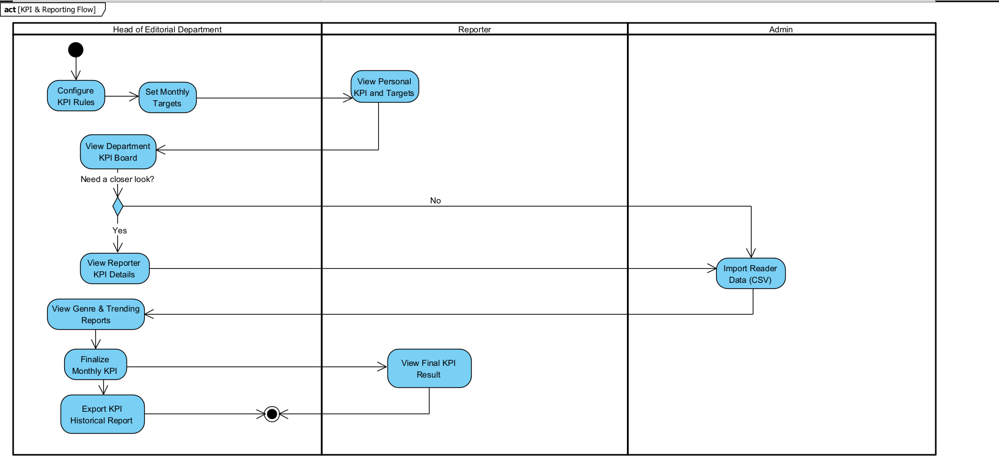
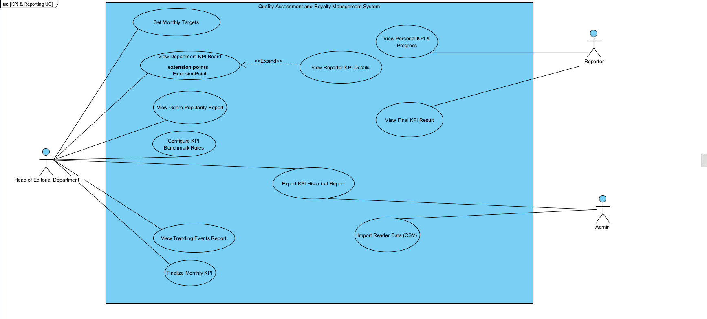

# SRS — BF-05 Quản trị & Đánh giá KPI tháng (KPIs & Reporting)

> Chuyển từ `SRS.pdf`. Package code: `kpi`. Đọc kèm `docs/SRS_Overview.md` và `database/schema.sql` (bảng `kpi_targets`, `kpi_snapshots`, `csv_import_logs`, `reader_interactions`).
>
> **Ghi chú (Vấn đề #6):** UC-58 lưu cấu hình vào `kpi_benchmarks` — **bảng này không có trong `schema.sql`**. UC-59 có `target_views` — **`kpi_targets` không có cột này**. CSV có `avg_rating`, còn `reader_interactions` lưu `rating_count` + `rating_sum`. Hỏi nhóm trước khi code phần này.

- **Trigger (mục 2.5):** Trưởng ban tạo kỳ và đặt chỉ tiêu KPI tháng cho phóng viên.
- **End condition (mục 2.5):** Kỳ KPI được đóng, kết quả xếp loại được lưu và công bố cho phóng viên.

## Activity diagram

Mô tả sơ đồ `act [KPI & Reporting Flow]` (3 làn: Head of Editorial Department | Reporter | Admin):

1. Head: Configure KPI Rules → Set Monthly Targets → Reporter: View Personal KPI and Targets.
2. Head: View Department KPI Board → **Need a closer look?**
   - Yes → View Reporter KPI Details → Admin: Import Reader Data (CSV).
   - No → Admin: Import Reader Data (CSV).
3. Head: View Genre & Trending Reports → Finalize Monthly KPI → Reporter: View Final KPI Result → End.
4. Head: Export KPI Historical Report → End.

## Use Case Diagram

- Head of Editorial Department: Set Monthly Targets, View Department KPI Board, View Genre Popularity Report, Configure KPI Benchmark Rules, Export KPI Historical Report, View Trending Events Report, Finalize Monthly KPI.
- View Reporter KPI Details «Extend» View Department KPI Board.
- Reporter: View Personal KPI & Progress, View Final KPI Result.
- Admin: Import Reader Data (CSV), Export KPI Historical Report.

## Use Cases (4.2.5)

Actor chính: Trưởng ban biên tập (Head of Editorial Department), Phóng viên (Reporter), Quản trị viên (Admin). Phạm vi: 11 Use Cases.

| ID | Use Case | Feature | Use Case Description |
|---|---|---|---|
| 58 | Configure KPI Benchmark Rules | KPI & Reporting | The Head of Editorial Department configures evaluation benchmarks by reporter level, co-authorship weighting rules, and topic imbalance notification thresholds. |
| 59 | Set Monthly Targets | KPI & Reporting | The Head of Editorial Department sets monthly quota targets (minimum published articles, target views, and quality score benchmarks) for individual reporters or applies predefined defaults by seniority level. |
| 60 | View Personal KPI & Progress | KPI & Reporting | The Reporter views assigned monthly targets and tracks real-time progress of published articles (calculated with co-author split ratios, e.g., 0.6 / 0.4) and projected Pass / Not Pass status throughout the cycle. |
| 61 | View Department KPI Board | KPI & Reporting | The Head of Editorial Department monitors the overall department dashboard displaying real-time progress metrics, article quotas, and milestone completion rates across all reporters in the team. |
| 62 | View Reporter KPI Details | KPI & Reporting | The Head of Editorial Department inspects granular performance details of a selected reporter, including the list of published articles, effective quality scores, co-authorship weightings, and accumulated page views. |
| 63 | Import Reader Data (CSV) | KPI & Reporting | The Administrator uploads daily readership metrics via a CSV file (article ID, date, page views, rating counts, average rating); existing records are automatically overwritten if re-imported for the same date and article. |
| 64 | View Genre Popularity & Cost Report | KPI & Reporting | The Head of Editorial Department reviews analytical reports on audience preferences categorized by genre, including mean and median views, Bayesian average ratings, royalty cost per 1,000 views, and neglected genre alerts. |
| 65 | View Trending Events Report | KPI & Reporting | The Head of Editorial Department reviews the surge detection report highlighting emerging events or topics where traffic in the last 7 days exceeds twice the baseline 7-day average of the previous 4 weeks. |
| 66 | Finalize Monthly KPI | KPI & Reporting | The Head of Editorial Department locks the monthly evaluation cycle; the system automatically determines Pass / Not Pass status based on predefined quotas and generates an immutable snapshot of all KPI metrics. |
| 67 | View Final KPI Result | KPI & Reporting | The Reporter views the official finalized monthly KPI results (Pass / Not Pass status) and managerial comments once the evaluation period has been locked and snapshot data is published. |
| 68 | Export KPI Historical Report | KPI & Reporting | The Head of Editorial Department reviews historical KPI snapshots across quarters and exports performance summaries to Excel/PDF format. |

## Use cases full dressed (II.1.2.5 — Flow 5)

### UC-58: Configure KPI Benchmark Rules

| Field | Value |
|---|---|
| Actor | Head of Editorial Department (Primary), Administrator |
| Trigger | The Head of Editorial Department accesses the KPI configuration settings before the target-setting cycle begins. |
| Preconditions | The user is authenticated with the Head of Editorial Department role; active reporter roles and article categories exist in the system. |
| Postconditions | KPI benchmark baselines and alert thresholds are updated and applied to subsequent monthly target-setting workflows. |
| Business Rules | BR-KPI-01 |

**Normal Flow**
1. System displays baseline KPI criteria by reporter seniority level (Probationary, Junior, Senior) and category split ratios.
2. Head of Department configures the default minimum converted published works, default quality score floors, and content imbalance alert triggers.
3. System validates that minimum target values are non-negative and weight ratios are within valid ranges (0.0 < share <= 1.0).
4. Head of Department clicks Save; system persists configurations to kpi_benchmarks and logs the audit event.

**Alternative / Exceptions**
- A1 Cancel configuration: User discards pending changes; system preserves current benchmark rules.
- E1 Invalid parameters: If threshold values are negative or invalid numeric inputs, system displays: "Invalid benchmark parameter values.".

### UC-59: Set Monthly Targets

| Field | Value |
|---|---|
| Actor | Head of Editorial Department |
| Trigger | At the beginning of the monthly evaluation cycle, the Head of Department opens the monthly target assignment screen. |
| Preconditions | The evaluation period (year, month) is initialized; reporter accounts in the department are in ACTIVE status. |
| Postconditions | A unique monthly target record is created/updated per reporter in kpi_targets. |
| Business Rules | BR-KPI-01 |

**Normal Flow**
1. System displays the roster of active department reporters alongside benchmark default targets by seniority level.
2. Head of Department customizes individual quotas: minimum converted articles (min_published), minimum average quality score (min_avg_score), and supplementary view expectations (target_views).
3. Head of Department clicks Save; system verifies target uniqueness per reporter for the specified cycle (BR-KPI-01).
4. System saves records in kpi_targets and notifies reporters of their assigned targets.

**Alternative / Exceptions**
- A1 Bulk Apply Defaults: Head of Department selects "Apply Benchmark Defaults" to auto-populate all reporter quotas simultaneously.
- A2 Update Target: Head of Department modifies targets during an ongoing period before the period is finalized.
- E1 Duplicate Target Violation: System blocks creation if (reporter_id, target_year, target_month) already exists, prompting user to update instead.

### UC-63: Import Reader Data (CSV)

| Field | Value |
|---|---|
| Actor | Admin |
| Trigger | The Admin uploads a daily readership interaction CSV export from the website analytics platform. |
| Preconditions | The user is authenticated with the Admin role; the uploaded file matches the predefined CSV format. |
| Postconditions | Interaction records are persisted in reader_interactions; execution statistics are stored in csv_import_logs. |
| Business Rules | BR-KPI-03, BR-KPI-04 |

**Normal Flow**
1. Admin selects and uploads the daily CSV file.
2. System parses file headers (article_id, record_date, page_views, rating_count, avg_rating) and validates column types.
3. System checks for duplicate (article_id, record_date) pairs and cleanly overwrites existing records with incoming values (BR-KPI-03).
4. System inserts valid records into reader_interactions and records execution trace (file_name, total_records, success_records) into csv_import_logs.
5. System displays a confirmation summary showing total rows imported and overwritten.

**Alternative / Exceptions**
- E1 Malformed CSV or Missing Headers: File structure is invalid; system aborts import with error: "Invalid CSV format. Required headers: article_id, record_date, page_views, rating_count, avg_rating."
- E2 Non-existent Article ID: CSV contains article_id values not present in articles table; system skips invalid rows, logs row numbers in the import log, and processes valid rows.

### UC-64: View Genre Popularity & Cost Report

| Field | Value |
|---|---|
| Actor | Head of Editorial Department |
| Trigger | The Head of Department accesses analytical reports to review audience engagement and royalty expenditure efficiency. |
| Preconditions | The department has published articles with completed royalty gradings (BF-04) and imported reader metrics. |
| Postconditions | None (Read-only analytical visualization). |
| Business Rules | BR-KPI-04 |

**Normal Flow**
1. System prompts user to select a date range or reporting month.
2. System aggregates published articles grouped by category/genre.
3. System computes: mean page views, median page views, Bayesian average rating, average quality score, and Royalty Cost per 1,000 Views (BR-KPI-04).
4. System highlights categories where article count < k as "Insufficient Data" and flags categories at risk of editorial neglect based on configured imbalance rules.
5. Head of Department reviews analytics and exports dashboard visuals if needed.

**Alternative / Exceptions**
- A1 Filter by Specific Genre: User drills down into a single genre to inspect article-level performance.
- E1 No Readership Data: If no CSV records exist for the selected window, system displays royalty and quality scores with view-based metrics marked as "N/A".

### UC-66: Finalize Monthly KPI

| Field | Value |
|---|---|
| Actor | Head of Editorial Department |
| Trigger | At month-end, the Head of Department reviews cumulative progress and closes the evaluation cycle. |
| Preconditions | At month-end, the Head of Department reviews cumulative progress and closes the evaluation cycle. *(PDF chép trùng với Trigger)* |
| Postconditions | Monthly KPI period is locked; an immutable snapshot is recorded in kpi_snapshots per reporter; reporters are notified. |
| Business Rules | BR-KPI-02, BR-KPI-05, BR-KPI-06 |

**Normal Flow**
1. System compiles final converted article totals (BR-KPI-02) and average effective quality scores for all reporters in the department.
2. System compares actuals against assigned targets and evaluates binary status: PASS or NOT_PASS (BR-KPI-05).
3. Head of Department enters qualitative appraisal notes where applicable and clicks "Finalize Monthly KPI".
4. System locks the period, generates permanent immutable records in kpi_snapshots, and dispatches notification to reporters (BR-KPI-06).

**Alternative / Exceptions**
- A1 Incomplete Editorial Workflow: If articles published within the month remain in SUBMITTED or ASSIGNED without finalized scores, system displays a warning listing pending articles before user confirms override.
- E1 Period Already Finalized: If the period already has records in kpi_snapshots, the finalize button is disabled: "This KPI period is locked and finalized."

Simple view and administrative reporting use cases (UC-60, 61, 62, 65, 67, 68) are described in the Use Case Table (Section 4.2.5) only.

## Business Rules for KPI & Reporting (BR-KPI)

| BR-ID | Rule |
|---|---|
| BR-KPI-01 | Monthly targets require unique allocation per reporter per cycle: UQ(reporter_id, target_year, target_month). Quotas must specify minimum converted published works (min_published) and threshold quality score floor (min_avg_score). |
| BR-KPI-02 | Published articles credit into the KPI cycle matching their publication date (published_at) and accumulate strictly by co-authorship share percentages (e.g., a 60/40 co-authored article yields 0.6 and 0.4 converted article units respectively). Scores used must be the finalized effective scores from BF-02/BF-03. |
| BR-KPI-03 | Reader data CSV ingestion requires mandatory columns: article_id, record_date, page_views, rating_count, and avg_rating. Re-importing duplicate (article_id, record_date) pairs cleanly overwrites prior values. |
| BR-KPI-04 | Royalty Cost per 1,000 Views = (Total Royalty Paid / Total Page Views) * 1,000. Readership metrics from CSV are strictly isolated to reporting analytics and must never factor into reporter Pass/Not Pass evaluations. |
| BR-KPI-05 | Monthly KPI outcomes are strictly binary: PASS if actual_articles >= min_published AND actual_avg_score >= min_avg_score; otherwise NOT_PASS. Grade rankings (A/B/C/D) are strictly prohibited. |
| BR-KPI-06 | Finalizing a KPI period captures a permanent, immutable point-in-time record in kpi_snapshots. Once locked, snapshot records cannot be altered, edited, or re-evaluated. |

> **Ghi chú:** comment trong `schema.sql` của `kpi_snapshots` có trạng thái DRAFT (số tạm, tính lại được) và FINALIZED (đã chốt). Khi code theo BR-KPI-06 thì chỉ bản FINALIZED là bất biến.

## Luật chung liên quan

GBR-13 (KPI cộng theo tỷ lệ đồng tác giả; số liệu đọc từ CSV chỉ dùng cho báo cáo), GBR-14 (PASS / NOT_PASS, snapshot bất biến) — xem `SRS_Overview.md`.

## Mockup liên quan

`srs-images/mockup-11.png` (bảng KPI của ban).
