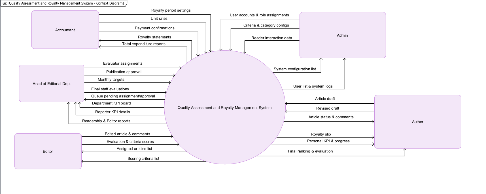
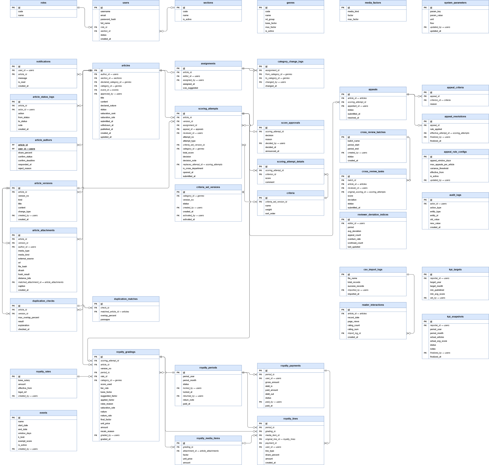

# SRS — Tổng quan hệ thống

> Chuyển từ `SRS.pdf` (SWP391 Project Report — Software Requirement Specification, Hanoi, Aug 2026).
> Bộ SRS dạng Markdown gồm:
>
> | File | Nội dung |
> |---|---|
> | `docs/SRS_Overview.md` (file này) | Context, 5 luồng nghiệp vụ, ERD, entity, actor, quy tắc chung GBR, ràng buộc kỹ thuật, phần template chưa điền |
> | `docs/SRS_BF01_Article.md` | BF-01 Viết & nộp bài — UC-01…13, BR-IN-xx |
> | `docs/SRS_BF02_Scoring.md` | BF-02 Chấm điểm chất lượng + duyệt đăng — UC-14…34, BR-SC-xx |
> | `docs/SRS_BF03_Appeal.md` | BF-03 Kiểm soát chất lượng chấm (khiếu nại) — UC-35…45, BR-QC-xx |
> | `docs/SRS_BF04_Royalty.md` | BF-04 Chốt kỳ & chi trả nhuận bút — UC-46…57, BR-RY-xx |
> | `docs/SRS_BF05_KPI.md` | BF-05 KPI & báo cáo — UC-58…68, BR-KPI-xx |
> | `docs/srs-images/` | Ảnh sơ đồ và mockup tách từ PDF |
>
> Nội dung giữ nguyên tiếng Anh như bản gốc. Ghi chú của người chuyển đổi để trong khối `> **Ghi chú:**`.

---

## Vấn đề đã biết (đọc trước khi code)

Đây là chỗ PDF tự mâu thuẫn hoặc lệch với `database/schema.sql`. Theo `AGENTS.md`, mâu thuẫn **nghiệp vụ** thì **không tự chọn**: dừng lại và báo người dùng.

| # | Vấn đề | Chi tiết |
|---|---|---|
| 1 | Trạng thái `PENDING_CONFIRMATION` | **Đã chốt (2026-10-11):** thêm `PENDING_CONFIRMATION` vào `ck_articles_status` theo SRS BF-01 (UC-05, UC-12). Cùng đợt: ngưỡng kiểm trùng sửa theo BR-IN-04/05 (20% / 50% / dHash 5 bit), kết quả kiểm trùng đổi thành `NORMAL` / `NEED_EXPLAIN` / `BLOCKED`, mã role đổi sang tiếng Anh (`REPORTER`, `EDITOR`, ...). |
| 2 | Quyết định trả bài | UC-27 ghi decision `RETURN`. `schema.sql` (`ck_scoring_attempts_decision`) dùng `ACCEPT` / `REVISION` / `REJECT`. |
| 3 | Mã luật BF-01 | Các UC của BF-01 tham chiếu `BR-IN-01…07`. Phụ lục của PDF lại in bảng này với mã `BR-RY-01…08` (trùng mã với luật nhuận bút). Bản MD đổi sang `BR-IN-xx` theo cách UC tham chiếu. |
| 4 | Thiếu bảng luật BR-SC | Các UC của BF-02 tham chiếu `BR-SC-01…11` nhưng PDF không có bảng định nghĩa. Nội dung luật phải suy ra từ UC (xem `SRS_BF02_Scoring.md`). |
| 5 | Tên/phạm vi BF-03 | **Đã chốt (2026-10-11):** BF-03 = `appeal` (*Kiểm soát chất lượng chấm*: khiếu nại, chấm mù) theo SRS. Duyệt đăng (UC-33) thuộc `assessment` (BF-02). `AGENTS.md` mục 2 và hook đã sửa theo. |
| 6 | Bảng KPI | UC-58 lưu vào `kpi_benchmarks` (không có trong `schema.sql`). UC-59 có `target_views` (không có cột này trong `kpi_targets`). |
| 7 | Bảng sở hữu trong AGENTS.md | **Đã chốt (2026-10-11):** cột "Bảng sở hữu" trong `AGENTS.md` mục 2 đã sửa theo danh sách 40 bảng ở đầu `schema.sql` (bỏ tên cũ `quality_criteria`, `quality_reviews`, `unit_prices`…). |
| 8 | End condition BF-02 | Mục 2.2 ghi "Bài được chốt hạng A, B, C hoặc D", còn UC/swimlane BF-02 kết thúc ở PUBLISHED / REJECTED và không có xếp hạng chữ. BR-KPI-05 cấm xếp hạng A/B/C/D cho KPI. |
| 9 | Mockup khác SRS | Mockup chấm điểm dùng 5 tiêu chí thang 10, tổng /50 và hệ số 1.30/1.15… Mockup phiếu chi có thuế TNCN 10% và số tài khoản. SRS và schema dùng thang 0–100 có trọng số và không có thuế/tài khoản. **Mockup chỉ minh hoạ bố cục, không phải yêu cầu.** |
| 10 | Phần template chưa điền | Một số mục vẫn là dữ liệu mẫu của template (hệ thống tuyển dụng: Candidate, Job posting, HR Manager, VnPay/SePay, JOB-01/02, MSG01…). Xem cuối file, mục **Phần template chưa thay**. **Không code theo phần này.** |

---

## Table of Contents (theo PDF)

- Change Log · Definition and Acronyms
- I. Overall Requirements: 1. Context Diagram · 2. Main Business Flow · 3. Conceptual Data Model (ERD, Entity Descriptions, Data Business Rules) · 4. User Requirements (Actors, Use Cases, UC Diagrams, Permission Matrix) · 5. System Functionalities (Screen, External API, Background Job)
- II. Functional Requirements: 1. Screens + Use cases full dressed · 2. User Authentication · 3. System Administration · 5. Background Job Inventory · 6. External API Inventory
- III. Requirement Appendix: 1. Business Rules · 2. System Messages · 3. Other Requirements

## Change Log

| Date | A/M/D | In charge | Change Description |
|---|---|---|---|
| *(trống trong PDF)* | | | |

*A = Added, M = Modified, D = Deleted*

## Definition and Acronyms

> **Ghi chú:** PDF chỉ còn dòng mẫu `COS — Cafeteria Ordering System` của template. Bảng dưới là thuật ngữ thật của dự án, lấy từ nội dung SRS.

| Thuật ngữ | Nghĩa |
|---|---|
| Work / Article | Bài viết (tác phẩm) Phóng viên nộp để chấm chất lượng và tính nhuận bút |
| Main author / Co-author | Tác giả chính / đồng tác giả (tối đa 5 tác giả, tổng tỷ lệ 100%) |
| Category / Genre | Thể loại bài (bảng `genres`), quyết định bộ tiêu chí và hệ số nhuận bút |
| Nature | Tính chất bài: Original / Translation / Compilation / Repost |
| Scoring attempt | Một lần chấm của Biên tập viên |
| Criteria set version | Phiên bản bộ tiêu chí chấm của một thể loại (DRAFT / ACTIVE / RETIRED) |
| Appeal | Khiếu nại điểm chất lượng của Phóng viên |
| Blind review | Chấm lại mù: người chấm không thấy điểm/nhận xét cũ |
| Royalty grading | Phiếu chấm nhuận bút của Thư ký toà soạn |
| Royalty period | Kỳ nhuận bút tháng (OPEN → CLOSED → LOCKED → PAID) |
| Saturation rate | Tỷ lệ giảm hệ số khi sự kiện bão hoà (100% / 80% / 60%) |
| Unit price / Royalty rate | Đơn giá nhuận bút theo hiệu lực (bảng `royalty_rates`) |
| KPI target / snapshot | Chỉ tiêu KPI tháng / bản chốt KPI bất biến |
| BF | Business Flow — luồng nghiệp vụ |
| UC | Use Case |
| BR / GBR | Business Rule / General Business Rule |

---

# I. Overall Requirements

## 1. Context Diagram

> **Mô tả sơ đồ:** hệ thống *Quality Assessment and Royalty Management System* ở giữa, 5 tác nhân bên ngoài:
>
> | Tác nhân | Gửi vào hệ thống | Nhận từ hệ thống |
> |---|---|---|
> | Accountant | Royalty period settings, Unit rates, Payment confirmations | Royalty statements, Total expenditure reports |
> | Admin | User accounts & role assignments, Criteria & category configs, Reader interaction data | System configuration list, User list & system logs |
> | Head of Editorial Dept | Evaluator assignments, Publication approval, Monthly targets, Final staff evaluations | Queue pending assignment/approval, Department KPI board, Reporter KPI details, Readership & Editor reports |
> | Editor | Edited article & comments, Evaluation & criteria scores | Assigned articles list, Scoring criteria list |
> | Author (Reporter) | Article draft, Revised draft | Article status & comments, Royalty slip, Personal KPI & progress, Final ranking & evaluation |

## 2. Main Business Flow

Chi tiết từng luồng (swimlane, UC, luật) nằm trong file riêng của luồng.

| Mã | Tên | Trigger | End condition | File |
|---|---|---|---|---|
| BF-01 | Viết và nộp bài | Phóng viên tạo bài mới. | Bài đạt PUBLISHED hoặc REJECTED. | `SRS_BF01_Article.md` |
| BF-02 | Chấm điểm & xếp loại chất lượng | Bài chuyển sang PUBLISHED, trưởng ban phân công người chấm. | Bài được chốt hạng A, B, C hoặc D. | `SRS_BF02_Scoring.md` |
| BF-03* | Kiểm soát chất lượng chấm | Phóng viên gửi khiếu nại. | Nhận khiếu nại và chấm lại, sau đó cập nhật chỉ số. | `SRS_BF03_Appeal.md` |
| BF-04* | Chốt kỳ & chi trả nhuận bút | Trưởng ban duyệt đăng bài, hệ thống đưa bài vào kỳ nhuận bút của tháng xuất bản. | Kỳ nhuận bút đạt PAID (mọi người trong kỳ đã được chi). | `SRS_BF04_Royalty.md` |
| BF-05 | Quản trị & Đánh giá KPI tháng | Trưởng ban tạo kỳ và đặt chỉ tiêu KPI tháng cho phóng viên. | Kỳ KPI được đóng, kết quả xếp loại được lưu và công bố cho phóng viên. | `SRS_BF05_KPI.md` |

> **Ghi chú:** trigger/end condition ở mục 2 của PDF (tiếng Việt) khác với tiêu đề trên sơ đồ swimlane (tiếng Anh). Ví dụ BF-02 swimlane: *Trigger: an article is SUBMITTED (from BF-01) and enters the assignment queue. End: the article is PUBLISHED, or is returned to BF-01, or is REJECTED.* Swimlane và UC chi tiết khớp với `schema.sql` hơn. Dấu `*` có sẵn trong PDF.

## 3. Conceptual Data Model

### 3.1 Entity Relationship Diagram

> **Ghi chú:** ERD khớp với các bảng trong `database/schema.sql`. Khi code, **luôn đọc `schema.sql`** (kiểu, CHECK, comment) chứ không đọc theo ảnh. Nhóm bảng trên ERD:
> - Nền tảng: `roles`, `users`, `sections`, `genres`, `media_factors`, `system_parameters`, `events`, `notifications`, `audit_logs`
> - BF-01: `articles`, `article_authors`, `article_versions`, `article_attachments`, `duplication_checks`, `duplication_matches`, `article_status_logs`
> - BF-02: `assignments`, `category_change_logs`, `criteria_set_versions`, `criteria`, `scoring_attempts`, `scoring_attempt_details`, `score_approvals`
> - BF-03: `appeals`, `appeal_criteria`, `appeal_resolutions`, `appeal_rule_configs`, `cross_review_batches`, `cross_review_tasks`, `reviewer_deviation_indices`
> - BF-04: `royalty_rates`, `royalty_periods`, `royalty_gradings`, `royalty_media_items`, `royalty_payments`, `royalty_lines`
> - BF-05: `kpi_targets`, `kpi_snapshots`, `csv_import_logs`, `reader_interactions`

### 3.2 Entity Descriptions

#### 3.2.1 Entity: User

| Field | Value |
|---|---|
| Purpose | Every person with an account, regardless of role. Each user has exactly one role. |
| Key business attributes | Full name, username, email, role, section, status |
| Business identity | Username and email unique system-wide |
| Status / lifecycle | ACTIVE · LOCKED |

#### 3.2.2 Entity: Article

| Field | Value |
|---|---|
| Purpose | A work submitted by a Reporter for quality scoring and royalty. |
| Key business attributes | Title, content, main author, section, declared / applied category, nature, event, publish date |
| Business identity | No natural unique key |
| Status / lifecycle | DRAFT → SUBMITTED → ASSIGNED → PENDING_APPROVAL → SCORE_PUBLISHED → PUBLISHED; may go to REVISION_REQUESTED or REJECTED |

#### 3.2.3 Entity: Article Author

| Field | Value |
|---|---|
| Purpose | An author of an article and their royalty share. |
| Key business attributes | Article, user, share %, confirmation status, deadline |
| Business identity | (Article, User) unique; max 5 authors; shares total 100% |
| Status / lifecycle | PENDING → ACCEPTED / REJECTED / EXPIRED (3 days) |

#### 3.2.4 Entity: Scoring Attempt

| Field | Value |
|---|---|
| Purpose | One scoring of an article by an Editor, with a score per criterion. |
| Key business attributes | Article version, reviewer, criteria version, total score, decision |
| Business identity | (Article, Attempt no.) unique |
| Status / lifecycle | Locked once submitted; approved or sent back by the Head |

#### 3.2.5 Entity: Appeal

| Field | Value |
|---|---|
| Purpose | A Reporter's complaint about a published score. |
| Key business attributes | Article, appealed attempt, disputed criteria, reason, final rule applied |
| Business identity | Within the appeal window; limited per article |
| Status / lifecycle | SUBMITTED → IN_REVIEW → RESOLVED |

#### 3.2.6 Entity: Royalty Grading

| Field | Value |
|---|---|
| Purpose | The Editorial Secretary's royalty assessment of an article. |
| Key business attributes | Score used, suggested / applied / final factor, nature rate, unit price, amount |
| Business identity | A recalculation creates a new version |
| Status / lifecycle | Joins the open period when complete |

#### 3.2.7 Entity: Royalty Period

| Field | Value |
|---|---|
| Purpose | A monthly royalty payment period. |
| Key business attributes | Year, month, locked by, return note, paid date |
| Business identity | (Year, Month) unique |
| Status / lifecycle | OPEN → CLOSED → LOCKED → PAID |

#### 3.2.8 Entity: Royalty Payment

| Field | Value |
|---|---|
| Purpose | The amount paid to one person in a period, made of royalty lines. |
| Key business attributes | Person, gross amount, debt, paid amount; lines: article / media / adjustment |
| Business identity | (Period, User) unique |
| Status / lifecycle | UNPAID → PAID |

### 3.3 Data Business Rules

> **Ghi chú:** bảng này trong PDF vẫn là **dữ liệu mẫu của template** (hệ thống tuyển dụng), chỉ có 2 dòng đầu dùng được cho dự án. Phần còn lại chép ở mục **Phần template chưa thay** cuối file. Luật dữ liệu thật của dự án nằm trong comment của `schema.sql` và các bảng BR-xx của từng luồng.

| Rule | Description | Enforced On |
|---|---|---|
| Unique username | No two users may share the same username, regardless of role. | Account creation and username change |
| Unique email | No two users may share the same email address. | Account creation and email change |

## 4. User Requirements

### 4.1 Actors

| # | Actor | Description |
|---|---|---|
| 1 | Admin | Manage user accounts, permissions, categories, and evaluation criteria. |
| 2 | Reporter | Write, submit, and edit articles; view their own scores and royalties. |
| 3 | Editor | Score assigned articles by criteria, then accept, return or reject them; perform blind re-evaluations when assigned. |
| 4 | Head of Editorial Department | Assign evaluators, review and approve evaluation results before scores are finalized, and view KPI reports. |
| 5 | Accountant | Manage unit prices, review monthly royalty statements (return or lock the period), and record payments. |
| 6 | Editorial Secretary | Grade royalty for published articles (confirm the nature, grade images/videos), review the monthly royalty statement and submit the period to the Accountant. |
| 7 | System (Timer) | Run scheduled jobs: expire co-author confirmations after 3 days and close the appeal window after 7 days. |

### 4.2 Use Cases (UC) — mục lục

Bảng UC đầy đủ (ID, tên, feature, mô tả) nằm trong file của từng luồng.

| Luồng | ID | Actor chính | File |
|---|---|---|---|
| BF-01 Work Intake | 01–13 | Reporter, Admin | `SRS_BF01_Article.md` |
| BF-02 Editor Scoring | 14–34 | Editor, Head of Dept, Admin | `SRS_BF02_Scoring.md` |
| BF-03 Quality control of scores | 35–45 | Reporter, Head of ED, Editor | `SRS_BF03_Appeal.md` |
| BF-04 Royalty | 46–57 | Editorial Secretary, Accountant (khác: Reporter, Admin) | `SRS_BF04_Royalty.md` |
| BF-05 KPIs & Reporting | 58–68 | Head of ED, Reporter, Admin | `SRS_BF05_KPI.md` |
| Chức năng dùng chung | 69–70 | Mọi vai trò | ngay dưới đây |

#### 4.2.6 Chức năng dùng chung (UC-69, UC-70)

| ID | Use Case | Feature | Use Case Description |
|---|---|---|---|
| 69 | Log In | Common | The User logs in using a username and password. The system verifies that the account is in ACTIVE status before granting access. |
| 70 | Log Out | Common | The User ends their session, and the system terminates the current session. |

### 4.3 Use Case Diagrams

| Mục PDF | Ảnh | File luồng |
|---|---|---|
| 4.3.1 UCs for Reporter (BF-01) | `srs-images/uc-bf01-reporter.png` | `SRS_BF01_Article.md` |
| 4.3.2 UCs for Editorial Secretary and Accountant (BF-04) | `srs-images/uc-bf04-royalty.png` | `SRS_BF04_Royalty.md` |
| 4.3.3 UCs for Quality control of scores (BF-03) | `srs-images/uc-bf03-quality-control.png` | `SRS_BF03_Appeal.md` |
| 4.3.4 UCs for Head of Editorial Department (BF-05) | `srs-images/uc-bf05-kpi.png` | `SRS_BF05_KPI.md` |
| 4.3.5 UCs for Editor (BF-02) | `srs-images/uc-bf02-editor.png` | `SRS_BF02_Scoring.md` |

### 4.4 Permission Matrix

> **Ghi chú:** PDF vẫn để **ma trận mẫu của template** (Admin / HR Manager / Interviewer / Candidate / Guest). Xem mục **Phần template chưa thay**. Quyền thật của dự án suy ra từ cột Actor của từng UC: mỗi UC chỉ actor được ghi mới được làm.

## 5. System Functionalities

### 5.1 Screen Inventory

**a. Screen Flow** — PDF chưa có sơ đồ luồng màn hình.

**b. Screen List** — PDF vẫn để dòng mẫu của template (Sign In; User Register cho Candidate). Danh sách màn hình thực tế nằm ở mục **Mockup màn hình** bên dưới.

### 5.2 External API Inventory

PDF vẫn để dòng mẫu của template (Employee sync API, Outbound webhook). Dự án **không có API bên ngoài**. Dữ liệu đọc báo được nhập bằng CSV (UC-63).

### 5.3 Background Job Inventory

PDF vẫn để dòng mẫu của template (JOB-01, JOB-02). Job thật của dự án suy ra từ actor *System (Timer)*:

| Job | Nguồn | Mô tả |
|---|---|---|
| Hết hạn xác nhận đồng tác giả | UC-12 A2, BR-IN-06 | Đồng tác giả không trả lời trong 3 ngày → bài về DRAFT, báo mọi tác giả |
| Đóng cửa sổ khiếu nại | Actor 7, BR-QC-01 | Hết 7 ngày sau khi công bố điểm thì không được khiếu nại nữa |

---

# II. Functional Requirements

## 1. Mockup màn hình (mục 1.1 của PDF)

PDF để 11 khung `1.1.x Screen/Function NameN` theo template, mỗi khung có 1 ảnh chụp giao diện, chưa có mô tả trường. **Chỉ dùng để tham khảo bố cục** (xem Vấn đề #9).

| Ảnh | Màn hình | Vai trò | UC liên quan |
|---|---|---|---|
| `srs-images/mockup-01.png` | Chọn vai trò vào hệ thống (6 thẻ: Phóng viên, Trưởng ban, Biên tập viên, Thư ký toà soạn, Kế toán, Quản trị viên) | Mọi vai trò | UC-69 |
| `srs-images/mockup-02.png` | Bài của tôi — tab trạng thái, tìm kiếm, lọc thể loại/ngày, nút Soạn bài mới, Nộp | Phóng viên | UC-01, 03, 05 |
| `srs-images/mockup-03.png` | Hàng chờ phân công — cảnh báo vàng > 24h, đỏ > 48h, nút Phân công | Trưởng ban | UC-18 |
| `srs-images/mockup-04.png` | Chỉ định Biên tập viên — danh sách BTV kèm số bài đang xử lý | Trưởng ban | UC-19, 20 |
| `srs-images/mockup-05.png` | Phiếu chấm chất lượng — bài bên trái, tiêu chí bên phải, nhận xét | Biên tập viên | UC-22, 24, 25 |
| `srs-images/mockup-06.png` | Hàng chờ duyệt xuất bản | Trưởng ban | UC-33 |
| `srs-images/mockup-07.png` | Popup kiểm duyệt xuất bản (xuất bản ngay / hẹn giờ, trả lại BTV) | Trưởng ban | UC-33 |
| `srs-images/mockup-08.png` | Chấm nhuận bút — hệ số thể loại theo khung, phụ cấp ảnh/video, tổng nhuận bút | Thư ký toà soạn | UC-47, 48 |
| `srs-images/mockup-09.png` | Quản lý phiếu chi nhuận bút theo kỳ | Kế toán | UC-53, 54 |
| `srs-images/mockup-10.png` | Popup thực hiện chi trả một phiếu | Kế toán | UC-54 |
| `srs-images/mockup-11.png` | Báo cáo KPI của ban — tiến độ nộp, tỷ lệ xuất bản, điểm TB, biểu đồ theo phóng viên | Trưởng ban | UC-61 |

## 1.2 Use cases full dressed

Nằm trong file của từng luồng (mục "Use cases full dressed").

## 2. User Authentication

2.1 User Register, 2.2 User Login: PDF để trống (`…`). Đăng nhập theo UC-69/70 và mục Constraints bên dưới.

## 3. System Administration

3.1 System Settings (Setting List, Setting Details), 3.2 User Management (để trống): PDF vẫn là mẫu template, chép ở mục **Phần template chưa thay**. Tham số cấu hình thật của dự án nằm trong bảng `system_parameters`, `appeal_rule_configs`, `genres`, `media_factors`, `royalty_rates`.

---

# III. Requirement Appendix

## 1. General Business Rules (GBR)

| GBR-ID | Rule Statement | Applies To | Rationale | Enforced By |
|---|---|---|---|---|
| GBR-01 | A single work may have at most 5 authors. Every author must hold a share > 0%, and total shares must strictly equal 100%. | Article submission, Co-author declaration | Prevents ghost authorship and maintains mathematical consistency in split payments. | The system automatically upon declaration and submission. |
| GBR-02 | Text similarity >= 20% requires explanation; similarity > 50% for original works blocks submission. Reused images (<= 5 bit dHash) receive zero royalty. | Plagiarism and media integrity checking | Protects intellectual property and prevents fraudulent payouts on reused assets. | The system automatically during the pre-submission check. |
| GBR-03 | An article proceeds to grading only if all co-authors confirm within 3 days. A single rejection or timeout reverts the work to DRAFT. | Work intake lifecycle | Ensures unanimous legal consent among all collaborators prior to editorial review. | The system automatically and scheduled timer background job. |
| GBR-04 | Criteria set weights must total 100%. An active rubric version binds at the moment grading opens and cannot be modified retroactively. | Quality criteria versioning and scoring | Ensures fair, objective, and legally consistent evaluation standards for reporters. | The system automatically when opening and validating rubrics. |
| GBR-05 | Any criterion scored below 50 points requires mandatory written justification. Articles with rejected scores terminate and cannot enter royalty calculation. | Editor scoring and approval | Provides constructive feedback for authors and filters substandard content from payment. | The system automatically on scoring sheet submission. |
| GBR-06 | Appeals must be filed within 7 days of score publication (1 attempt per work). Re-evaluations are strictly blind and mask prior scores and reviewer comments. | Quality control appeals | Eliminates reviewer confirmation bias and ensures independent arbitrations. | The system automatically on appeal submission and blind assignment. |
| GBR-07 | Apply the appeal's bound threshold T (default 5): if ABS(S1-S0) <= T, propose S1; otherwise require S2. Compare ABS(S2-S0) with ABS(S2-S1): average S2 with the closer score, or use S2 when tied. The Head confirms the result; no original-score floor applies. | Dispute resolution and score arbitration | Uses the agreed S2 arbitration rule; at most two re-evaluations (BR-QC-06/07). | The system calculates the proposal; the Head confirms it. |
| GBR-08 | All royalty computations must use exact fixed-point decimals (DECIMAL). Unit price binds immutably to the article's publication date. | Royalty calculation and line generation | Eliminates floating-point rounding discrepancies and ensures compliance with statutory decrees. | The system automatically during factor and amount calculation. |
| GBR-09 | Saturated event coefficients diminish across a 7-day window (100% -> 80% -> 60%). Articles with effective scores >= 90 are fully exempt. | Royalty factor grading | Controls editorial budget exhaustion on viral topics while incentivizing exceptional quality. | The system automatically during coefficient evaluation. |
| GBR-10 | Co-author payouts are rounded down to 1,000 VND (FLOOR), with any remaining fractional rounding balance allocated to the primary author. | Royalty line division | Guarantees sum of split payments exactly equals the total article royalty without cash leakage. | The system automatically on statement compilation. |
| GBR-11 | Locked and paid royalty periods are immutable. Score alterations from post-lock appeals generate automated adjustment lines in the next active open period. | Period lifecycle and retroactive adjustments | Preserves accounting integrity while automating retro-pay reconciliation. | The system automatically upon effective score synchronization. |
| GBR-12 | A royalty payment sheet can never evaluate to a negative net amount. Excess deductions roll forward as carried debt into future cycles. | Payment voucher generation | Prevents negative cash disbursements to staff while tracking cumulative liabilities. | The system automatically on voucher creation. |
| GBR-13 | Monthly reporter KPI progress accumulates articles proportionally by co-author shares. External reader metrics from CSV are restricted to reporting only. | KPI progress and target monitoring | Reflects true individual output credits while keeping editorial evaluation independent of traffic swings. | The system automatically on KPI calculation and CSV upload. |
| GBR-14 | Monthly KPI outcomes are strictly binary (PASS or NOT_PASS) based on minimum article and score thresholds. Finalized snapshots are immutable. | Monthly KPI finalization | Establishes definitive, tamper-proof performance baselines for departmental audits. | The system automatically upon period finalization. |

Luật chi tiết theo luồng: `BR-IN-xx` (BF-01), `BR-SC-xx` (BF-02), `BR-QC-xx` (BF-03), `BR-RY-xx` (BF-04), `BR-KPI-xx` (BF-05) — nằm trong file của từng luồng.

## 2. System Messages

> **Ghi chú:** bảng trong PDF vẫn là mẫu template (MSG03–MSG05 nói về "asset"). Chỉ MSG01, MSG02, MSG08, MSG09 dùng chung được. Thông báo lỗi nghiệp vụ cụ thể nằm trong mục E1/E2… của từng UC. Message hiển thị cho người dùng phải là **tiếng Việt có dấu** (AGENTS.md mục 3.6).

| # | Code | Type | Context | Content |
|---|---|---|---|---|
| 1 | MSG01 | In line | There is not any search result | No search results. |
| 2 | MSG02 | In red, under the text box | Input-required fields are empty | The * field is required. |
| 3 | MSG03 | Toast message | Updating asset(s) information successfully | Update asset(s) successfully. |
| 4 | MSG04 | Toast message | Adding new asset successfully | Add asset successfully. |
| 5 | MSG05 | Toast message | Confirming email of asset hand-over is sent successfully | A confirmation email has been sent to {email_address}. |
| 6 | MSG08 | In red, under the text box | Input value length > max length | Exceed max length of {max_length}. |
| 7 | MSG09 | In line | Username or password is not correct when clicking sign-in | Incorrrect user name or password. Please check again. |

## 3. Other Requirements

### 3.1 Constraints (Technical Stack)

| Constraint | Description |
|---|---|
| Back-end | Java 17, Spring Boot 3.5 (Spring Web, Spring Data JPA, Validation), Lombok, Maven. REST API returning JSON, port 8080. |
| Front-end | React 19 + Vite 8, JavaScript (no TypeScript), react-router-dom. Port 5173; calls the API only through the Vite proxy (/api), so no CORS. |
| Database | Microsoft SQL Server 2019+, managed with SSMS. database/schema.sql is the only source of table definitions; Hibernate runs with ddl-auto = validate. |
| Authentication | Spring Security + JWT with BCrypt passwords (planned; a temporary X-User-Id header is used until it is ready). |
| Architecture | Single web application (client–server, 3 layers): Controller → Service → Repository, packaged by business flow. No microservices, no message queue. |
| Money & numbers | Money in VND stored as DECIMAL and handled with BigDecimal (never double/float); amounts rounded to 1,000 VND. |
| Platform | Desktop web browser (latest Chrome / Edge). User interface and messages in Vietnamese. |
| Development | Git + GitHub with feature branches and pull requests; IntelliJ IDEA / VS Code; JUnit 5 for calculation logic; each member runs SQL Server locally. |
| Project | 5 members, 10 weeks, 3 iterations. Code kept at student level: no custom design patterns or extra libraries without team approval. |
| Regulation | Royalty rules follow the newsroom's internal regulation; the coefficient method refers to Decree 18/2014/ND-CP, replaced by Decree 287/2026/ND-CP from 01/09/2026. |

---

# Phần template chưa thay

> **KHÔNG CODE THEO PHẦN NÀY.** Đây là dữ liệu mẫu của template SRS (hệ thống tuyển dụng / thương mại) còn sót trong PDF. Chép lại để đủ nội dung, nhóm sẽ thay bằng nội dung thật sau.

### Mẫu — 3.3 Data Business Rules (các dòng còn lại)

| Rule | Description | Enforced On |
|---|---|---|
| One application per job | A Candidate may not submit a second Application for a job they have already applied to, even if the previous was withdrawn. | Application submission |
| Application requires active job | A Candidate may only apply for a Job Posting with status Active. | Application submission |
| Accounts never permanently deleted | User accounts are deactivated, not deleted. All associated data must remain accessible. | Account deactivation |
| Jobs with applications cannot be deleted | A Job Posting with at least one Application (any status) cannot be deleted — must be Closed instead. | Job deletion |
| Internal notes are permanent | Once saved, an Internal Note cannot be edited or deleted by anyone. They form an audit trail. | Note creation |
| Evaluations are permanent | Once an Interviewer submits rating and feedback, neither can be changed by anyone. | Evaluation submission |
| CV files are access-controlled | CV files must never be accessible via a guessable or publicly shareable link. Access verified by system on every download. | CV file access |

### Mẫu — 4.4 Permission Matrix

Full = unrestricted · Restricted = conditions apply (see footnotes) · No = denied

| Entity | Action | Admin | HR Manager | Interviewer | Candidate | Guest |
|---|---|---|---|---|---|---|
| User account | Create | Full | No | No | No | No |
| User account | Edit / Deactivate | Full | No | No | No | No |
| User account | Unlock | Full | No | No | No | No |
| Job posting | Create | Full | Full | No | No | No |
| Job posting | Edit | Full | Full | No | No | No |
| Job posting | Delete | Full | Full | No | No | No |
| Job posting | Change status | Full | Full | No | No | No |
| Job posting | View (Active only) | Full | Full | Full | Full | Full |
| Application | Submit | No | No | No | Full | No |
| Application | View own | No | No | No | Full | No |
| Application | View all (per job) | Full | Full | Restricted ¹ | No | No |
| Application | Update status | Full | Full | No | No | No |
| Application | Withdraw | No | No | No | Full | No |
| Internal note | Create / View | Full | Full | No | No | No |
| Interview | Schedule / Assign | Full | Full | No | No | No |
| Interview | Submit evaluation | Full | Full | Full | No | No |
| Dashboard | View | Full | Full | No | No | No |

### Mẫu — 5.1 Screen List

| # | Screen Name | Feature | Description |
|---|---|---|---|
| 1 | Sign In | Authentication | Allows any user to authenticate and reach their role-specific area of the system |
| 2 | User Register | Authentication | Allows a new Candidate to create their own account |

### Mẫu — 5.2 External API Inventory

| # | API Name | Calling Path | Description |
|---|---|---|---|
| 1 | Employee sync API | HRM System → TalentHub | allows an external HR management system to push employee records and automatically create Interviewer accounts |
| 2 | Outbound webhook | TalentHub → External HRM | notifies an external system when a Candidate's status changes to HIRED |

### Mẫu — 5.3 Background Job Inventory

| # | Job Name | Group | Description |
|---|---|---|---|
| 1 | Unlock expired locked accounts | Scheduled | Every 15 minutes |
| 2 | Clean up old audit log entries | Scheduled | Daily at 2:00 AM |

### Mẫu — II.1.1 Screen/Function (khung mô tả trường)

Mỗi khung 1.1.1 → 1.1.11 có cùng hướng dẫn: *[Content #1: UI layout (Mockup screen prototype)] [Content #2: brief descriptions of the screen/function, mapped to the relevant use cases] [Content #3: further descriptions for the screen's components/fields]* và bảng mẫu `Field Name | Field description: data type min/max length or value, initial data, etc.`

### Mẫu — II.3.1 System Settings

**3.1.1 Setting List.** This screen allows the Administrator to:
- View Setting List: view list of current master data.
- Filter Setting List: filter master data by data types, statuses
- Search Settings: enter keyword(s) to search master data by their names or values
- Sort Setting List: sort master data list (ascending, descending) by clicking column headers

On the screen, s/he can also:
- Activate/Deactivate Setting: change status of a specific inactive/active master data
- Choose to go to the Setting Details screens for adding new or updating an existing master data by clicking the New Setting or Edit link.

| Field Name | Description |
|---|---|
| (1) | Initial values: all the active setting names with null or blank type. Hover the mouse to show the field name: "Setting Type" |
| (2) | Initial values: All Statuses, Active, Inactive (default value "All Status"). Hover the mouse to show the field name: "Setting Status" |
| (3) | The change-status action is Activate or Deactivate depending on the current status of the relevant setting (Inactive or Active, respectively). |

**3.1.2 Setting Details.** This screen allows the Administrator to: Add New Setting (add new master data); Update Setting Details (update details of a specific master data).

| Field Name | Description |
|---|---|
| Name | Data type: non-digit string, max length of 20 characters |
| Type | Initial data values: all active setting names (with null or blank type) |
| Value | Data type: any string, max length of 100 characters |
| Priority | Data type: a positive integer |
| Description | Data type: any string, max length of 200 characters |

**3.2 User Management** (3.2.1 User List, 3.2.2 User Details) và **4. Feature NameN**: để trống (`…`).

### Mẫu — II.5 Background Job Inventory (chi tiết)

**5.1 Unlock Expired Locked Accounts (JOB-01)** — Trigger: Scheduled, every 15 minutes. Purpose: automatically unlocks accounts that were locked after failed sign-in attempts, once the lockout duration has elapsed.
1. Find all accounts with status = Locked where the lockout timestamp is more than 10 minutes ago.
2. For each account found: reset the failed sign-in count to zero, set status back to Active.
3. Log the number of accounts unlocked in this run.

| Scenario | System behavior |
|---|---|
| Database unreachable | Job retries up to 3 times with 30-second intervals. If still failing, logs a critical error. Accounts remain locked until the next successful run. |
| No locked accounts found | Job completes immediately with no action — this is normal and expected. |

**5.2 Clean Up Old Audit Log Entries (JOB-02)** — Trigger: Scheduled, daily at 2:00 AM. Purpose: removes audit log entries older than the configured retention period to prevent unbounded database growth.
1. Determine the configured log retention period (default: 90 days).
2. Find all audit log entries with a timestamp older than the retention threshold.
3. Delete the old entries in batches of up to 5,000 records per run — to avoid locking the database for an extended period.
4. If records remain after one batch, schedule the next batch to run 5 minutes later rather than deleting everything at once.
5. Log the total number of entries deleted and the number of batches processed.

| Scenario | System behavior |
|---|---|
| Database timeout during delete | Current batch rolled back. Job logs a warning. Tries again at the next scheduled time. No data corruption. |
| Retention period not configured | Job uses default of 90 days and logs a warning that the setting was not found. |

> **Ghi chú:** BR-QC-09 yêu cầu audit log **bất biến**, nên JOB-02 (xoá audit log) mâu thuẫn với nghiệp vụ thật của dự án.

### Mẫu — II.6 External API Inventory

| API | URL | Purpose | Caller | Auth |
|---|---|---|---|---|
| 6.1 (khung mẫu) | HTTP method: URL pattern | Purpose in one plain-language sentence | Who the caller is (which external system) | Authentication requirement (yes/no + type) |
| 6.2 VnPay Webhook (API-02) | POST: /api/v1/commerce/payment/webhook/vnpay | Receives payment confirmation (IPN) from VNPay; triggers access grant creation | VNPay payment gateway | HMAC-SHA512 signature validation |
| 6.3 SePay Webhook (API-03) | POST: /api/v1/commerce/payment/webhook/sepay | Receives payment confirmation from SePay; triggers access grant creation | SePay payment gateway | HMAC signature validation |
