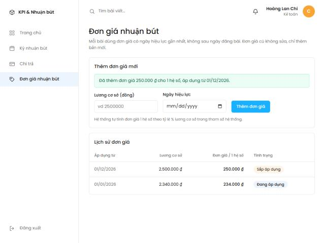
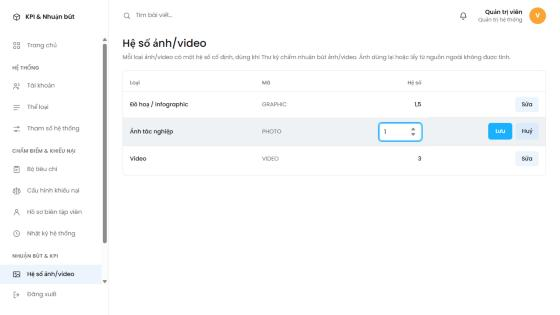
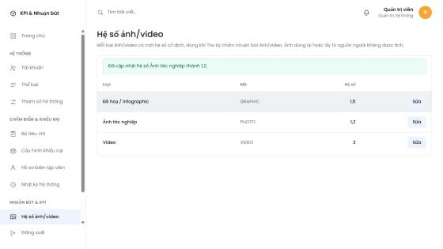
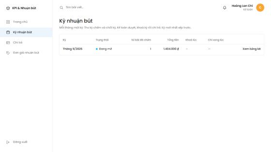

# BF-04 — Giải thích Frontend Iter 1 và phân quyền API

> Luồng 4 `royalty` (Quang). Đọc kèm **BF04-on-review.docx** (backend, swimlane, UC) và **BF04-ly-thuyet.docx** (Spring, JPA). File này chỉ nói phần **frontend React** của 3 màn Iter 1 và phần **phân quyền** trong `SecurityConfig`.

## 0. Tóm tắt

| Màn | UC | Ai dùng | Đường dẫn | Trang React | API |
|---|---|---|---|---|---|
| Đơn giá nhuận bút | UC-55 | Kế toán | `/royalty-rates` | `RoyaltyRates.jsx` | `GET`, `POST /api/royalty-rates` |
| Hệ số ảnh/video | UC-56 | Admin | `/media-factors` | `MediaFactors.jsx` | `GET /api/media-factors`, `PUT /api/media-factors/{id}` |
| Kỳ nhuận bút | UC-49 | Thư ký + Kế toán | `/royalty-periods` | `RoyaltyPeriods.jsx` | `GET /api/royalty-periods` |

**Các file đã sửa / thêm:**

| File | Mới / sửa | Làm gì |
|---|---|---|
| `server/.../config/SecurityConfig.java` | sửa (file dùng chung) | Thêm 3 luật chặn theo vai trò |
| `client/src/api/royaltyApi.js` | sửa | 5 hàm gọi API của BF-04 |
| `client/src/utils/royaltyLabels.js` | mới | Đổi mã (OPEN, PHOTO...) ra chữ tiếng Việt |
| `client/src/pages/royalty/Royalty.css` | mới | CSS chung 3 trang, chỉ dùng màu Figma `--fm-*` |
| `client/src/pages/royalty/RoyaltyRates.jsx` | mới | Trang đơn giá |
| `client/src/pages/royalty/MediaFactors.jsx` | mới | Trang hệ số ảnh/video |
| `client/src/pages/royalty/RoyaltyPeriods.jsx` | mới | Trang kỳ nhuận bút |
| `client/src/routes/AppRoutes.jsx` | sửa | Gắn 3 trang vào đường dẫn |
| `client/src/pages/home/AccountantHome.jsx` | sửa 2 dòng | Đổi tên hàm `layDanhSachDonGia` → `getRoyaltyRates` |

**Giao diện làm theo gì?** File Figma của nhóm chỉ có 1 màn bảng công việc kiểu Kanban, không có bảng dữ liệu hay form. Theo AGENTS.md mục 4, màn không có trong thiết kế thì **ghép từ màu, font, kiểu thẻ có sẵn**: font Poppins, thẻ trắng bo góc trên nền `#eef2f5`, nút xanh dương `#18b0ff`, chấm màu trạng thái. Các màu này đã có sẵn trong `index.css` (biến `--fm-*`), và trang "Bài của tôi" của Minh cũng dùng đúng kiểu này.

## 1. Một thao tác chạy qua những đâu

Ví dụ Kế toán bấm **"Thêm đơn giá"**:

1. **React** (`RoyaltyRates.jsx`): hàm `handleSubmit` chặn trình duyệt tải lại trang, kiểm tra nhanh dữ liệu, rồi gọi `createRoyaltyRate(...)`.
2. **File API** (`royaltyApi.js`): `createRoyaltyRate` gọi `goiApi('/api/royalty-rates', { method: 'POST', body })`.
3. **`goiApi.js`** (của nhóm): gắn header `Authorization: Bearer <token>`, đổi body sang JSON, gọi `fetch`.
4. **Vite proxy** (`vite.config.js`): mọi đường dẫn bắt đầu bằng `/api` được chuyển từ cổng 5173 sang Spring Boot cổng 8080. Nhờ vậy không cần CORS.
5. **Spring Security** (`SecurityConfig`): kiểm tra token, đọc vai trò. Không phải `ACCOUNTANT` → trả **403**, không vào tới controller.
6. **Controller → Service → Repository → DB**: `RoyaltyRateController.createRate` → `RoyaltyRateService.createRate` (kiểm tra ngày, tính đơn giá) → lưu bảng `royalty_rates`.
7. Server trả `{ success, message, data }`. `goiApi` trả về phần `data`, hoặc ném lỗi kèm `message` tiếng Việt.
8. **React** nhận `data` → `setRates(...)` → trang tự vẽ lại, dòng mới hiện trên đầu bảng.

## 2. Kiến thức React cần nắm

| Khái niệm | Ý nghĩa | Ví dụ trong code |
|---|---|---|
| Component | Một hàm JavaScript trả về giao diện. Tên viết hoa chữ đầu | `export default function RoyaltyRates() { return (<div>…</div>) }` |
| JSX | Viết HTML ngay trong JavaScript. `class` phải viết là `className`, giá trị JS đặt trong `{ }` | `<td>{formatMoney(rate.amount)}</td>` |
| Props | Tham số truyền từ component cha xuống con | `<RateBadge rate={rate} today={today} />` |
| `useState` | Biến "nhớ" của trang. Gọi hàm `setXxx` thì React vẽ lại trang | `const [rates, setRates] = useState(null)` |
| `useEffect(fn, [])` | Chạy `fn` **một lần** sau khi trang hiện ra. Dùng để gọi API lấy dữ liệu | `useEffect(() => { getRoyaltyRates()… }, [])` |
| Ô nhập có kiểm soát | Giá trị ô luôn lấy từ state; gõ phím thì cập nhật state | `value={baseSalary} onChange={(e) => setBaseSalary(e.target.value)}` |
| Hiện có điều kiện | `điều kiện && <JSX>`: điều kiện đúng mới hiện | `{loadError && <p className="thong-bao-loi">…</p>}` |
| Danh sách + `key` | Dùng `.map()` để vẽ từng dòng. `key` giúp React biết dòng nào là dòng nào khi danh sách đổi | `rates.map((rate) => <tr key={rate.id}>…</tr>)` |
| Không sửa mảng cũ | Luôn tạo mảng mới. React so sánh mảng cũ và mới để biết phải vẽ lại | `setRates([created, ...rates])` |
| `async` / `await` | Chờ API trả về mà không khoá giao diện | `const created = await createRoyaltyRate(…)` |
| `try` / `catch` / `finally` | Bắt lỗi API. `finally` luôn chạy dù thành công hay lỗi | `finally { setIsSaving(false) }` |
| React Router | Đổi trang theo đường dẫn mà không tải lại cả web | `<Route path="/royalty-rates" element={<RoyaltyRates />} />`, `<Link to=…>` |

**Ba trạng thái của dữ liệu tải từ API** (cả 3 trang đều dùng cùng cách):

- `null` → đang tải → hiện *"Đang tải…"*
- mảng rỗng `[]` → tải xong nhưng không có dữ liệu → hiện *"Chưa có …"*
- mảng có phần tử → vẽ bảng
- lỗi → lưu vào `loadError` → hiện khung đỏ

**Vì sao có biến `isMounted`?** Nếu người dùng rời trang trước khi API trả về, React không còn trang đó để cập nhật. Hàm `return () => { isMounted = false }` trong `useEffect` chạy lúc rời trang, đánh dấu "trang đã đóng", nên kết quả về muộn bị bỏ qua. Cách viết này giống trang `MyArticles` của Minh.

## 3. Phân quyền API — `SecurityConfig.java`

### 3.1 Lý thuyết

- **Spring Security** là một chuỗi bộ lọc chạy **trước** mọi controller. Request không hợp lệ bị trả lỗi ngay ở đây.
- **401 Unauthorized**: chưa đăng nhập, hoặc token sai / hết hạn.
- **403 Forbidden**: đã đăng nhập nhưng **không đúng vai trò**.
- Token JWT của nhóm có claim `role` (ví dụ `"ACCOUNTANT"`). `SecurityConfig` đổi nó thành quyền `ROLE_ACCOUNTANT`, nên viết được `.hasRole("ACCOUNTANT")`. Tên vai trò lấy đúng cột `roles.code` trong DB.
- Các luật được xét **từ trên xuống**, gặp luật khớp đầu tiên thì dừng. Vì vậy luật riêng phải đặt **trước** `anyRequest()`.

### 3.2 Code đã thêm

```java
.requestMatchers(HttpMethod.POST, "/api/auth/login").permitAll()
.requestMatchers("/error").permitAll()
// BF-04: chi Ke toan them don gia (UC-55), chi Admin sua he so anh/video (UC-56)
.requestMatchers(HttpMethod.POST, "/api/royalty-rates").hasRole("ACCOUNTANT")
.requestMatchers(HttpMethod.PUT, "/api/media-factors/**").hasRole("ADMIN")
// BF-04: ky nhuan but co tong tien, chi Thu ky va Ke toan xem (UC-49)
.requestMatchers("/api/royalty-periods/**").hasAnyRole("EDITORIAL_SECRETARY", "ACCOUNTANT")
.anyRequest().authenticated())
```

- `requestMatchers(HttpMethod.POST, "/api/royalty-rates")`: chỉ khớp **POST** vào đường dẫn này. `GET` cùng đường dẫn không bị luật này bắt, nên rơi xuống `anyRequest().authenticated()`: ai đăng nhập cũng xem được.
- `"/api/media-factors/**"`: `**` nghĩa là mọi thứ phía sau, ví dụ `/api/media-factors/1`, `/api/media-factors/2`.
- `hasAnyRole(...)`: có **một trong** các vai trò là được.
- **Vì sao xem đơn giá và hệ số không chặn?** Đây là cấu hình chung, không nhạy cảm, và Thư ký sẽ cần xem hệ số khi chấm ảnh (UC-48, Iter 2). Kỳ nhuận bút thì có **tổng tiền** nên chỉ Thư ký và Kế toán được xem.
- **Vì sao vẫn chặn ở server dù frontend đã ẩn menu?** Người dùng có thể gọi API thẳng bằng Postman hoặc curl mà không qua giao diện. Ẩn menu chỉ để dễ dùng; chặn thật phải ở server.

### 3.3 Kết quả chạy thử (mã HTTP trả về)

| Tài khoản mẫu | GET đơn giá | POST đơn giá | GET hệ số | PUT hệ số | GET kỳ |
|---|---|---|---|---|---|
| Phóng viên `an.nv` | 200 | **403** | 200 | **403** | **403** |
| Thư ký `dung.pt` | 200 | **403** | 200 | **403** | 200 |
| Kế toán `chi.hl` | 200 | 409 (*) | 200 | **403** | 200 |
| Admin `admin` | 200 | **403** | 200 | 200 | **403** |

(*) Kế toán qua được phân quyền, nhưng bài thử gửi ngày hiệu lực 01/01/2026 (không sau đơn giá mới nhất) nên service trả 409: *"Ngày hiệu lực phải sau ngày 01/01/2026 của đơn giá mới nhất."*

Bị chặn vai trò thì server trả: `{"success":false,"message":"Bạn không có quyền thực hiện chức năng này."}`

## 4. `api/royaltyApi.js` — gọi API

Mỗi luồng có 1 file trong `src/api/` (AGENTS.md mục 4). Trang React **không gọi `fetch` trực tiếp**, chỉ gọi các hàm ở đây.

```js
import { goiApi } from './goiApi.js'

export async function getRoyaltyRates() {
  return goiApi('/api/royalty-rates')
}

export async function createRoyaltyRate(rate) {
  return goiApi('/api/royalty-rates', { method: 'POST', body: rate })
}

export async function getMediaFactors() {
  return goiApi('/api/media-factors')
}

export async function updateMediaFactor(id, factor) {
  return goiApi(`/api/media-factors/${id}`, { method: 'PUT', body: { factor } })
}

export async function getRoyaltyPeriods() {
  return goiApi('/api/royalty-periods')
}
```

| Hàm | Dùng để làm gì | Trả về |
|---|---|---|
| `getRoyaltyRates()` | Lấy lịch sử đơn giá, mới nhất trước | `[{ id, baseSalary, amount, effectiveFrom: "2026-01-01", createdBy }]` |
| `createRoyaltyRate(rate)` | Thêm đơn giá. `rate = { baseSalary, effectiveFrom }` | Đơn giá vừa tạo (có `amount` do server tính) |
| `getMediaFactors()` | Lấy hệ số các loại ảnh/video | `[{ id, mediaKind: "PHOTO", factor: 1.00 }]` |
| `updateMediaFactor(id, factor)` | Sửa hệ số 1 loại | Dòng sau khi sửa |
| `getRoyaltyPeriods()` | Lấy danh sách kỳ | `[{ id, periodYear, periodMonth, status, lockedAt, returnNote, paidAt, totalAmount, gradedArticleCount }]` |

- `` `/api/media-factors/${id}` `` là **template string**: dấu backtick cho phép chèn biến bằng `${...}`.
- `{ factor }` là cách viết tắt của `{ factor: factor }`.
- `goiApi` (file chung của nhóm) làm sẵn 4 việc:
  1. Gắn token.
  2. Đổi body sang JSON.
  3. Lỗi thì ném `Error` kèm câu tiếng Việt từ server.
  4. Token hết hạn (401) thì xoá phiên và đưa về trang đăng nhập.

## 5. `utils/royaltyLabels.js` — nhãn hiển thị

Server trả **mã** (`OPEN`, `PHOTO`...). File này đổi mã ra **chữ**, dùng chung mọi màn để cùng 1 mã luôn hiện cùng 1 chữ (giống `articleLabels.js` của Minh).

```js
export const PERIOD_STATUS_LABELS = {
  OPEN:   'Đang mở',
  CLOSED: 'Đã chốt, chờ kế toán duyệt',
  LOCKED: 'Đã khoá, chờ chi trả',
  PAID:   'Đã chi trả',
}

export const PERIOD_STATUS_COLORS = {
  OPEN: 'xanh-duong', CLOSED: 'cam', LOCKED: 'tim', PAID: 'xanh-la',
}

export const MEDIA_KIND_LABELS = {
  PHOTO: 'Ảnh tác nghiệp', GRAPHIC: 'Đồ hoạ / infographic', VIDEO: 'Video',
}

export function periodStatusLabel(status) {
  return PERIOD_STATUS_LABELS[status] || status
}
```

- Key của object phải **trùng đúng** giá trị CHECK trong `schema.sql` (`ck_royalty_periods_status`).
- Màu là đuôi của class chung `.cham--xanh-duong`, `.cham--cam`... trong `index.css` (chấm tròn giống thẻ trong Figma), và trùng màu trang chủ Kế toán.
- `PERIOD_STATUS_LABELS[status] || status`: tra không ra (mã lạ) thì hiện nguyên mã, không để ô trống.

## 6. `pages/royalty/RoyaltyRates.jsx` — Đơn giá (UC-55)



### 6.1 Các hàm trong file

| Hàm | Dùng để làm gì |
|---|---|
| `RoyaltyRates()` | Component chính: form thêm đơn giá ở trên, bảng lịch sử ở dưới |
| `handleSubmit(event)` | Chạy khi bấm "Thêm đơn giá": kiểm tra, gọi API, cập nhật bảng |
| `RateBadge({ rate, currentRateId, today })` | Component nhỏ vẽ nhãn **Sắp áp dụng** / **Đang áp dụng** / **Đã thay thế** |
| `findCurrentRateId(rates, today)` | Tìm id đơn giá đang áp dụng hôm nay |
| `todayIsoDate()` | Ngày hôm nay dạng `"2026-10-14"` |
| `nextIsoDate(isoDate)` | Ngày kế tiếp: `"2026-01-31"` → `"2026-02-01"` |

### 6.2 State của trang

```js
const [rates, setRates] = useState(null)        // null = dang tai
const [loadError, setLoadError] = useState('')

const [baseSalary, setBaseSalary] = useState('')
const [effectiveFrom, setEffectiveFrom] = useState('')
const [isSaving, setIsSaving] = useState(false)
const [formError, setFormError] = useState('')
const [successMessage, setSuccessMessage] = useState('')
```

- `rates`: danh sách đơn giá. Bắt đầu `null` = đang tải.
- `baseSalary`, `effectiveFrom`: giá trị 2 ô nhập. Để kiểu **chuỗi** vì ô nhập luôn trả chuỗi; khi gửi mới đổi sang số.
- `isSaving`: đang gửi thì khoá nút, tránh bấm 2 lần tạo 2 đơn giá.
- `formError`, `successMessage`: câu báo lỗi / báo thành công phía trên form.

### 6.3 Tải dữ liệu khi mở trang

```js
useEffect(() => {
  let isMounted = true
  getRoyaltyRates()
    .then((data) => { if (isMounted) setRates(data) })
    .catch((err) => { if (isMounted) setLoadError(err.message) })
  return () => { isMounted = false }
}, [])
```

- `[]` ở cuối: chỉ chạy 1 lần khi trang mở.
- `.then(...)` chạy khi API thành công, `.catch(...)` khi lỗi. `err.message` là câu tiếng Việt do `goiApi` ghép sẵn.

### 6.4 Bấm "Thêm đơn giá" — `handleSubmit`

```js
async function handleSubmit(event) {
  event.preventDefault()   // khong cho trinh duyet tai lai trang khi gui form
  setFormError('')
  setSuccessMessage('')

  // Kiem tra nhanh o trinh duyet; server van kiem lai (@Valid + luat ngay hieu luc)
  const salary = Number(baseSalary)
  if (!Number.isInteger(salary) || salary <= 0) {
    setFormError('Lương cơ sở phải là số nguyên dương (đồng).')
    return
  }
  if (!effectiveFrom) {
    setFormError('Vui lòng chọn ngày hiệu lực.')
    return
  }

  setIsSaving(true)
  try {
    const created = await createRoyaltyRate({ baseSalary: salary, effectiveFrom })
    // Don gia moi luon co ngay hieu luc lon nhat -> dat len dau danh sach (khong sua mang cu)
    setRates([created, ...rates])
    setBaseSalary('')
    setEffectiveFrom('')
    setSuccessMessage(`Đã thêm đơn giá ${formatMoney(created.amount)} cho 1 hệ số, `
      + `áp dụng từ ${formatDate(created.effectiveFrom)}.`)
  } catch (err) {
    setFormError(err.message)
  } finally {
    setIsSaving(false)
  }
}
```

Giải thích từng đoạn:

1. `event.preventDefault()`: mặc định, gửi form làm trình duyệt **tải lại cả trang**. Dòng này chặn việc đó để React tự xử lý.
2. Xoá thông báo cũ trước khi gửi lần mới.
3. **Kiểm tra ở trình duyệt** để báo lỗi nhanh, không cần gọi server. Server **vẫn kiểm lại** (`@Valid` ở DTO và luật ngày trong service), vì không bao giờ tin dữ liệu từ trình duyệt.
4. `setIsSaving(true)` → nút đổi chữ thành *"Đang lưu…"* và bị khoá.
5. `await createRoyaltyRate(...)`: gửi **lương cơ sở**, không gửi đơn giá. **Server tự tính** đơn giá = lương cơ sở × `UNIT_PRICE_PERCENT` / 100. Frontend không viết cứng số 10%; sau này đổi tỷ lệ chỉ cần sửa bảng `system_parameters`.
6. `setRates([created, ...rates])`: tạo mảng mới gồm dòng vừa tạo ở đầu, rồi đến các dòng cũ (`...` là toán tử trải). Dòng mới luôn mới nhất vì server bắt ngày hiệu lực phải sau đơn giá mới nhất.
7. Xoá trắng 2 ô nhập và báo thành công.
8. `catch`: server trả lỗi (409 sai ngày, 403 sai vai trò...) thì hiện câu lỗi phía trên form.
9. `finally`: dù thành công hay lỗi đều mở khoá nút.

### 6.5 Đơn giá nào đang áp dụng?

```js
function findCurrentRateId(rates, today) {
  for (const rate of rates) {
    if (rate.effectiveFrom <= today) {
      return rate.id
    }
  }
  return null
}
```

- Luật BR-RY-03: đơn giá áp dụng cho 1 ngày = dòng có **ngày hiệu lực lớn nhất mà ≤ ngày đó**.
- Danh sách đã xếp **mới nhất trước**, nên dòng **đầu tiên** có `effectiveFrom <= today` chính là đơn giá đang áp dụng. Dòng có ngày lớn hơn hôm nay là "Sắp áp dụng", các dòng còn lại là "Đã thay thế".
- So sánh chuỗi `"2026-01-01" <= "2026-10-14"` đúng như so sánh ngày, vì dạng `năm-tháng-ngày` luôn đủ chữ số và xếp từ lớn đến nhỏ.

```js
function RateBadge({ rate, currentRateId, today }) {
  if (rate.effectiveFrom > today) {
    return <span className="royalty__badge royalty__badge--future">Sắp áp dụng</span>
  }
  if (rate.id === currentRateId) {
    return <span className="royalty__badge royalty__badge--current">Đang áp dụng</span>
  }
  return <span className="royalty__badge">Đã thay thế</span>
}
```

### 6.6 Hai hàm xử lý ngày

```js
function todayIsoDate() {
  const now = new Date()
  const month = String(now.getMonth() + 1).padStart(2, '0')
  const day = String(now.getDate()).padStart(2, '0')
  return `${now.getFullYear()}-${month}-${day}`
}

function nextIsoDate(isoDate) {
  const date = new Date(`${isoDate}T00:00:00Z`)
  date.setUTCDate(date.getUTCDate() + 1)
  return date.toISOString().slice(0, 10)
}
```

- `getMonth()` của JavaScript đếm **từ 0** (tháng 1 = 0), nên phải `+ 1`.
- `padStart(2, '0')`: thêm số 0 phía trước cho đủ 2 chữ số (`"9"` → `"09"`).
- `nextIsoDate` dùng giờ **UTC** (chữ `Z`) để không bị lệch ngày do múi giờ Việt Nam (+7).
- Kết quả dùng cho thuộc tính `min` của ô ngày: lịch không cho chọn ngày ≤ đơn giá mới nhất.

```js
const minDate = rates && rates.length > 0 ? nextIsoDate(rates[0].effectiveFrom) : undefined
```

`rates[0]` là đơn giá mới nhất. Chưa có đơn giá nào thì `undefined` = không giới hạn.

## 7. `pages/royalty/MediaFactors.jsx` — Hệ số ảnh/video (UC-56)





### 7.1 Các hàm trong file

| Hàm | Dùng để làm gì |
|---|---|
| `MediaFactors()` | Component chính: bảng các loại ảnh/video, sửa ngay trên dòng |
| `startEdit(mediaFactor)` | Bấm "Sửa": đánh dấu dòng đang sửa, điền sẵn hệ số cũ vào ô |
| `cancelEdit()` | Bấm "Huỷ": thoát chế độ sửa, không gọi API |
| `saveEdit(mediaFactor)` | Bấm "Lưu": kiểm tra định dạng, gọi API, thay đúng dòng vừa sửa |

### 7.2 Kiểm tra định dạng hệ số

```js
const FACTOR_PATTERN = /^\d{1,3}(\.\d{1,2})?$/
```

Đây là **biểu thức chính quy (regex)**:

- `^` … `$`: khớp **cả chuỗi**, từ đầu tới cuối.
- `\d{1,3}`: 1 đến 3 chữ số (phần nguyên).
- `(\.\d{1,2})?`: dấu chấm và 1–2 chữ số thập phân, **có hoặc không** (dấu `?`).
- Khớp đúng cột `DECIMAL(5,2)` trong DB: tối đa 999.99. Ví dụ `1`, `1.5`, `1.50` hợp lệ; `1.234`, `abc` không hợp lệ.

### 7.3 Sửa trên dòng

```js
const [editingId, setEditingId] = useState(null)   // id dong dang sua, null = khong sua dong nao
const [editValue, setEditValue] = useState('')

function startEdit(mediaFactor) {
  setEditingId(mediaFactor.id)
  setEditValue(String(mediaFactor.factor))
  setSaveError('')
  setSuccessMessage('')
}
```

Trong bảng, mỗi dòng tự quyết định hiện gì:

```js
{editingId === mediaFactor.id ? (
  <> … ô nhập + nút Lưu, Huỷ … </>
) : (
  <> … số hệ số + nút Sửa … </>
)}
```

- `điều kiện ? A : B`: toán tử 3 ngôi, đúng thì vẽ A, sai thì vẽ B.
- `<> … </>` (Fragment): gom nhiều thẻ `<td>` mà không sinh thêm thẻ HTML thừa.
- Chỉ 1 dòng được sửa tại một thời điểm, vì `editingId` chỉ giữ 1 id.

### 7.4 Lưu

```js
async function saveEdit(mediaFactor) {
  if (!FACTOR_PATTERN.test(editValue) || Number(editValue) <= 0) {
    setSaveError('Hệ số phải lớn hơn 0, tối đa 2 chữ số thập phân (vd 1.50).')
    return
  }

  setIsSaving(true)
  try {
    const updated = await updateMediaFactor(mediaFactor.id, Number(editValue))
    // Thay dong vua sua bang du lieu server tra ve, cac dong khac giu nguyen
    setFactors(factors.map((item) => (item.id === updated.id ? updated : item)))
    setEditingId(null)
    setSaveError('')
    setSuccessMessage(`Đã cập nhật hệ số ${mediaKindLabel(updated.mediaKind)} thành ${formatNumber(updated.factor)}.`)
  } catch (err) {
    setSaveError(err.message)
  } finally {
    setIsSaving(false)
  }
}
```

- `factors.map(...)` tạo **mảng mới**: dòng có id trùng thì thay bằng dữ liệu server trả về, các dòng khác giữ nguyên.
- Lấy dữ liệu **server trả về** (`updated`) thay vì giá trị vừa gõ, để chắc chắn bảng hiện đúng cái đã lưu trong DB.
- `setEditingId(null)` → thoát chế độ sửa.

## 8. `pages/royalty/RoyaltyPeriods.jsx` — Kỳ nhuận bút (UC-49)



Trang **chỉ đọc**, chỉ có 1 hàm là component `RoyaltyPeriods()`: tải danh sách kỳ khi mở trang (giống mục 6.3) rồi vẽ bảng.

```js
<td className="royalty__strong royalty__nowrap">Tháng {period.periodMonth}/{period.periodYear}</td>
<td>
  <span className="royalty__status">
    <span className={`cham cham--${PERIOD_STATUS_COLORS[period.status]}`} aria-hidden="true" />
    {periodStatusLabel(period.status)}
  </span>
  {/* Ke toan tra ky ve (UC-52) thi hien ly do de Thu ky sua */}
  {period.returnNote && <p className="royalty__note">Bị trả lại: {period.returnNote}</p>}
</td>
<td className="royalty__number">{formatNumber(period.gradedArticleCount)}</td>
<td className="royalty__number royalty__strong">{formatMoney(period.totalAmount)}</td>
<td className="royalty__date">{formatDate(period.lockedAt)}</td>
<td className="royalty__date">{formatDate(period.paidAt)}</td>
<td className="royalty__actions">
  <Link to={`/royalty-periods/${period.id}`} className="royalty__link">Xem bảng kê</Link>
</td>
```

- Chấm màu + chữ trạng thái lấy từ `royaltyLabels.js`.
- `aria-hidden="true"`: chấm màu chỉ để trang trí, trình đọc màn hình (cho người khiếm thị) bỏ qua.
- `returnNote` chỉ có khi Kế toán từng **trả kỳ về** (UC-52); có thì hiện dòng chữ hồng *"Bị trả lại: …"*.
- `formatMoney`, `formatDate`, `formatNumber` là hàm dùng chung của nhóm trong `utils/`. Chưa khoá hay chưa chi thì `lockedAt` / `paidAt` là `null` → hiện `—`.
- `<Link to=…>`: chuyển trang **không tải lại web**. Trang chi tiết kỳ (UC-50, 51) làm ở Iter 2, hiện đang là trang "Sắp ra mắt".
- **Thư ký và Kế toán dùng chung trang này.** Việc khác nhau giữa 2 vai trò (Thư ký chốt kỳ, Kế toán khoá kỳ) nằm ở trang chi tiết, Iter 2.

## 9. `routes/AppRoutes.jsx` — gắn trang vào đường dẫn

```js
import RoyaltyPeriods from '../pages/royalty/RoyaltyPeriods.jsx'
import RoyaltyRates from '../pages/royalty/RoyaltyRates.jsx'
import MediaFactors from '../pages/royalty/MediaFactors.jsx'
…
{vaiTro === 'EDITORIAL_SECRETARY' && (
  <>
    <Route path="/royalty-periods" element={<RoyaltyPeriods />} />
  </>
)}
{vaiTro === 'ACCOUNTANT' && (
  <>
    <Route path="/royalty-periods" element={<RoyaltyPeriods />} />
    <Route path="/royalty-rates" element={<RoyaltyRates />} />
  </>
)}
{vaiTro === 'ADMIN' && (
  <>
    …
    <Route path="/media-factors" element={<MediaFactors />} />
  </>
)}
```

- Khung trang (menu bên trái, thanh trên) do `Layout` của từng vai trò vẽ; trang của mình hiện vào chỗ `<Outlet />`.
- Mỗi vai trò chỉ có route của mình. Phóng viên gõ thẳng `/royalty-rates` → không có route → về trang chủ.
- Đồng thời **xoá** 4 dòng tương ứng khỏi các mảng `TRANG_TK_CHUA_LAM`, `TRANG_KT_CHUA_LAM`, `TRANG_ADMIN_CHUA_LAM`. Đây là danh sách trang chưa làm, hiện trang "Sắp ra mắt". Đường dẫn `/royalty-periods/:id` vẫn giữ trong danh sách đó vì Iter 2 mới làm.
- Menu bên trái đã có sẵn 3 mục này trong `AccountantLayout`, `SecretaryLayout`, `AdminLayout` từ trước, nên không phải sửa menu.

## 10. `pages/royalty/Royalty.css`

- Một file CSS chung cho 3 trang, vì 3 trang cùng bố cục: tiêu đề → thẻ trắng → form / bảng.
- Mọi class có tiền tố `.royalty__` (kiểu đặt tên BEM: `khối__phần--biến thể`), để không đụng CSS của trang khác.
- Chỉ dùng biến màu Figma `--fm-*` (`--fm-the` nền thẻ, `--fm-vien` đường kẻ, `--fm-xanh-duong` nút chính...).
- Một số class đáng chú ý:
  - `.royalty__number`: cột số căn phải, `tabular-nums` để các chữ số thẳng cột.
  - `.royalty__scroll { overflow-x: auto }`: màn hẹp thì bảng cuộn ngang trong thẻ, không vỡ khung.
  - `.royalty__badge--current` / `--future`: nền xanh nhạt cho "Đang áp dụng", nền cam nhạt cho "Sắp áp dụng".

## 11. Bảng dữ liệu (DB) mà 3 màn dùng

| Bảng | Vì sao có bảng này | Cột dùng | Quan hệ |
|---|---|---|---|
| `royalty_rates` | Lưu **từng phiên bản** đơn giá theo ngày hiệu lực. Không sửa dòng cũ, để bài đăng ngày nào tính theo giá ngày đó (BR-RY-03) | `base_salary`, `amount`, `effective_from` (UNIQUE), `created_by` | n–1 với `users` (`created_by` = Kế toán tạo) |
| `system_parameters` | Lưu tỷ lệ `UNIT_PRICE_PERCENT` (10%) dạng tham số, không viết cứng trong code | `param_key`, `param_value`, `flow` | n–1 với `users` (`updated_by`) |
| `media_factors` | Mỗi loại ảnh/video 1 hệ số cố định (BR-RY-04) | `media_kind` (UNIQUE), `factor` | 1–n với `article_attachments.media_kind` của BF-01 (chưa có FK, nằm trong PR `[DB]`) |
| `royalty_periods` | Mỗi tháng 1 kỳ, giữ trạng thái OPEN → CLOSED → LOCKED → PAID (BR-RY-07) | `period_year` + `period_month` (UNIQUE), `status`, `locked_at`, `paid_at`, `return_note` | 1–n với `royalty_lines` (cộng `amount` ra tổng tiền) và `royalty_gradings` (đếm số bài đã chấm) |
| `roles` | Danh sách vai trò cố định. `roles.code` chính là tên dùng trong `hasRole(...)` và trong `AppRoutes` | `code` | 1–n với `users` (mỗi user đúng 1 vai trò) |

## 12. Kết quả chạy thử

| Thử | Kết quả |
|---|---|
| `mvn compile`, `mvn test` (backend) | Thành công, toàn bộ unit test pass |
| `npm run build` (frontend) | Thành công, không lỗi |
| Kế toán mở Đơn giá | Hiện 234.000 ₫ (lương cơ sở 2.340.000 ₫), nhãn "Đang áp dụng" |
| Kế toán thêm lương cơ sở 2.500.000 ₫, ngày 01/12/2026 | Server tính 250.000 ₫, có thông báo thành công, dòng mới ở đầu với nhãn "Sắp áp dụng" |
| Admin sửa hệ số Ảnh tác nghiệp 1 → 1,2 | Lưu thành công, bảng đổi thành 1,2 |
| Kế toán mở Kỳ nhuận bút | Kỳ 9/2026 Đang mở, 1 bài đã chấm, 1.404.000 ₫ |
| Ma trận phân quyền 4 vai trò × 5 API | Đúng như bảng ở mục 3.3 |

Dữ liệu thử (đơn giá 01/12/2026, hệ số đã sửa) đã được trả lại như `data.sql` sau khi thử.

## 13. Test case: happy, edge, bad

- **Happy case**: người dùng làm đúng luồng, dữ liệu hợp lệ → chức năng chạy như mong đợi.
- **Edge case** (ca biên): dữ liệu nằm **sát ranh giới** giữa đúng và sai (bằng đúng ngày giới hạn, số nhỏ nhất hợp lệ, làm tròn...). Lỗi hay nằm ở đây nhất.
- **Bad case**: dữ liệu sai, thiếu, sai quyền, không tìm thấy → hệ thống phải **từ chối** và báo lỗi tiếng Việt dễ hiểu, không ghi gì vào DB.

Cột **Đã kiểm** ghi cách kiểm:
- **UI**: bấm thật trên trình duyệt.
- **API**: gọi thật bằng curl.
- **UT**: unit test, kèm tên hàm test.
- **Theo code**: chưa chạy, suy ra từ code. Những ca này nếu chạy sẽ ghi dữ liệu thật vào DB, nên để dành lúc demo.

Kết quả ghi trong bảng là **kết quả thật** đã chạy ngày 14/10/2026. Sau khi chạy, DB vẫn khớp `data.sql`.

### 13.1 UC-55 Đơn giá nhuận bút

| # | Loại | Tình huống | Dữ liệu vào | Kết quả | Đã kiểm |
|---|---|---|---|---|---|
| H1 | Happy | Kế toán thêm đơn giá hợp lệ | Lương 2.500.000, ngày 01/12/2026 | 201. Đơn giá **250.000 ₫**, dòng mới ở đầu bảng, nhãn "Sắp áp dụng" | UI |
| H2 | Happy | Thêm đơn giá đầu tiên khi bảng còn trống | Lương 2.340.000 | Đơn giá 234.000 ₫, không cần kiểm ngày | UT `createFirstRateWhenNoRateExists` |
| H3 | Happy | Xem lịch sử | — | Mới nhất xếp trước, đúng 1 dòng "Đang áp dụng" | UI |
| E1 | Edge | Ngày hiệu lực **bằng đúng** ngày của đơn giá mới nhất | Ngày 01/01/2026 | 409 *"Ngày hiệu lực phải sau ngày 01/01/2026 của đơn giá mới nhất."* | API, UT `createRateRejectsDateNotAfterLatestRate` |
| E2 | Edge | Ngày hiệu lực = ngày mới nhất **+ 1** | Ngày 02/01/2026 | Hợp lệ. Lịch trên giao diện cũng chỉ cho chọn từ ngày này trở đi | Theo code |
| E3 | Edge | Lương cơ sở quá nhỏ: 10% làm tròn xuống bằng 0 | Lương 9 | 409 *"Lương cơ sở quá nhỏ, đơn giá tính ra bằng 0 đồng."* | API |
| E4 | Edge | Lương cơ sở nhỏ nhất cho đơn giá > 0 | Lương 10 | Hợp lệ, đơn giá 1 ₫ | Theo code |
| E5 | Edge | Lương cơ sở lẻ, đơn giá bỏ phần lẻ dưới 1 đồng | 2.345.678 | Đơn giá 234.567 ₫ | UT `unitPriceIsBaseSalaryTimesPercent` |
| B1 | Bad | Lương cơ sở bằng 0 | `baseSalary: 0` | 400 *"Lương cơ sở phải lớn hơn 0"* | API |
| B2 | Bad | Bỏ trống cả 2 ô | `{}` | 400, báo cả 2 lỗi *"Lương cơ sở không được để trống"*, *"Ngày hiệu lực không được để trống"* | API |
| B3 | Bad | Lương cơ sở có số lẻ | `2500000.5` | 400 *"Lương cơ sở phải là số nguyên đồng, tối đa 18 chữ số"* | API |
| B4 | Bad | Thư ký, Admin, Phóng viên thêm đơn giá | Token sai vai trò | 403 *"Bạn không có quyền thực hiện chức năng này."* | API |
| B5 | Bad | Không đăng nhập / token sai | Không có token | 401 *"Bạn chưa đăng nhập hoặc phiên đăng nhập đã hết hạn."* | API |
| B6 | Bad | Nhập chữ hoặc số âm vào ô lương | `-5` | Frontend báo *"Lương cơ sở phải là số nguyên dương (đồng)."*, **không gọi API** | Theo code |
| B7 | Bad | DB thiếu tham số `UNIT_PRICE_PERCENT` | Xoá tham số | `RoyaltyCalculator` báo *"Thiếu tham số hệ thống: UNIT_PRICE_PERCENT"* | UT `throwsWhenAParameterIsMissing` |

### 13.2 UC-56 Hệ số ảnh/video

| # | Loại | Tình huống | Dữ liệu vào | Kết quả | Đã kiểm |
|---|---|---|---|---|---|
| H1 | Happy | Admin sửa hệ số Ảnh tác nghiệp | 1 → 1.2 | 200. Thông báo thành công, dòng đổi thành 1,2 | UI, UT `updateFactorSavesNewFactor` |
| H2 | Happy | Xem danh sách | — | 3 loại GRAPHIC, PHOTO, VIDEO kèm hệ số | UI |
| H3 | Happy | Bấm Sửa rồi bấm Huỷ | — | Thoát chế độ sửa, giữ số cũ, không gọi API | Theo code |
| E1 | Edge | Hệ số nhỏ nhất hợp lệ | 0.01 | Hợp lệ | Theo code (`@DecimalMin("0.01")`) |
| E2 | Edge | 3 chữ số thập phân | 1.234 | 400 *"Hệ số tối đa 3 chữ số phần nguyên và 2 chữ số thập phân"* | API |
| E3 | Edge | **Lỗi đã biết:** hệ số vượt `max_factor` cũ của DB | PHOTO 2.50 (trần cũ 2.00) | **500**, lỗi SQL từ CHECK `ck_media_factors_factor`. Hết lỗi khi PR `[DB]` bỏ cột `max_factor` được merge | API |
| B1 | Bad | Hệ số bằng 0 | 0 | 400 *"Hệ số phải lớn hơn 0"* | API |
| B2 | Bad | Bỏ trống | `{}` | 400 *"Hệ số không được để trống"* | API |
| B3 | Bad | Loại ảnh/video không tồn tại | id 999 | 404 *"Không tìm thấy loại ảnh/video có ID: 999"* | API, UT `updateFactorThrowsWhenIdNotFound` |
| B4 | Bad | Kế toán, Thư ký, Phóng viên sửa hệ số | Token sai vai trò | 403 | API |
| B5 | Bad | Gõ 1.234 trên giao diện | 1.234 | Frontend báo lỗi ngay (regex), không gọi API | Theo code |

### 13.3 UC-49 Kỳ nhuận bút

| # | Loại | Tình huống | Dữ liệu vào | Kết quả | Đã kiểm |
|---|---|---|---|---|---|
| H1 | Happy | Kế toán xem danh sách kỳ | — | Tháng 9/2026, Đang mở, 1 bài, 1.404.000 ₫ | UI |
| H2 | Happy | Thư ký xem danh sách kỳ | — | Cùng bảng như Kế toán | UI |
| H3 | Happy | Tổng tiền và số bài tính đúng | Kỳ có các dòng nhuận bút | Tổng 1.233.000 ₫, 2 bài | UT `getAllPeriodsAddsTotalAmountAndGradedArticleCount` |
| E1 | Edge | Kỳ chưa có dòng nhuận bút nào | Kỳ mới mở | Tổng 0 ₫, 0 bài (nhờ `COALESCE(SUM(amount), 0)`, không bị `null`) | Theo code |
| E2 | Edge | Kỳ chưa khoá, chưa chi | `lockedAt`, `paidAt` = `null` | Hiện "—" | UI |
| E3 | Edge | Chưa có kỳ nào | Bảng trống | *"Chưa có kỳ nhuận bút nào."* | Theo code |
| B1 | Bad | Phóng viên hoặc Admin xem kỳ | Token sai vai trò | 403 | API |
| B2 | Bad | Không có token / token sai | — | 401 | API |

### 13.4 `RoyaltyCalculator`: 19 unit test chia theo loại

| Loại | Tên test | Kiểm điều gì |
|---|---|---|
| Happy | `createsCalculatorWhenAllParametersArePresent` | Đủ tham số thì tạo được bộ tính |
| Happy | `suggestedFactorIsBaseFactorTimesScorePercent` | Hệ số = hệ số chuẩn × điểm / 100 (BR-RY-01) |
| Happy | `natureRateComesFromSystemParameters` | Tỷ lệ tính chất lấy từ `system_parameters` |
| Happy | `finalFactorMultipliesSaturationAndNatureRates` | 5,00 × 80% × 70% = 2,80 (BR-RY-02) |
| Happy | `unitPriceIsBaseSalaryTimesPercent` | Đơn giá = lương cơ sở × 10% |
| Happy | `amountIsFactorTimesUnitPriceRoundedDownToThousand` | Tiền = hệ số × đơn giá, làm tròn xuống 1.000 ₫ |
| Happy | `coAuthorsAreRoundedDownAndMainAuthorTakesTheRest` | Chia 40/35/25%, phần dư cho tác giả chính (GBR-10) |
| Edge | `suggestedFactorIsRoundedToTwoDecimals` | Làm tròn hệ số 2 chữ số |
| Edge | `articleNotInEventGetsFullSaturationRate` | Bài không thuộc sự kiện → 100% |
| Edge | `scoreBelowExemptScoreKeepsArticleSaturationRate` | Điểm 89,99, sát dưới ngưỡng 90 → vẫn bị giảm |
| Edge | `scoreAtOrAboveExemptScoreIsExempt` | Điểm **đúng 90** → được miễn giảm |
| Edge | `natureRateFollowsChangedParameter` | Đổi tham số 70 → 65 thì kết quả đổi theo |
| Edge | `finalFactorIsRoundedOnlyOnceAtTheEnd` | Ra 2,27 chứ không phải 2,28 (chỉ làm tròn 1 lần ở cuối) |
| Edge | `finalFactorIsAtLeastMinFinalFactor` | 0,693 → nâng lên tối thiểu 1 |
| Edge | `splitPartsAlwaysAddUpToTheWholeAmount` | Chia 33,34 / 33,33 / 33,33 vẫn cộng lại đúng tổng |
| Edge | `singleAuthorGetsTheWholeAmount` | Một tác giả nhận đủ 100% |
| Bad | `throwsWhenAParameterIsMissing` | Thiếu tham số → báo lỗi rõ tên tham số |
| Bad | `throwsWhenAParameterIsNotANumber` | Tham số không phải số → báo lỗi |
| Bad | `throwsWhenSharesDoNotAddUpTo100` | Tỷ lệ chia 60 + 30 = 90% → báo lỗi *"…đang là 90"* |

**Chạy test:**

```
mvn -f server/pom.xml test
mvn -f server/pom.xml test -Dtest=RoyaltyCalculatorTest
```

Lệnh thứ hai chỉ chạy 19 test của `RoyaltyCalculator`, hợp để demo nhanh trước mặt thầy.

## 14. Câu hỏi thầy dễ hỏi

**Vì sao frontend không tự tính đơn giá 10%?**
Tỷ lệ nằm trong bảng `system_parameters` (`UNIT_PRICE_PERCENT`). Tính ở server thì đổi tỷ lệ chỉ cần sửa DB, không phải sửa và build lại React. Và số tiền luôn tính bằng `BigDecimal` ở server, không bị sai số như số thực của JavaScript.

**Đã kiểm tra ở trình duyệt rồi sao server còn kiểm tra?**
Kiểm tra ở trình duyệt chỉ để báo lỗi nhanh. Người dùng có thể gọi API thẳng (Postman, curl) bỏ qua giao diện, nên server phải kiểm lại (`@Valid` + luật trong service).

**401 và 403 khác nhau thế nào?**
401: chưa đăng nhập hoặc token sai / hết hạn. 403: đã đăng nhập nhưng vai trò không được phép.

**Ẩn menu theo vai trò đã đủ an toàn chưa?**
Chưa. Ẩn menu chỉ giúp dễ dùng. Chặn thật nằm ở `SecurityConfig` phía server.

**`useEffect` với `[]` nghĩa là gì?**
Mảng phụ thuộc rỗng: hàm chỉ chạy 1 lần sau khi trang hiện ra. Nếu trong mảng có biến (ví dụ `[page]`) thì hàm chạy lại mỗi khi biến đó đổi (như trang "Bài của tôi" khi đổi trang).

**Vì sao không viết `rates.push(created)`?**
`push` sửa mảng cũ. React so sánh tham chiếu mảng cũ và mới; mảng vẫn là mảng cũ thì React nghĩ không có gì thay đổi và **không vẽ lại**. Phải tạo mảng mới: `[created, ...rates]`.

**`key={rate.id}` để làm gì?**
Giúp React nhận ra từng dòng khi danh sách thay đổi (thêm, xoá, đổi thứ tự), để chỉ vẽ lại dòng thay đổi. `key` phải duy nhất, nên dùng `id` từ DB.

**Vì sao nút bị khoá khi đang lưu?**
Tránh bấm 2 lần gửi 2 request. Với đơn giá, request thứ hai sẽ bị server từ chối (409) nhưng người dùng thấy lỗi khó hiểu.

**Vì sao đơn giá cũ không có nút sửa / xoá?**
BR-RY-03 và comment bảng `royalty_rates`: không sửa dòng cũ, chỉ thêm dòng mới. Bài đăng trong quá khứ phải tính theo đơn giá lúc đó.

**Gọi API mà không viết `http://localhost:8080`?**
Vite proxy chuyển mọi đường dẫn `/api/...` từ cổng 5173 sang 8080 (`vite.config.js`). Trình duyệt chỉ thấy 1 địa chỉ nên không bị lỗi CORS.

## 15. Bài luyện sửa code

1. **Hiện thêm cột "Người tạo" ở bảng đơn giá.**
   Thêm `<th>Người tạo</th>` và `<td>{rate.createdBy}</td>` trong `RoyaltyRates.jsx`. Muốn hiện tên thay vì id thì phải sửa DTO `RoyaltyRateResponse` ở server.
2. **Hỏi xác nhận trước khi lưu hệ số.**
   Đầu hàm `saveEdit` thêm: `if (!window.confirm('Lưu hệ số mới?')) return`.
3. **Cho Admin xem Kỳ nhuận bút.**
   - Server (`SecurityConfig`): `hasAnyRole("EDITORIAL_SECRETARY", "ACCOUNTANT", "ADMIN")`.
   - Frontend (`AppRoutes`): thêm `<Route path="/royalty-periods" element={<RoyaltyPeriods />} />` vào khối `ADMIN`.
   - Thêm mục menu trong `AdminLayout`.
4. **Chỉ Kế toán được xem lịch sử đơn giá.**
   Thêm `.requestMatchers(HttpMethod.GET, "/api/royalty-rates").hasRole("ACCOUNTANT")` trước `anyRequest()`.
5. **Đổi chữ trạng thái "Đã chi trả" thành "Đã chi xong".**
   Chỉ sửa 1 chỗ trong `royaltyLabels.js`, mọi màn tự đổi theo. Đây là lý do gom nhãn vào 1 file.
6. **Lọc kỳ theo trạng thái** (ví dụ chỉ xem kỳ Đang mở).
   - Thêm `const [statusFilter, setStatusFilter] = useState('')`.
   - Thêm một `<select>` chọn trạng thái.
   - Vẽ bảng bằng `periods.filter((p) => !statusFilter || p.status === statusFilter)` thay cho `periods`.
7. **Lương cơ sở tối thiểu 1.000.000 đ.**
   - Frontend: `if (salary < 1000000) { setFormError(...); return }`.
   - Server: đổi `@DecimalMin("1")` thành `@DecimalMin("1000000")` trong `RoyaltyRateCreateRequest`.

## 16. Việc còn lại

- **Khởi động lại server** (`mvn -f server/pom.xml spring-boot:run`) để luật phân quyền mới có hiệu lực.
- **Báo nhóm**: đã sửa `SecurityConfig` (file dùng chung). Từ giờ Phóng viên và Admin gọi `/api/royalty-periods` nhận 403; chỉ Kế toán thêm được đơn giá; chỉ Admin sửa được hệ số.
- Đến khi PR `[DB]` bỏ `media_factors.max_factor` được merge, sửa hệ số vượt mức tối đa cũ (ví dụ Ảnh > 2) vẫn bị DB chặn.
- Iter 2: trang chi tiết kỳ (UC-50, 51, 52, 53), chấm nhuận bút (UC-46, 47, 48), chi trả (UC-54).
