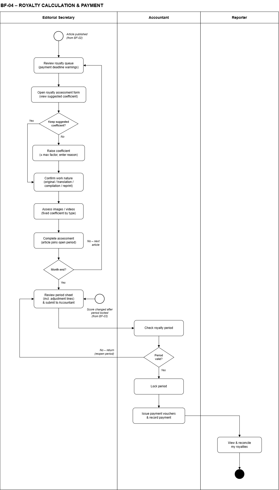

# Ôn review cá nhân: BF-04 Nhuận bút (Quang)

> Bám đúng **5 nội dung review** của thầy: (1) swimlane, (2) use case, (3) demo và logic code, (4) thiết kế DB + code, (5) sửa code tại chỗ. **Hai lần fail là trượt môn.**
> Phạm vi code: **Iter1** (`RoyaltyCalculator`, Unit Price List, Media Factor, Royalty Period List). Phần nghiệp vụ: toàn bộ luồng BF-04.
> Lý thuyết (JPA, Hibernate, annotation...) nằm ở file riêng: **BF04-ly-thuyet.docx** (cùng thư mục).
> Cập nhật: 13/10/2026.

---

## 0. Chuẩn bị trước giờ review

1. Bật SQL Server (`services.msc`, rồi Start **SQL Server (MSSQLSERVER)** hoặc bản `SQLEXPRESS` mà `application-local.properties` đang dùng).
2. Chạy lại `database/schema.sql`, rồi `database/data.sql` bản mới nhất.
3. **Nếu PR `[DB]` chưa merge**, chạy thêm câu này. Không có nó thì API thêm đơn giá sẽ báo *"Thiếu tham số hệ thống: UNIT_PRICE_PERCENT"*:
   ```sql
   INSERT INTO system_parameters (param_key, param_value, unit, flow, updated_by)
   VALUES ('UNIT_PRICE_PERCENT', N'10', N'%', 'BF-04', 8);
   ```
4. Chạy app: `mvn -f server/pom.xml spring-boot:run`. Nếu entity lệch DB thì app báo lỗi ngay lúc khởi động (`ddl-auto=validate`).
5. Mở Postman với các request ở **mục 3.2**.
6. Học thuộc **mục 6** (các điểm thầy dễ hỏi vặn).

---

## 1. Giải thích luồng nghiệp vụ qua swimlane



**Một câu tóm tắt:** bài đã xuất bản thì Thư ký chấm nhuận bút. Cuối tháng Thư ký chốt kỳ và gửi Kế toán. Kế toán kiểm tra, khoá kỳ rồi chi tiền. Phóng viên xem và đối chiếu.

- **Trigger:** Trưởng ban duyệt đăng bài (BF-02), bài thành PUBLISHED.
- **End:** kỳ nhuận bút thành **PAID** (đã chi hết cho mọi người).
- **3 làn:** Editorial Secretary (Thư ký toà soạn), Accountant (Kế toán), Reporter (Phóng viên).

| # | Làn | Bước trên sơ đồ | UC | Ghi chú |
|---|---|---|---|---|
| 1 | Thư ký | *Review royalty queue (payment deadline warnings)* | UC-46 | Danh sách bài đã đăng mà **chưa chấm**, cảnh báo bài sắp quá hạn chi |
| 2 | Thư ký | *Open royalty assessment form (view system-calculated coefficient)* | UC-47 | Hệ số = hệ số chuẩn thể loại × điểm / 100, do **hệ thống tính** (BR-RY-01) |
| 3 | Thư ký | *Confirm work nature (original / translation / compilation / repost)* | UC-47 | Tỷ lệ 100 / 70 / 50 / 30% |
| 4 | Thư ký | *Assess images / videos (fixed coefficient by type)* | UC-48 | Mỗi loại ảnh có 1 hệ số cố định (BR-RY-04) |
| 5 | Thư ký | *Complete assessment (article joins open period)* | UC-47 | Bài vào **kỳ đang OPEN lúc chấm xong** (BR-RY-05) |
| 6 | Thư ký | ◇ *Month-end?* | | **No:** quay lại bước 1 chấm bài tiếp. **Yes:** sang bước 7 |
| 7 | Thư ký | *Review period sheet (incl. adjustment lines) & submit to Accountant* | UC-50 | Kỳ OPEN thành **CLOSED** |
| 8 | Kế toán | *Check royalty period* | UC-51 | Xem từng dòng tiền của từng người |
| 9 | Kế toán | ◇ *Period valid?* | | **No:** trả về kèm ghi chú (UC-52), kỳ về **OPEN**, quay lại bước 7. **Yes:** sang bước 10 |
| 10 | Kế toán | *Lock period* | UC-53 | Kỳ thành **LOCKED**, mỗi người 1 phiếu chi UNPAID. Từ đây số liệu **bất biến** |
| 11 | Kế toán | *Issue payment vouchers & record payment* | UC-54 | Chi xong tất cả thì kỳ thành **PAID** |
| 12 | Phóng viên | *View & reconcile my royalties* | UC-57 | Xem tiền theo kỳ, theo bài, phần đồng tác giả, điều chỉnh |

**Hai điểm bắt đầu (vòng tròn rỗng):**
- *Article published (from BF-02)*: điểm vào chính.
- *Score changed after period locked (from BF-03)*: bài bị khiếu nại và đổi điểm **sau khi kỳ đã khoá**. Không sửa kỳ cũ được, nên phần chênh lệch thành **dòng điều chỉnh (ADJUSTMENT)** ở kỳ sau (BR-RY-06) và đi vào bước 7.

**Vòng đời kỳ (BR-RY-07):**
```
OPEN ──(Thư ký chốt)──► CLOSED ──(Kế toán khoá)──► LOCKED ──(chi hết)──► PAID
  ▲                        │
  └──(Kế toán trả về + ghi chú)┘
```

**Nếu thầy hỏi "sao không có bước Thư ký nâng hệ số?":** nhóm đã đổi BR-RY-01. Hệ số được tính thẳng theo điểm và **cố định**, để tránh Thư ký tự ý nâng gây bất công. Swimlane đã được vẽ lại theo luật mới.

---

## 2. Giải thích các use case

### 2.1 Bảng tổng (12 UC, ID 46–57)

| UC | Tên | Actor | Iter | Trạng thái |
|---|---|---|---|---|
| 46 | View Articles Pending Grading | Thư ký | 2 | chưa làm |
| 47 | Grade Article Royalty | Thư ký | 2 | đã có `RoyaltyCalculator` |
| 48 | Grade Media Royalty | Thư ký | 2 | chưa làm |
| **49** | **View Royalty Periods** | Thư ký, Kế toán | **1** | **✅ API xong** |
| 50 | Close Royalty Period | Thư ký | 2 | chưa làm |
| 51 | Review Period Statement | Kế toán | 3 | chưa làm |
| 52 | Return Royalty Period | Kế toán | 3 | chưa làm |
| 53 | Lock Royalty Period | Kế toán | 3 | chưa làm |
| 54 | Record Royalty Payment | Kế toán | 3 | chưa làm |
| **55** | **Manage Unit Prices** | Kế toán | **1** | **✅ API xong** |
| **56** | **Manage Media Factor Ranges** | Admin | **1** | **✅ API xong** |
| 57 | View My Royalties | Phóng viên | 3 | chưa làm |

**Quan hệ trong sơ đồ UC:** Grade Article Royalty «extend» View Articles Pending Grading; Grade Media Royalty «extend» Grade Article Royalty; Return / Lock Royalty Period «extend» Review Period Statement.

### 2.2 Ba UC đã code ở Iter1 (nói kỹ)

#### UC-55 Manage Unit Prices (Kế toán)
| Mục | Nội dung |
|---|---|
| Mục đích | Quản lý **đơn giá 1 hệ số**. Tiền bài = hệ số × đơn giá |
| Trigger | Kế toán mở màn Unit Price List |
| Pre-condition | Kế toán đã đăng nhập (tạm thời dùng header `X-User-Id`) |
| Post-condition | Có thêm 1 dòng `royalty_rates`; dòng cũ **không đổi** |
| Normal flow | 1. Hệ thống hiện lịch sử đơn giá, mới nhất lên đầu. 2. Kế toán nhập **lương cơ sở** + **ngày hiệu lực**. 3. Hệ thống tính đơn giá = lương cơ sở × `UNIT_PRICE_PERCENT` (10%), bỏ phần lẻ dưới 1 đồng. 4. Lưu và trả về đơn giá mới |
| Exception | E1 Ngày hiệu lực **không sau** ngày của đơn giá mới nhất: *"Ngày hiệu lực phải sau ngày dd/MM/yyyy của đơn giá mới nhất."* (409). E2 Thiếu hoặc sai dữ liệu: 400 kèm lỗi từng ô. E3 Đơn giá tính ra 0đ: 409 |
| Business rule | BR-RY-03: bài dùng đơn giá có `effective_from` lớn nhất mà ≤ ngày đăng. **Không sửa, không xoá** đơn giá cũ |
| Màn hình | Unit Price List: bảng lịch sử + form "Thêm đơn giá" |
| API | `GET /api/royalty-rates`, `POST /api/royalty-rates` |

#### UC-56 Manage Media Factor Ranges (Admin)
| Mục | Nội dung |
|---|---|
| Mục đích | Đặt **hệ số cố định** cho từng loại ảnh/video (PHOTO, GRAPHIC, VIDEO) |
| Pre-condition | Admin đã đăng nhập |
| Post-condition | `media_factors.factor` của loại đó đổi. Phiếu chấm **cũ không đổi**, vì hệ số đã được chép vào `royalty_media_items.factor` |
| Normal flow | 1. Hệ thống hiện danh sách loại và hệ số. 2. Admin sửa hệ số một loại. 3. Hệ thống kiểm tra > 0, tối đa 3 chữ số nguyên và 2 chữ số thập phân, rồi lưu |
| Exception | E1 Không tìm thấy loại: 404. E2 Hệ số ≤ 0 hoặc sai định dạng: 400 |
| Business rule | BR-RY-04: ảnh/video dùng hệ số cố định của loại; ảnh tái sử dụng hoặc nguồn ngoài không được tiền |
| Màn hình | Media Factor: bảng 3 loại, mỗi dòng sửa được hệ số |
| API | `GET /api/media-factors`, `PUT /api/media-factors/{id}` |

> Tên UC trong SRS là "Ranges" (min–max) nhưng nhóm đã chốt **1 hệ số cố định**, bỏ `max_factor`.

#### UC-49 View Royalty Periods (Thư ký, Kế toán)
| Mục | Nội dung |
|---|---|
| Mục đích | Xem các kỳ nhuận bút theo tháng: trạng thái, tổng tiền |
| Post-condition | Không đổi dữ liệu (chỉ đọc) |
| Normal flow | Hệ thống hiện các kỳ, tháng mới nhất lên đầu. Mỗi kỳ có trạng thái, ngày khoá, ngày chi, ghi chú trả về, **tổng tiền** (cộng mọi dòng `royalty_lines` của kỳ) và **số bài đã chấm** |
| Business rule | BR-RY-07 (vòng đời kỳ) |
| API | `GET /api/royalty-periods` |

### 2.3 Bốn UC full dressed trong SRS (Iter sau, vẫn phải giải thích được)

**UC-47 Grade Article Royalty** (Thư ký)
- *Pre:* bài PUBLISHED, điểm đã duyệt. *Post:* lưu 1 phiên bản phiếu chấm, bài vào kỳ OPEN, tạo dòng tiền cho từng tác giả.
- *Flow:*
  1. Hiện bài, điểm, thể loại, tính chất, và hệ số tính từ điểm (BR-RY-01).
  2. Thư ký xác nhận tính chất bài.
  3. Hệ thống tính hệ số cuối và tiền (BR-RY-02, 03).
  4. Thư ký chấm ảnh/video nếu có (BR-RY-04).
  5. Bấm Complete: lưu và đưa bài vào kỳ OPEN (BR-RY-05).
- *A1:* điểm đổi sau khi chấm (BF-03): tạo phiên bản mới; nếu kỳ đã LOCKED thì chênh lệch sang kỳ sau (BR-RY-06).
- *E1:* không có đơn giá hoặc không có kỳ OPEN thì không hoàn tất được.

**UC-50 Close Royalty Period** (Thư ký)
- *Pre:* kỳ OPEN, mọi bài trong kỳ đã chấm xong. *Post:* kỳ CLOSED, báo Kế toán.
- *A1:* kỳ bị trả về thì bảng kỳ hiện ghi chú của Kế toán. *E1:* còn bài chưa chấm xong: *"Please finish all gradings before closing."*

**UC-53 Lock Royalty Period** (Kế toán)
- *Pre:* kỳ CLOSED. *Post:* kỳ LOCKED, mỗi người 1 phiếu chi UNPAID.
- *A1:* trả kỳ về kèm ghi chú bắt buộc, kỳ về OPEN (UC-52). *A2:* tổng của một người âm thì phiếu chi = 0, nợ chuyển kỳ sau (GBR-12).

**UC-54 Record Royalty Payment** (Kế toán)
- *Pre:* kỳ LOCKED, phiếu UNPAID. *Post:* phiếu PAID; khi mọi phiếu PAID thì kỳ thành PAID và báo cho phóng viên.
- *E1:* phiếu đã PAID thì không chi lại được.

### 2.4 Business rules BR-RY (nói bằng ví dụ)

| BR | Luật | Ví dụ |
|---|---|---|
| 01 | Hệ số = hệ số chuẩn thể loại × điểm / 100, hệ thống tính, Thư ký **không sửa** | Phản ánh 5.00 × 77 điểm = **3.85** |
| 02 | Hệ số cuối = hệ số × bão hoà × tính chất, tối thiểu 1 | 3.85 × 80% × 70% = 2.156, thành **2.16** |
| 03 | Tiền = hệ số cuối × đơn giá ngày đăng; chia theo % tác giả, làm tròn xuống 1.000đ, dư cho tác giả chính | 2.16 × 234.000 = 505.440, thành **505.000** |
| 04 | Ảnh/video theo hệ số cố định của loại; tái sử dụng hoặc nguồn ngoài = 0 | GRAPHIC 1.50 × 234.000 = 351.000 |
| 05 | Bài vào kỳ **đang OPEN lúc chấm xong** | Đăng 30/9, chấm 2/10 thì vào kỳ tháng 10 |
| 06 | Kỳ LOCKED bất biến; chênh lệch thành dòng điều chỉnh ở kỳ sau | Điểm tăng sau khiếu nại: +50.000 ở kỳ sau |
| 07 | OPEN → CLOSED → LOCKED → PAID; chỉ kỳ CLOSED mới trả về hoặc khoá được | |

Luật chung liên quan: GBR-09 (bão hoà 100/80/60%, điểm ≥ 90 được miễn), GBR-10 (làm tròn xuống, dư cho tác giả chính), GBR-12 (phiếu chi không âm, nợ chuyển kỳ sau).

---

## 3. Demo và giải thích logic code

### 3.1 Danh sách API Iter1

| Method | URL | Ai dùng | Kết quả |
|---|---|---|---|
| GET | `/api/royalty-rates` | Kế toán | Lịch sử đơn giá |
| POST | `/api/royalty-rates` | Kế toán | Thêm đơn giá (201) |
| GET | `/api/media-factors` | Admin | 3 loại ảnh và hệ số |
| PUT | `/api/media-factors/{id}` | Admin | Sửa hệ số |
| GET | `/api/royalty-periods` | Thư ký, Kế toán | Các kỳ, tổng tiền, số bài đã chấm |

### 3.2 Kịch bản demo (dữ liệu `data.sql`)

**a) Xem đơn giá:**
```bash
curl http://localhost:8080/api/royalty-rates
```
Kết quả: 1 dòng, `baseSalary` 2340000, `amount` 234000, `effectiveFrom` "2026-01-01".

**b) Thêm đơn giá hợp lệ**, Kế toán có id = 6:
```bash
curl -X POST http://localhost:8080/api/royalty-rates -H "Content-Type: application/json" -H "X-User-Id: 6" -d "{\"baseSalary\": 2500000, \"effectiveFrom\": \"2027-01-01\"}"
```
Kết quả 201: `amount` = **250000** (2.500.000 × 10%).

**c) Thêm đơn giá sai ngày** (không sau ngày 2027-01-01 vừa thêm):
```bash
curl -X POST http://localhost:8080/api/royalty-rates -H "Content-Type: application/json" -H "X-User-Id: 6" -d "{\"baseSalary\": 2600000, \"effectiveFrom\": \"2026-06-01\"}"
```
Kết quả 409: *"Ngày hiệu lực phải sau ngày 01/01/2027 của đơn giá mới nhất."*

**d) Thiếu dữ liệu**, gửi body `{}`: kết quả 400 với `errors.baseSalary` và `errors.effectiveFrom` bằng tiếng Việt.

**e) Hệ số ảnh:**
```bash
curl http://localhost:8080/api/media-factors
```
```bash
curl -X PUT http://localhost:8080/api/media-factors/1 -H "Content-Type: application/json" -d "{\"factor\": 1.20}"
```
⚠️ Lúc demo dùng hệ số **≤ max cũ** (PHOTO ≤ 2.00, GRAPHIC ≤ 3.00, VIDEO ≤ 5.00), vì DB vẫn còn CHECK `factor <= max_factor` cho tới khi PR `[DB]` xoá nó.

**f) Kỳ nhuận bút:**
```bash
curl http://localhost:8080/api/royalty-periods
```
Kết quả: kỳ 9/2026, `status` "OPEN", `totalAmount` **1404000** (819.000 + 351.000 + 234.000), `gradedArticleCount` **1**.

**g) Unit test** (chạy được cả khi không có DB):
```bash
mvn -f server/pom.xml clean test
```
Kết quả: 28 test pass (19 `RoyaltyCalculator` + 3 `RoyaltyRateService` + 2 `MediaFactorService` + 1 `RoyaltyPeriodService` + 3 `GlobalExceptionHandler`).

### 3.3 Logic từng chức năng (đi theo đường request)

**Thêm đơn giá (`POST /api/royalty-rates`):**
```
JSON ─► RoyaltyRateController.createRate
          @Valid kiểm baseSalary, effectiveFrom (sai thì 400, không vào service)
        ─► RoyaltyRateService.createRate
          1. findFirstByOrderByEffectiveFromDesc(): lấy đơn giá mới nhất
             ngày mới không SAU ngày đó thì BusinessException (409)
          2. SystemParameterService.getValuesByFlow("BF-04"): Map tham số
             new RoyaltyCalculator(map).unitPrice(baseSalary): lương × 10%, bỏ lẻ
          3. new RoyaltyRate(), set 4 field, repository.save(): INSERT
          4. RoyaltyRateResponse.from(saved) ─► ApiResponse 201
```

**Sửa hệ số ảnh (`PUT /api/media-factors/{id}`):** `findById(id)` (không có thì `NotFoundException` 404), rồi `setFactor`, `save` (UPDATE), trả `MediaFactorResponse`.

**Xem kỳ (`GET /api/royalty-periods`):** lấy các kỳ theo năm, tháng giảm dần. Với **mỗi kỳ** chạy 2 câu SQL: `SUM(amount)` của `royalty_lines` và `COUNT(DISTINCT article_id)` của `royalty_gradings`. Rồi ghép vào `RoyaltyPeriodResponse`.

**`RoyaltyCalculator`** (máy tính nhuận bút, không đụng DB). Ví dụ chạy trọn một bài:

| Hàm | Tính | Ra |
|---|---|---|
| `suggestedFactor` | 5.00 × 77 / 100 | 3.85 |
| `effectiveSaturationRate` | trong sự kiện, tỷ lệ 80, điểm 77 < 90 | 80 |
| `finalFactor` | 3.85 × 80 × 70 / 10 000 = 2.156 | 2.16 |
| `calculateAmount` | 2.16 × 234.000 = 505.440, làm tròn xuống | 505.000 |
| `splitAmount` | 50/30/20: đồng tác giả 151.000, 101.000 | chính 253.000 |
| `unitPrice` | 2.340.000 × 10 / 100 | 234.000 |

Giải thích từng dòng của `RoyaltyCalculator`: mở file và đọc comment. Các ý chính:
- Mọi tỷ lệ lấy từ `system_parameters`, **không viết cứng số**.
- `BigDecimal`, không dùng `double`.
- Hệ số làm tròn HALF_UP **một lần ở cuối**.
- Tiền làm tròn **xuống** (FLOOR).
- Đồng tác giả làm tròn xuống, **tác giả chính nhận phần dư**, nên tổng luôn đúng bằng tiền bài.

---

## 4. Giải thích cách thiết kế

### 4.1 Database: 7 bảng BF-04 sở hữu

```
royalty_periods (kỳ tháng)
 ├─1─n─► royalty_gradings (phiếu chấm) ◄─n─1─ articles, scoring_attempts, genres, royalty_rates, users
 │         ├─1─n─► royalty_media_items (tiền từng ảnh) ◄─n─1─ article_attachments
 │         └─1─n─► royalty_lines
 ├─1─n─► royalty_lines (tiền từng người) ◄─n─1─ users; tự trỏ: dòng điều chỉnh ─► dòng gốc
 └─1─n─► royalty_payments (phiếu chi, 1 người/kỳ) ─1─n─► royalty_lines
events ─1─n─► articles
```

| Bảng | Vì sao có | Quan hệ chính | Ràng buộc đáng nói |
|---|---|---|---|
| `royalty_rates` | Đơn giá đổi theo thời gian, bài cũ phải tính giá cũ, nên **lưu lịch sử**, chỉ thêm, không sửa | 1–n `royalty_gradings.rate_id`; n–1 `users` | `effective_from UNIQUE`, `CHECK amount > 0` |
| `events` | Cấu hình bão hoà riêng cho từng sự kiện (cửa sổ ngày, số bài, ngưỡng miễn) | 1–n `articles.event_id` (bài có thể không thuộc sự kiện) | `exempt_score 0–100` |
| `royalty_periods` | Quy trình duyệt **theo tháng**, có trạng thái và khoá | 1–n gradings, lines, payments | `UNIQUE(year, month)`, CHECK trạng thái, CHECK "đã khoá thì phải có người khoá" |
| `royalty_gradings` | Phiếu chấm lưu **từng bước tính** để giải trình; chấm lại thì **thêm phiên bản** | n–1 articles, scoring_attempts, periods, rates, genres | `UNIQUE(article_id, version_no)`, `CHECK final_factor >= 1` |
| `royalty_media_items` | 1 bài nhiều ảnh, nên cần bảng con; chỉ ảnh **được trả tiền** mới có dòng | n–1 gradings, `article_attachments` | `UNIQUE(grading_id, attachment_id)` |
| `royalty_lines` | **Sổ cái**: ai nhận bao nhiêu, từ bài/ảnh nào, kỳ nào; có dòng điều chỉnh âm | n–1 periods, gradings, media_items, payments, users; tự trỏ | CHECK hình dạng theo `line_type` |
| `royalty_payments` | Chi **theo người theo kỳ**, có trạng thái chi và **nợ chuyển kỳ** | n–1 periods, users; 1–n lines | `UNIQUE(period_id, user_id)`, CHECK cân bằng nợ |

**Bảng của luồng khác mà BF-04 đọc (qua Service của họ):** `system_parameters` (tham số), `genres` (hệ số chuẩn), `media_factors` (hệ số ảnh), `articles` / `article_authors` / `article_attachments` (BF-01), `scoring_attempts` (BF-02), `users`.

**Các quyết định thiết kế hay bị hỏi:**
- **Tiền `DECIMAL(18,0)`, hệ số `DECIMAL(5,2)`**, không dùng `FLOAT`: `FLOAT` lưu gần đúng nên tính tiền bị lệch.
- **Snapshot:** phiếu chấm **chép lại** `base_factor`, `unit_price`, `factor` thay vì JOIN, để sau này giá hay hệ số đổi thì phiếu cũ vẫn đúng.
- **Không UPDATE số tiền đã chốt:** chấm lại thì thêm phiên bản; kỳ khoá thì ghi dòng điều chỉnh. Mục đích là kiểm toán được.
- **n–n qua bảng trung gian:** bài ↔ tác giả (`article_authors`), kỳ ↔ người (`royalty_payments`), phiếu chấm ↔ người (`royalty_lines`).
- **Luật nhiều dòng** (tổng % = 100) không viết được bằng CHECK, nên kiểm ở service.

### 4.2 Code

**Kiến trúc chia tầng** (AGENTS.md 3.1–3.2):
```
React ──HTTP/JSON──► Controller ──► Service ──► Repository ──► SQL Server
                     nhận request    nghiệp vụ    truy vấn
                     @Valid          @Transactional
                     trả ApiResponse  ném Business/NotFound
```

| Tầng | File Iter1 | Làm gì | Không làm |
|---|---|---|---|
| Controller | `RoyaltyRateController`, `MediaFactorController`, `RoyaltyPeriodController` | Nhận request, `@Valid`, gọi 1 hàm service, trả `ResponseEntity<ApiResponse<...>>` | `if` nghiệp vụ, gọi repository |
| Service | `RoyaltyRateService`, `MediaFactorService`, `RoyaltyPeriodService`, `SystemParameterService` | Luật nghiệp vụ, transaction, đổi entity sang DTO | Trả entity ra ngoài |
| Tính toán thuần | `RoyaltyCalculator` (không `@Service`) | Công thức tiền, có unit test | Đọc DB |
| Repository | `RoyaltyRateRepository`, `MediaFactorRepository`, `RoyaltyPeriodRepository`, `SystemParameterRepository` | Query method, `@Query` | Logic |
| Entity | `RoyaltyRate`, `MediaFactor`, `RoyaltyPeriod`, `SystemParameter`, enum `RoyaltyPeriodStatus`, `RoyaltyNature` | Ánh xạ bảng | Trả thẳng ra API |
| DTO | `...Request` (dữ liệu vào, có validate), `...Response` (dữ liệu ra, hàm `from()`) | | |

**Lỗi, đổi ra mã HTTP** (`GlobalExceptionHandler`, file dùng chung):

| Lỗi | Khi nào | HTTP |
|---|---|---|
| `MethodArgumentNotValidException` | `@Valid` không qua | 400 + lỗi từng ô |
| `NotFoundException` | Không tìm thấy id | 404 |
| `BusinessException` | Vi phạm luật (ngày hiệu lực) | 409 |

**Vì sao viết vậy (hay bị hỏi):**
- *Sao `RoyaltyCalculator` không có `@Service`?* Đây là logic thuần, nên test bằng `new` mà không cần Spring. Tham số lấy từ DB phải truyền vào lúc tạo.
- *Sao FK là `Integer createdBy` chứ không phải `User`?* Entity `User` (luồng admin) chưa có. AGENTS.md 3.3 cho tạm để `Integer`, DB vẫn kiểm FK.
- *Sao `RoyaltyPeriodRepository` dùng native SQL?* Entity `RoyaltyLine` / `RoyaltyGrading` chưa làm (Iter2). Native SQL đọc thẳng bảng của chính BF-04.
- *Sao service không gọi `SystemParameterRepository` trực tiếp?* `system_parameters` là bảng admin. AGENTS.md mục 2 quy định gọi **Service** của luồng đó.
- *Có N+1 query ở danh sách kỳ không?* Có, mỗi kỳ chạy 2 câu. Nhưng mỗi năm chỉ 12 kỳ nên chấp nhận được. Muốn tối ưu thì gom bằng `GROUP BY period_id`.

---

## 5. Luyện sửa code theo yêu cầu

> Thầy hay yêu cầu sửa nhỏ ngay tại chỗ. Mỗi bài: **sửa ở đâu**, **sửa thế nào**. Sửa xong chạy `mvn -f server/pom.xml clean test`.

**Bài 1. "Đơn giá làm tròn xuống tới nghìn đồng."** Sửa `RoyaltyCalculator.unitPrice`, dùng lại hàm `roundDown`:
```java
public BigDecimal unitPrice(BigDecimal baseSalary) {
    BigDecimal exact = baseSalary.multiply(unitPricePercent).divide(ONE_HUNDRED);
    return roundDown(exact);
}
```
Rồi sửa test `unitPriceIsBaseSalaryTimesPercent`: 2.345.678 cho ra **234.000**.

**Bài 2. "Đổi tỷ lệ bài dịch từ 70% thành 65%."** **Không sửa code**. Chỉ sửa DB, đó là lợi ích của `system_parameters`:
```sql
UPDATE system_parameters SET param_value = N'65' WHERE param_key = 'NATURE_RATE_TRANSLATION';
```

**Bài 3. "Ngày hiệu lực không được ở quá khứ."** Thêm vào `RoyaltyRateService.createRate`, trước bước tính tiền:
```java
if (request.getEffectiveFrom().isBefore(LocalDate.now())) {
    throw new BusinessException("Ngày hiệu lực không được ở quá khứ.");
}
```
(nhớ `import java.time.LocalDate;`)

**Bài 4. "Hệ số ảnh tối đa 10."** Thêm annotation vào `MediaFactorUpdateRequest.factor`:
```java
@DecimalMax(value = "10.00", message = "Hệ số tối đa là 10")
```
Sai thì tự trả 400, không phải viết `if`.

**Bài 5. "Lọc kỳ theo năm: `GET /api/royalty-periods?year=2026`."**
```java
// Repository
List<RoyaltyPeriod> findByPeriodYearOrderByPeriodMonthDesc(Short periodYear);

// Controller
public ResponseEntity<...> getAllPeriods(@RequestParam(required = false) Short year)

// Service: year == null thì lấy hết như cũ, ngược lại gọi hàm mới
```

**Bài 6. "Thêm API lấy đơn giá áp dụng cho 1 ngày đăng bài."** Hàm này Iter2 cũng cần cho UC-47:
```java
// Repository: dòng có effective_from lớn nhất mà <= ngày đăng (BR-RY-03)
Optional<RoyaltyRate> findFirstByEffectiveFromLessThanEqualOrderByEffectiveFromDesc(LocalDate date);

// Service
@Transactional(readOnly = true)
public RoyaltyRateResponse getRateForDate(LocalDate date) {
    RoyaltyRate rate = royaltyRateRepository.findFirstByEffectiveFromLessThanEqualOrderByEffectiveFromDesc(date)
            .orElseThrow(() -> new NotFoundException("Chưa có đơn giá áp dụng cho ngày " + date));
    return RoyaltyRateResponse.from(rate);
}

// Controller: GET /api/royalty-rates/effective?date=2026-10-05
@GetMapping("/effective")
public ResponseEntity<ApiResponse<RoyaltyRateResponse>> getRateForDate(
        @RequestParam @DateTimeFormat(iso = DateTimeFormat.ISO.DATE) LocalDate date) { ... }
```
`@DateTimeFormat(iso = ISO.DATE)` báo Spring đọc chuỗi `2026-10-05` thành `LocalDate`.

**Bài 7. "Bài 0 điểm thì sao?"** `suggestedFactor` ra 0, nên `finalFactor` được kẹp lên **1** (tối thiểu). Nhưng cột `tier_rate` có `CHECK > 0`, đây là việc trong PR `[DB]`.

**Mẹo:** đọc tên hàm repository như một câu tiếng Anh. `findFirstByEffectiveFromLessThanEqualOrderByEffectiveFromDesc` nghĩa là "tìm bản đầu tiên có effectiveFrom ≤ ?, xếp effectiveFrom giảm dần". Spring tự sinh SQL từ tên này.

---

## 6. Phải thuộc: chỗ còn lệch và câu dễ bị hỏi vặn

### 6.1 Những gì chưa xong, trả lời thật
| Hỏi | Trả lời |
|---|---|
| Đăng nhập ở đâu? | Chưa làm. Tạm nhận người thao tác qua header `X-User-Id` (AGENTS.md 3.8). Đích là Spring Security + JWT, nhóm chưa chốt |
| Giao diện đâu? | Iter1 làm backend trước. Giao diện chờ ảnh thiết kế Figma |
| Ai tạo kỳ OPEN mới? | SRS chưa có UC tạo kỳ; `data.sql` có sẵn kỳ 9/2026. Sẽ bàn ở Iter2 khi chấm bài (UC-47 E1: không có kỳ OPEN thì không chấm xong được) |

### 6.2 DB đang lệch code, chờ PR `[DB]` (nên merge **trước** review)
1. Bỏ 5 tham số bậc điểm `SCORE_TIER_*`, `TIER_RATE_*` (luật cũ).
2. Sửa phiếu chấm mẫu trong `data.sql` theo luật mới.
3. Sửa comment bảng `royalty_gradings` (hệ số = điểm, không nâng, tiền làm tròn xuống).
4. `CHECK tier_rate > 0` đổi thành `>= 0` (bài 0 điểm).
5. Thêm FK `article_attachments.media_kind` tới `media_factors.media_kind` (bảng BF-01, báo Minh).
6. Xoá cột `royalty_rates.legal_ref` (nhóm thấy thừa).
7. Quyết định giữ hay bỏ `genres.max_factor`.
8. **Thêm tham số `UNIT_PRICE_PERCENT = 10`**.
9. **Xoá `media_factors.max_factor`** và CHECK `factor <= max_factor`, thay bằng `CHECK factor > 0`.

**Nếu thầy hỏi "sao DB còn cột `applied_factor`, `raise_reason`, `max_factor`, `legal_ref`?":** nhóm đổi luật sau khi thiết kế DB. Code đã bỏ dùng các cột này, còn việc xoá khỏi schema nằm trong PR `[DB]` đang chờ.

### 6.3 Câu hỏi nhanh
| Hỏi | Trả lời ngắn |
|---|---|
| Sao `BigDecimal` không dùng `double`? | `double` lưu nhị phân gần đúng (0.1 + 0.2 ≠ 0.3), tính tiền sai |
| `compareTo` khác `equals` thế nào? | `equals` so cả số chữ số (100 ≠ 100.00); `compareTo` chỉ so giá trị |
| HALF_UP và FLOOR? | HALF_UP: làm tròn thường (hệ số). FLOOR: luôn làm tròn xuống (tiền, không trả dư) |
| Sao đồng tác giả làm tròn xuống, tác giả chính nhận dư? | GBR-10. Tổng các phần luôn đúng bằng tiền bài, không mất đồng nào |
| `ddl-auto=validate` là gì? | Hibernate so entity với bảng lúc khởi động; lệch thì app không chạy. Không tự sửa DB |
| Sao đơn giá không có API sửa/xoá? | Bài cũ phải tính theo giá cũ (BR-RY-03); đổi giá là thêm phiên bản mới |
| Sửa hệ số ảnh có làm đổi tiền bài cũ? | Không. Phiếu chấm đã **chép** hệ số vào `royalty_media_items.factor` |
| `@Transactional(readOnly = true)` để làm gì? | Báo đây là hàm chỉ đọc: Hibernate bỏ bước dò thay đổi, nhẹ hơn và chặn ghi nhầm |
